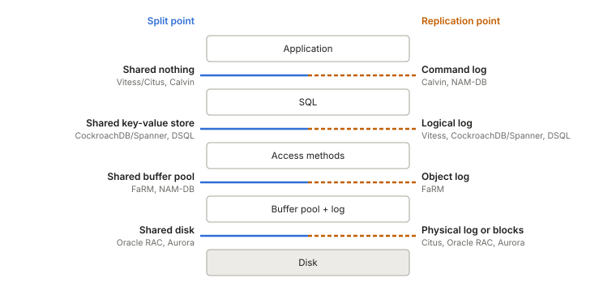
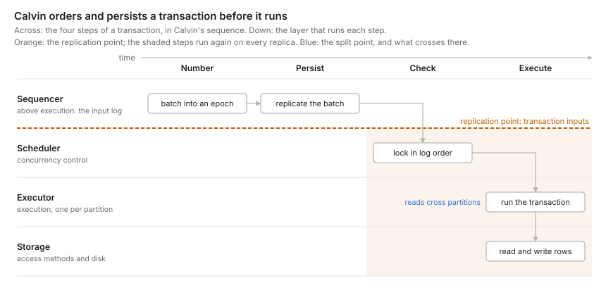

> [The second principle is] that of dividing things again by classes, where the natural joints are, and not trying to break any part, after the manner of a bad carver.
> -- Plato, *Phaedrus* 265e

- [Database engine and its interfaces](#database-engine-and-its-interfaces)
- [Three choices: replicate, split, order](#three-choices-replicate-split-order)
  - [Replication: where data is copied](#replication-where-data-is-copied)
  - [Splitting: where data divides](#splitting-where-data-divides)
  - [Ordering: where writes meet](#ordering-where-writes-meet)
- [How the three points fit together](#how-the-three-points-fit-together)
- [Four designs up close](#four-designs-up-close)
  - [CockroachDB: every range decides for itself](#cockroachdb-every-range-decides-for-itself)
  - [Aurora: the log is the database](#aurora-the-log-is-the-database)
  - [DSQL: every layer its own fleet](#dsql-every-layer-its-own-fleet)
  - [Calvin: the log comes first](#calvin-the-log-comes-first)
- [Conclusion: the whole picture](#conclusion-the-whole-picture)

## Database engine and its interfaces

If Plato were alive today and tasked with scaling a database engine, he would look for the natural joints at which to carve it.

This post does just that. It treats every distributed database it covers, from sharded Postgres to Spanner, Aurora, and Calvin, as the same engine cut in different places. Each design makes three choices: where it splits the data, where it replicates it, and where it orders conflicting writes. Two rules tie the choices together. Where a design makes them tells you how many nodes can write, how much work each replica repeats, and whether your schema has to know about shards.

The joints are the interfaces that connect components, from SQL statements at the top to disk blocks at the bottom:[^hellerstein]

- **SQL:** parse, plan, and execute queries. The planner picks an access method for each table, such as an index or a full scan, and the executor asks it for rows.
- **Access methods:** tables and indexes, stored as heaps, B-trees, or LSM trees. They turn a request for a row or a key into reads and writes of pages. Each change to a page also produces a log record.
- **Buffer pool:** hot pages in RAM. Reads stop here, or go to the data files on a miss. Before it writes a dirty page back, the buffer pool flushes the log up to that page's log sequence number (LSN). That way, after a crash, recovery can undo any uncommitted changes the page carried to disk.
- **Log:** the recovery log, kept beside the buffer pool. A commit is durable once its records are on disk. After a crash, recovery rebuilds pages from the redo records in the log.[^log-truth]
- **Disk:** blocks that hold the data files and the log files.
- **Concurrency control:** it works at every layer, so it sits beside the stack, cut by the same joints. SQL commits each transaction and picks the snapshot it reads. The access methods take row and key locks, which last the whole transaction, and keep old row versions for MVCC. The buffer pool and the log take latches, which last only a moment: on a page while a thread changes it, and on the log buffer while a thread appends to it. The log latch also hands out each LSN, so it fixes the order of writes inside the engine. The disk takes no part, unless storage offers a conditional write.

[^hellerstein]: Hellerstein, Stonebraker, and Hamilton's [Architecture of a Database System][hellerstein-arch] (2007) draws the main components as blocks, not as a stack. Its Figure 1.1 puts the access methods, buffer manager, lock manager, and log manager side by side in one transactional storage manager, next to a process manager and shared utilities. This post puts the parts in a line for simplicity, so that each interface is one joint. Process management and the shared utilities don't change where a design splits or replicates, so the figure leaves them out.

[^log-truth]: Which copy is the source of truth depends on the design. Without `force`, a commit may reach only the log, so the log is the truth and the data files are a copy. The log then holds redo records, plus undo records if uncommitted changes can reach the data files, as in ARIES. With `force`, every commit is already in the data files, so they are the truth, and the log holds only undo records, as in SQLite's rollback journal.

## Three choices: replicate, split, order

Past one machine, the engine runs on many nodes. Here a node is one machine that runs some adjacent layers of the stack: the whole engine, as in a classic shard, or only part of it, as when compute nodes run the top layers over a storage service. A design makes three choices:

- **Replicating** *copies* the data onto other nodes.
  - Benefits: durability, scalable reads, and lower-latency reads (via geo-replication).
- **Splitting** *shards* the data across several nodes.
  - Benefits: scalable writes, and a database larger than one storage device can hold.
- **Ordering** *decides* between conflicting writes.
  - It sets whether sharding scales writes: only when no single node checks every conflict.

Each choice sits at one of the engine's joints. Sharding splits the data at the **split point**: the interface where each request is routed to the node that owns its slice of the data. Above it, every node sees the whole database. Below it, each slice has one owner. Writes are replicated at the **replication point**: the interface where a write leaves the node that decides it, for its replicas. Writes are ordered at the **ordering point**: the interface where the decisions of different writers meet, and conflicting writes get their final order.

Most people know the classic sharded database. A router above SQL sends each query to the shards that hold its rows. Each shard is an ordinary database: it orders its own writes and has its own replicas. Vitess (sharded MySQL) and Citus (sharded Postgres) both work this way.[^citus] The engines under them still differ in how they replicate. Postgres ships its write-ahead log (WAL), a log of page changes. MySQL ships its binlog, a log of row changes.

[^citus]: Citus is a Postgres extension, not a fork. Postgres lets an extension take over query planning, and Citus uses this to rewrite each query into SQL on the shard tables, which are ordinary Postgres tables on the workers. Commits that span shards use Postgres's own two-phase commit (`PREPARE TRANSACTION`). MySQL has no planner hook like Postgres's, and Vitess runs as a separate proxy in front of it.

Sharded designs like these split first, then order and replicate within each slice. [Calvin](#calvin-the-log-comes-first) orders first, then replicates, then splits.

This figure shows only the sequence. Every joint can host a split point or a replication point, and, as we'll see, an ordering point. The three points are not fully independent, though. For example, a design must order a write before it replicates it, so the replication point never sits above the ordering point.

This post names each joint by its place: above SQL, below SQL, below the access methods, and below the buffer pool and log. All three points are places in the stack. Designs also differ in *when* they act: whether they replicate a write before or after it commits, and whether they order writes before, during, or after execution. [How the three points fit together](#how-the-three-points-fit-together) works out how the points constrain each other, in place and in time.

### Replication: where data is copied

A replicated database ships each write from the node that decides it to its replicas, almost always as a log.[^not-a-log] Layers above the replication point handle each write once, on the node that decides it. Layers below it handle each write on every replica: each one receives the stream and applies it. That is why replication never scales writes.

[^not-a-log]: Three exceptions. Leaderless systems, such as Dynamo and Cassandra, have no node that orders writes: a coordinator sends each write to a quorum of replicas, and replicas that miss one catch up by comparing state, not by replaying a log. State-based CRDTs ship their state, or a delta of it, and merge it. And a new replica first copies a snapshot of the data files, then switches to the log to keep up. This post leaves leaderless systems and CRDTs aside, and covers only designs where one node orders the writes to each piece of data.

A higher replication point repeats more work on each replica, but it usually ties the replicas less tightly to the primary's internals:

1. **Physical log.** Postgres ships its WAL, so its replicas only rebuild pages. This is the cheapest way to replicate, but each replica must match the primary byte for byte: same version, same indexes, every table.
2. **Object log.** FaRM ships the new value of each object a transaction wrote, to that object's backups. Its indexes are objects too, so a backup only copies values into memory and never runs the access methods. But a backup holds a byte-for-byte copy of its primary's memory, so this is still physical replication, with objects in place of pages. It buys little over a physical log: FaRM keeps its data in memory and has no pages, so objects are what it logs.
3. **Logical log.** MySQL keeps a physical WAL for durability on each node, like Postgres, but ships its binlog to replicas. Its replicas run their own access methods, so they can run another version or storage engine, keep their own indexes, or replicate only some tables. Outside consumers can also read the binlog for change data capture.[^engine-log]
4. **Command log.** Calvin ships the inputs of each transaction, as blockchains do. The log is small, and no replica depends on another to run a transaction. But every replica runs every transaction on its own, and all of them must reach the same result. So execution must be deterministic.[^statement] That has [benefits][deterministic-overview], and one main cost: transactions can't race for locks, as they do in Postgres or MySQL, because each race could have a different winner on each replica. Instead, every replica takes its locks in the order the log fixes.

[^statement]: MySQL shows what happens without it. Its binlog can also log SQL statements instead of row changes, which makes it a command log. But a statement that calls `UUID()`, or an `UPDATE … LIMIT 10` without an `ORDER BY`, can change different rows on each replica. MySQL now logs row changes by default, and its mixed mode switches to rows for any statement it deems unsafe.

[^engine-log]: The engine sets the usual choice, not a hard limit. Postgres also offers logical replication, and Aurora MySQL ships physical redo to its storage instead of the binlog.

Designs also differ in who must acknowledge a write before it commits:[^ack]

- **Asynchronous:** the primary commits alone. This is the default in Postgres and MySQL. A failover can lose the last few commits.
- **Semi-synchronous:** the primary waits for at least one replica. Examples are MySQL's semi-sync and a Postgres primary with one synchronous standby.
- **Quorum:** the primary waits for a majority, or for k of n replicas. CockroachDB waits for a Raft majority, and Aurora for four of six storage copies.

[^ack]: Designs also differ in what a replica acknowledges: that it received the write, flushed it to disk, or applied it. Postgres lets you choose with `synchronous_commit` (`remote_write`, `on`, or `remote_apply`). Only an applied write is visible to a client that reads from the replica.

Unless it acknowledges only applied writes, a replica can lag the primary. So replicas scale only the reads that can tolerate some lag. A read that must see the latest write either asks the node that decides writes, or waits until its replica has caught up.

### Splitting: where data divides

In the [classic picture](#three-choices-replicate-split-order), sharding is a router above SQL. Each shard is a whole engine that owns a horizontal slice of the database, and the router knows which shard holds each row. People call this design shared nothing. The classic alternatives are shared disk, where every compute node sees the data as one uniform space of block addresses, and shared memory, which is one machine.

These names fit modern databases poorly, for two reasons:

1. They describe hardware: what the processors physically share. Cloud databases run their parts as services on separate machines, so by that measure almost all of them are shared nothing, and the label stops telling them apart. Spanner and CockroachDB, for example, are shared nothing, yet every SQL node reads and writes one shared key-value store.[^ziegler]
2. They suggest that only shared nothing splits the data. But storage splits a shared disk into segments too, by page address instead of by row. Aurora has no visible shards, yet its storage service is sharded underneath.

[^ziegler]: [Ziegler, Bernstein, Leis and Binnig][ziegler-cidr23] (CIDR 2023) make a similar point: shared nothing versus shared disk no longer predicts how a system scales.

Every design that grows past one machine splits its data into slices somewhere. What tells designs apart is the interface through which requests reach each slice's owner: SQL queries, key-value reads and writes, reads of records in remote memory, or pages and log records. That interface is the split point.

So this post reads "shared X" as the name of a split point, not of hardware. **Shared X: every node above X can reach all of X; behind X's interface, the data is split into slices, each with one owner.** Sharing means common access, not copies: the nodes above may cache what they read, but none holds its own durable copy. Above X, each node runs its own instance of every layer. Read this way, the three classic names grow into five families of "shared X": shared memory, shared nothing, shared key-value store, shared buffer pool, and shared disk. Whether the nodes above can see the slices, as with a key-value store, or not, as with a shared disk, does not change the family. It depends on who orders the writes, as [Ordering](#ordering-where-writes-meet) shows.

**Shared memory** is one machine. Its threads order their writes in RAM, through one buffer pool and one lock table.[^per-core] Scaling it up means buying a bigger machine. **Read replicas** add machines for reads, but every write still goes through one primary.

[^per-core]: One machine need not share its memory. VoltDB runs one single-threaded partition per core, and ScyllaDB, built on the Seastar framework, gives each core its own slice of the data and its own memory. Cores talk by passing messages, so inside the box these designs are shared nothing. Across machines, ScyllaDB is leaderless, like Cassandra, so this post leaves it aside.

**Shared nothing** splits above SQL. The two designs differ in who decides: each shard, for its own rows, or one ordered log, before any shard runs.

- **Routed shards.** Each shard is an ordinary database with its own replication, and a router above SQL sends each query to the shards that hold its rows. Routers range from simple to smart, but they all split at the same joint. At the simple end, the application picks the shard itself, or a proxy such as [Figma's DBProxy][figma-dbproxy] forwards each statement, and cross-shard work is the application's problem. Vitess sits in between: it forwards most statements to one shard, but can also fan a query out and merge the results. At the smart end, the router is a query planner, as in Citus, Greenplum, and Teradata. A coordinator splits a query into fragments, sends them to the nodes that own the data, and merges the results. For `SELECT region, sum(amount) FROM orders WHERE status = 'paid' GROUP BY region`, each node sums its own rows and returns a small partial result. Joins on a key other than the shard key must first move rows to the nodes that own the new key, and multi-shard writes add a commit protocol such as two-phase commit (2PC).
- **Deterministic.** Partitions own the data, as with routed shards, but every replica runs every transaction from one ordered input log. Every partition sees the same order and runs deterministically, so no partition can veto a commit, and no transaction needs 2PC. To run a transaction that spans partitions, the partitions swap the rows they read. [Calvin](#calvin-the-log-comes-first) covers the details.

**Shared key-value store** splits below SQL. Every node runs SQL over the whole database and reads and writes rows through one key-value interface. Below the joint, keys are split into ranges, and each range has an owner. The two designs differ in who decides: each range's owner, while the transaction runs, or a separate service, at commit.

- **Range owners.** Each range's owner, its leaseholder, receives key-value reads and writes as a transaction runs, and enforces the locks for its range. Each owner runs its own access methods. Spanner, CockroachDB, TiDB, and YugabyteDB work this way.
- **Unbundled.**[^unbundled] No owner enforces locks while a transaction runs. Concurrency control becomes a service of its own. In DSQL, query processors ask storage for rows directly[^dsql-rows] and keep their writes until commit. Storage can also run the bottom of each query plan, such as filters and projections, next to the data. Then a commit check by the adjudicators, which own key ranges too, decides which writes win. [FoundationDB][foundationdb] has the same shape. [DSQL](#dsql-every-layer-its-own-fleet) covers the details.

[^unbundled]: The name comes from Lomet, Fekete, Weikum, and Zwilling's [Unbundling Transaction Services in the Cloud][lomet-unbundling] (CIDR 2009). It means something narrower than splitting compute from storage. They split the storage engine itself in two: a transactional component that runs concurrency control and recovery over logical records, and a data component that stores the records and knows nothing about transactions. The [FoundationDB paper][foundationdb] uses the word in the same sense. In Lomet's design, the transactional component still takes locks while a transaction runs. DSQL and FoundationDB check for conflicts only at commit.

[^dsql-rows]: DSQL can look as if it belongs one joint lower, below the access methods, in the [shared buffer pool](#splitting-where-data-divides) family, because its query processors keep no cache. But in [Brooker's words][dsql-reads], "the QP doesn't ask for pages, it asks for rows." The access methods moved to storage along with the cache, so storage walks the index, and a lookup costs one round trip.

**Shared buffer pool** splits below the access methods. Each node runs the access methods itself, and reads records or index nodes straight from other machines' memory. A B-tree lookup touches several nodes one after another, and across this joint each one can cost a round trip. So designs here need fast RDMA networks, where a read skips the remote CPU, and they still work hard to save round trips. The two designs differ in who decides: each object's primary, or the compute server that writes it.

- **Object owners.** Every machine holds part of the data and runs transactions over all of it. Each object has one primary, which locks it at commit, and other machines read it with one-sided RDMA. [FaRM][farm] works this way, and it is the main production example: it runs under [A1][a1], a graph database in Microsoft's Bing.
- **Disaggregated memory.** Compute servers hold no data. Memory servers hold the tables, the indexes, and the logs, and compute servers read and write them directly. In [NAM-DB][nam-db] (network-attached memory), a research system, any compute server may write: it locks a record by a compare-and-swap on the record's header in remote memory.[^nam-db-durability] Even NAM-DB avoids walking a B-tree across the joint. It sends B-tree lookups to the memory server as messages. [Sherman][sherman], a research B-tree, does walk the tree over RDMA, but caches the upper levels on each compute server.

[^nam-db-durability]: NAM-DB keeps its data in memory. On a power failure, a UPS lets each memory server write a snapshot to disk. Against hardware failure, each compute thread writes a log of the statements it ran, with their read timestamps, to two or more memory servers before it installs its writes. When a memory server fails, NAM-DB halts, restores the last checkpoint, and replays the merged logs. The authors state that high availability is not a design goal. So the log gives durability, but NAM-DB has no replicas.

**Shared disk** splits below the buffer pool and log: every node shares one disk, and storage splits it into slices that no node sees. The designs differ in who decides: storage itself, or the nodes above it. Plain storage cannot decide. It sees no transactions, and a block write has no condition: it always overwrites. So unless storage offers a conditional write, designs order above it, where either one node decides, or many, which must share their locks and caches.

- **Page owners.** Storage can decide, once it offers a conditional write. Aurora Multi-Master, now retired, let several writers share one volume. Storage accepted the first write to each page, and the writer that lost aborted its transaction. Storage sees only pages, so two transactions that changed different rows on the same page still conflicted. Object stores now offer conditional writes too: since 2024, S3 can refuse a write if the object already exists or has changed. Table formats on object storage, such as Delta Lake, commit this way. Each commit tries to create the next numbered file in the table's log, and only one writer can. The loser checks whether the winning commit touched the same data, and if not, retries at the next number. Here the unit is a whole table, so every commit to a table races for the same file.
- **Log-based storage.** The log is the interface. The writer sends redo records to a storage service, and storage sends pages back on a miss. Aurora, Neon, Azure SQL Hyperscale, and AlloyDB work this way, each with one writer. [Aurora](#aurora-the-log-is-the-database) shows why.
- **Coherent caches.** The buffer pools also talk to each other. Every node runs SQL, access methods, a buffer pool, and its own log over the whole database, and all of them read and write one set of shared volumes. The hard part is keeping the buffer pools coherent and the locks global. This is data shipping: pages and lock messages cross between nodes. Oracle RAC (Cache Fusion) and Db2 pureScale are the long-lived examples. ScaleStore, a research system, keeps buffer pools coherent the same way, over RDMA and without shared disk.

Every family that spans machines has two designs, and they differ in the same way: whether the nodes that hold the data decide what commits, or other nodes do. This post calls them owner-decider and separate-decider. Shared disk is the one family with a third design: a single writer decides, over storage that spans many machines. Aurora, Azure SQL Hyperscale, PolarDB, AlloyDB, and Neon all work this way. [Ordering](#ordering-where-writes-meet) shows why that choice shapes the rest of a design.

![Which nodes decide, in each family. Rows are the four families that span machines, each named by where it splits; columns are owner-decider, separate-decider, and single-decider. Shared nothing: routed shards lock per shard and use 2PC; Calvin's input log fixes the order. Shared key-value store: leaseholders lock their ranges; DSQL's adjudicators check at commit. Shared buffer pool: FaRM's primaries lock at commit; NAM-DB's writer locks by compare-and-swap. Shared disk: in Aurora Multi-Master, now retired, storage takes the first write to each page; Oracle RAC orders with global locks, one joint above its split; and only this family has a single-decider design: in Aurora, the one writer orders every write, above its split](/assets/db-cuts/06-who-orders.svg)

### Ordering: where writes meet

The **ordering point** is where conflicting writes get their final order. Concurrency control runs there.

Ordering does two jobs: numbering and checking. [Miller][miller-decomposing] calls them *order* and *validate*. This post renames them, because here ordering means both. Numbering gives every write a place in one sequence, so that replicas and snapshots agree on what came first. Checking finds the writes that conflict and settles which one wins. Only checking must look at the data. It names keys, objects, or pages, so it sits at the joint for that unit. Numbering need not look at the data, so it can be cheap and need no joint. It can come from clocks, as in [Spanner and CockroachDB](#cockroachdb-every-range-decides-for-itself), or from one process, as in FoundationDB's sequencer.[^numbering] The ordering point is where the checking happens. Calvin is the edge case: its partitions lock in the order the log fixes, so the number alone decides and no partition votes on a commit. Its log is its ordering point.

[^numbering]: In practice, numbering often borrows some of checking's view of the data. A CockroachDB range remembers when each key was last read, and pushes a later write past that time. A Spanner commit timestamp must come after every participant's prepare timestamp. And DSQL's adjudicators pick the commit time as they check.

A conflict is two accesses to the same item, where at least one is a write. Snapshot isolation checks only write against write. Serializability also checks read against write, because a transaction that read a value must come before one that overwrote it.

Most of a design follows from one question: who checks conflicts? Two smaller questions sort the answers: how many nodes may write, and, if many, which nodes decide. That leaves three answers: single-decider, owner-decider, and separate-decider. Each one fixes where a design keeps its locks, cache, and log, where its ordering point sits, and whether its shards show.[^ziegler-axes]

[^ziegler-axes]: [Ziegler et al.][ziegler-cidr23] sort designs by who may write each item. This post sorts them by who checks conflicts. In most designs, the same nodes do both:

    | Ziegler et al.: who writes | This post: who checks | Designs |
    | --- | --- | --- |
    | Single-Writer | single-decider | Aurora, read replicas |
    | Partitioned-Writer | owner-decider | CockroachDB, Spanner, FaRM |
    | Shared-Writer | separate-decider | DSQL, NAM-DB, Oracle RAC |

    The two disagree where writing and checking happen on different nodes. Aurora Multi-Master is Shared-Writer but owner-decider: any node can write any page, but storage picks the winner. Calvin is Partitioned-Writer but separate-decider: each partition writes only its own rows, but the input log decides. Ziegler et al. also split Shared-Writer by whether caches are coherent. Here, that shows up only in the cache column of the state figure.

![A decision tree with two questions and three answers. First: how many nodes may write? With one writer, the writer decides, inside itself, at no joint (single-decider); its locks, cache, and log stay private, and shards, if any, stay hidden, as in Aurora, Neon, and read replicas. With many writers, the locks, cache, and log must be split or kept coherent. Then: which nodes decide? If the data owners decide (owner-decider), they order at the split, in each slice; the locks split with the data, and shards show to whoever coordinates commits, the application or the engine, as in Vitess, CockroachDB, and FaRM. If something else decides (separate-decider), it orders at the split on other nodes, or above it; the locks still split, and the data shards stay hidden, as in Calvin, DSQL, NAM-DB, and Oracle RAC](/assets/db-cuts/07-decision-tree.svg)

**Single-decider.** One node, the writer, keeps the state that orders writes, its locks, cached pages, and log, private, over the whole database. Private state is safe only while one node writes. Two writers with private locks could lock the same row and never know it. Two writers with private caches could each update a stale copy of the same page. [Stonebraker][stonebraker-sn] named these three as the problems of shared disk in 1985. With one writer, nothing crosses between nodes to order writes, so the ordering point sits inside the writer, not at a joint. Read replicas work this way. So does Aurora, which shares its storage but nothing above it: its storage splits each volume into 10 GB segments that no SQL node thinks about. [Aurora](#aurora-the-log-is-the-database) covers the details.

**Many writers split that state.** Splitting adds write capacity only when no single node checks every conflict. So every design with many writers splits its locks, so that each slice of them has one owner. Caches have more options: a design can split its cache, keep none, or keep one per node and make them coherent. Logs have the most options, because a log only numbers writes. One log can serve every writer, or each node keeps its own, and recovery merges them.[^multi-leader] What remains is who owns each slice of the locks: the nodes that hold the data, or something else.

**Owner-decider.** Each item lives in one slice, so the slice's owner sees every conflict on its data, as long as the reads that matter pass through it too. The locks split with the data, for free. Two-phase commit doesn't change who decides: its coordinator checks no conflicts, it only collects each shard's vote, and any shard can veto. Routed shards, range owners, and FaRM's object owners work this way, and so did Aurora Multi-Master, whose storage took the first write to each page.

The price is that the shards show. A slice boundary must show to whoever coordinates commits across it, and here that coordinator is the layer just above the split. It pays for a commit protocol each time a transaction crosses the boundary.

- **Routed shards** show their shards to the schema. Each shard is a whole database, so a transaction that spans shards needs 2PC to be atomic. Someone must pick a shard key for each table, and that choice decides which queries are cheap.
- **Range owners** show their shards to the engine only. The engine runs the commit protocol across ranges, so the application writes ordinary SQL. It sees ranges only through speed: a transaction over many ranges is slower, and keys that only increase pile up on one range.

This is also why designs below SQL split and move their data on their own. A range below SQL is small, and moving it changes only who serves it, never which queries are legal. A shard above SQL is a whole database. Citus and Vitess can move data between shards online, but an operator starts the move, and changing the shard key is a schema change.

**Separate-decider.** Here the deciders are not the nodes that hold the data: Calvin's input log, DSQL's adjudicators, NAM-DB's compute servers, and Oracle RAC's lock masters. The locks still split, so each slice has one owner: per partition in Calvin, per key range in DSQL, per record in NAM-DB's remote memory, and per resource in RAC, whose master node is chosen by hash. Most of these deciders meet the other writers at the split point. Shared disk is the exception: plain storage can't decide, so RAC orders one joint higher, below the access methods, and keeps its caches coherent there. That is why a shared disk alone never gives you many writers.

Because the deciders coordinate commits, the data shards stay out of sight. Calvin's partitions and DSQL's storage are split by key, but a transaction pays no commit protocol to touch several of them. DSQL's adjudicators own key ranges, so the protocol runs among them instead.

The figure gathers where each design keeps its locks, cache, and log, grouped by the three answers.

![Where each design keeps the state that orders writes: locks, cache, and log, grouped by who checks conflicts. In single-decider designs, read replicas and Aurora, all three stay in one node. In owner-decider designs, routed shards, range owners, and FaRM's object owners, the locks split with the data, per shard, range, or object, and so do the caches and logs, except that FaRM keeps no cache. In separate-decider designs, the locks still split, per partition, key range, record, or resource, but caches and logs vary most: Calvin and DSQL share one log stream, NAM-DB and Oracle RAC keep one log per node and merge them, and RAC also keeps one coherent cache per node](/assets/db-cuts/08-state-placement.svg)

[^multi-leader]: Many writers here does not mean multi-leader replication. Conflicting writes are still ordered before they commit, through shared locks or a check at commit.

## How the three points fit together

This post covers designs that give conflicting writes one order.[^commute] That choice constrains the other two through two rules.

**Rule 1: order before you replicate.** Every replica must see the same order. So a design orders writes before it replicates them. Either one place orders and ships the result, or every replica receives the same ordered input and runs it deterministically, as Calvin's replicas do from its log.

**Rule 2: check each item in one place.** No slice may hide a conflict, so each item needs one place that sees every access the isolation level checks: every write, and under serializability, every read too. Below the split, that place is the slice owner. Above it, each node keeps private locks and caches over the whole database. So a design that orders above its split either has one writer, or splits its locks at that higher joint, as Oracle RAC does. [Ordering](#ordering-where-writes-meet) shows why.

[^commute]: Designs whose writes commute need neither rule. A CRDT copies each write first and merges later, and the merge gives the same result in any order. Dynamo and Cassandra also copy first, then let each replica keep the write with the latest timestamp. The price: commuting writes can't enforce a rule that spans writes, such as unique usernames or a balance that never goes below zero. Hellerstein and Alvaro's [CALM theorem][calm] makes this precise. A program can run without coordination exactly when it is monotonic, meaning new input never makes an earlier answer wrong. A uniqueness check fails this test: a later write can turn an earlier "yes, that name is free" into a "no."

A write moves down the stack as it moves forward in time. That turns each choice of sequence into a constraint on place:

- **Replication sits at or below ordering** (rule 1). Every layer below the replication point runs again on each replica. So the later a design copies, the less each replica repeats: Aurora's storage only builds pages, but every Calvin replica runs every transaction.
- **Replication comes before the split only when ordering does** (rules 1 + 2). If the slice owners decide, a design splits, then orders and replicates each slice. Most designs work this way. Calvin orders first, so it can replicate its input log above SQL, and each replica then splits the log among its partitions. Aurora orders in its one writer, so it can go either way: its storage splits each volume into segments and then replicates each one, and Aurora MySQL can also ship its binlog to another cluster before any split.
- **Ordering before execution puts the ordering point above SQL.** A design that orders a transaction before running it must fix the order before the transaction enters the stack, above everything that executes. Calvin is the one design here that does.

Beyond that, the rules leave execution free. CockroachDB and DSQL both check below SQL: CockroachDB while the transaction runs, DSQL after it, at commit.

Together, the rules leave four sequences, and the answer to [who checks conflicts](#ordering-where-writes-meet) picks among them:

- **Single-decider:** order, split, replicate (Aurora), or order, replicate, with no split (read replicas).
- **Owner-decider:** split, order, replicate (Vitess, CockroachDB, FaRM).
- **Separate-decider:** order, replicate, split (Calvin, DSQL), or order, split, replicate (Oracle RAC). NAM-DB orders and splits, but has no replicas.

[Four designs up close](#four-designs-up-close) charts both axes for each design, and [the grid at the end](#conclusion-the-whole-picture) places every design in space and time, grouped by who checks conflicts.

## Four designs up close

Four designs cover all three answers to [who checks conflicts](#ordering-where-writes-meet), and all three times a design can check: before, during, or after the transaction runs. Each also puts its log in a different place.

| Design | Who checks | When | Where the log sits |
| --- | --- | --- | --- |
| [CockroachDB](#cockroachdb-every-range-decides-for-itself) | owner-decider: each range's leaseholder | while the transaction runs | one Raft log per range |
| [Aurora](#aurora-the-log-is-the-database) | single-decider: the one writer | while the transaction runs | at the bottom: redo records |
| [DSQL](#dsql-every-layer-its-own-fleet) | separate-decider: the adjudicators | after it runs, at commit | in the middle: write sets |
| [Calvin](#calvin-the-log-comes-first) | separate-decider: the input log | before it runs | at the top: transaction inputs |

None of them is alone. Spanner, TiDB, and YugabyteDB have CockroachDB's shape: SQL over ranges, each range with its own consensus log. Azure SQL Hyperscale ([Socrates][socrates]), Google's AlloyDB, and Neon have Aurora's shape: one writer over shared, log-based storage. Socrates and Neon go one step further and separate the log service from the page servers. FoundationDB has DSQL's shape, as a key-value store without SQL on top. VoltDB, like Calvin, replicates transactions rather than their results.

Each design below gets a chart with two axes. Across is time: [Miller's][miller-decomposing] four steps, execute, number, check, and persist, in that design's own sequence. The ordering point is where a design checks, and the replication point is where its persist step sends copies to replicas. Down is space: the layer that runs each step. The orange line is the replication point, and the shaded area holds the steps that every replica repeats.

### CockroachDB: every range decides for itself

[CockroachDB][cockroachdb] splits its keys into ranges of up to 512 MiB, and Raft replicates each range three times by default. One replica of each range, the leaseholder, serves its reads and writes. Every node runs SQL over the whole database.

- **The gateway** is whichever node the client connects to. It runs the SQL, coordinates the transaction, and sends each key-value read and write to the leaseholder of the key's range.
- **Leaseholders** check conflicts while the transaction runs. A write leaves an *intent*: a provisional value that also locks its key. A transaction that meets another's intent usually waits for it to finish. Each leaseholder also remembers when each key was last read, and moves a later write past that time.
- **Raft** replicates each intent as soon as the leaseholder writes it. The transaction doesn't wait for each one, only for all of them at commit.
- **The commit** is one more write: the transaction's record, on the range of its first key. Once the commit is durable, the intents become ordinary values in the background.

**How it numbers without a joint.** Each node stamps transactions with a hybrid logical clock: wall time, plus a counter. But clocks drift, so a read that finds a value stamped just after its own timestamp can't tell which came first. CockroachDB treats any value within the maximum clock offset, 500 ms by default, as uncertain. It moves the read past that value, and restarts the transaction if the move would change what it has already read. [Spanner][spanner] pays at write time instead. Its TrueTime clocks bound their error to a few milliseconds, and each commit waits out that bound before it returns. TiDB skips clocks and takes every timestamp from one server.

**What a commit across ranges costs.** A transaction that writes to several ranges must commit on all of them or on none. This is the commit protocol that [owner-deciders pay for](#ordering-where-writes-meet). A plain two-phase commit takes two rounds of consensus: one to make the intents durable, and one to write the record. With [parallel commits][crdb-parallel-commits], CockroachDB writes the record as *staging*, alongside the last intents, in one round. The transaction is committed once all of them are durable, and any node that finds a staging record can check whether they are. None of this reaches the application.

### Aurora: the log is the database

Aurora keeps a single writer running the full SQL and transaction engine, but moves logging and page storage into a shared, quorum-replicated service. The writer sends storage only redo records, never pages.

In [Werner Vogels' description][aurora-ascendant] (2019), Aurora treated caching and logging as the layers ripe for reinvention. The storage service builds page images from the log on demand, so instances never flush dirty pages. Every write goes to six copies across three AZs and succeeds once four acknowledge. Up to 15 read replicas share the same volume.

**Why the cache sits on the joint.** The buffer pool is RAM on each instance, so physically it belongs to compute. Its rules, though, are set by the storage contract:

- **Misses:** a miss is a request to storage for a page at a specific LSN.
- **Eviction:** a dirty page can be dropped once its redo is durable, because storage can always rebuild it. There is no flush.
- **Replicas:** a read replica gets no copy of the data, because it reads the writer's storage. The writer still streams its redo to each replica. Per the [Aurora paper][aurora-paper], the replica applies each record to a page it has cached and drops the rest. That stream keeps caches fresh: it is a cache-coherence protocol, not a durability one.

**Why there is still exactly one writer.** The lock manager and the buffer pool are in-memory structures inside one process, and the writer assigns every LSN. Storage persists the log and replays it, but never decides its order. Aurora offloaded the log's durability and page construction, not its authorship. A second writer would need global locks and coherent caches, which brings back [Stonebraker's three shared-disk problems](#ordering-where-writes-meet). Aurora sits in the shared-disk family but avoids all three, because it has one writer.

**Getting more writers.** AWS has tried three ways. Only sharding adds real write capacity:

| Approach | How it works | More write capacity? |
| --- | --- | --- |
| Multi-Master (MySQL 5.6 only, discontinued) | Several writers on one volume; conflicting writes abort at the storage layer | Not reliably |
| [Global Database write forwarding][aurora-write-forwarding] | Replicas in secondary regions accept writes and forward them to the one writer | No |
| [Aurora Limitless Database][aurora-limitless] (PostgreSQL) | Tables sharded behind a router; each shard is a single-writer Aurora | Yes |

Limitless splits above SQL, like [routed shards](#splitting-where-data-divides): there are more writers in total, but every key range still has exactly one owner.

DSQL is AWS's fourth answer. It keeps Postgres's SQL layer and rebuilds everything below it, to allow many writers without putting shards in the schema.

### DSQL: every layer its own fleet

Aurora DSQL keeps Postgres's SQL engine but replaces everything beneath it with separately scaled services. Marc Brooker's walkthrough ([Reads and Compute][dsql-reads], [Transactions and Durability][dsql-writes]) describes each piece.

- **Query processors** run a customized Postgres engine. They never talk to each other, and they cache no table data, only rarely-changing metadata such as table definitions.
- **Adjudicators** own key ranges and check each write set at commit. A transaction aborts if another one has written its keys since it started. Isolation is snapshot isolation, so write skew is possible.
- **The journal** persists committed transactions in commit order. Appending is the commit.
- **Storage** is sharded, and serves rows as of a timestamp rather than pages.

**How it gets many writers.** Aurora avoids Stonebraker's three shared-disk problems by having one writer. DSQL removes each one instead. Concurrency control lives in the adjudicators, so no query processor keeps a lock table. Query processors cache no data, so there are no buffer pools to keep coherent. And the journal is the log that many writers share, built as a service that scales. The price: contention becomes aborts, and every read and commit crosses the network.

**Why only snapshot isolation.** The adjudicators see only what a query processor sends them at commit: its write set. Reads go straight to storage, as of the transaction's start time, and never reach the adjudicators. So the adjudicators can check only write against write, which is snapshot isolation. Two transactions can each read a row the other writes, and both commit: that is write skew. A query can opt a read into the check with `SELECT … FOR UPDATE`, which adds the row to the write set. FoundationDB has the same shape, but its clients send their read sets along with their write sets at commit. Its resolvers check both, so it offers serializability, at the price of bigger commit messages and more aborts. Where the reads go decides which conflicts the ordering point can see.

### Calvin: the log comes first

[Calvin][calvin] runs the steps in the opposite sequence from Aurora and DSQL. It agrees on the order of transactions first, makes that order durable, and only then runs them. It began as a research system. Fauna later built a commercial database on its design, and ran it until the company shut the service down in 2025.

- **Sequencers** collect transaction requests into 10 ms batches, called epochs, and replicate each batch by Paxos. Once the batch is replicated, the transaction will run: this is the commit. Calvin can also replicate batches asynchronously. That is faster, but a failed sequencer can then lose its last batches.
- **Schedulers**, one per partition (Calvin's name for a shard of each replica), take the locks each transaction needs, in log order. Replicas that read the same log take the same locks in the same order.
- **Executors** run the transaction. When it spans partitions, each partition reads its own rows and sends them to the partitions that write. Each writing partition then has every input, and computes the same result.
- **Storage** can be any store that reads and writes by key.

**How it gets many writers without aborts.** Every partition, on every replica, sees the same order. Nothing that happens after the order is fixed can change the outcome, so no partition needs to vote: there is no two-phase commit. A crashed node recovers by replaying the input log. And because locks follow the log order, contention makes transactions wait, not abort.

**What it pays.** A transaction must be deterministic, and the scheduler must know which keys it will touch before it runs. When those keys depend on data, Calvin first runs a read-only query to find them, then restarts the transaction if that data has changed. This is the one case where contention costs a retry. And one slow transaction holds its locks while every later transaction that needs them waits.

## Conclusion: the whole picture

Every design in this post comes down to three choices: [where it splits](#splitting-where-data-divides), [where it replicates](#replication-where-data-is-copied), and [where it orders](#ordering-where-writes-meet). To place a design this post doesn't cover, ask three questions:

1. What interface reaches a slice of the data: SQL, keys, records, or pages? That is its split point.
2. What does a replica receive: pages, objects, rows, or transactions? That is its replication point.
3. Which nodes check conflicts? That is its ordering point. If one node keeps the locks, cache, and log for the whole database, the design has one writer, however many machines it spans.

The figure below places every design in space and time: where it splits, orders, and replicates, in what sequence, and when the transaction executes. Where all three points share one joint, as in CockroachDB and DSQL, only the sequence tells the designs apart. Where two designs share a sequence, as Aurora and Oracle RAC do, only the joints do.

![Every design in space and time, one small grid per design, in three columns: owner-decider, separate-decider, and single-decider. Rows are places, from in a node down to below the buffer pool; columns are four steps in sequence; a green band marks when the transaction executes. Among owner-deciders, every design splits, orders, and replicates at one joint, except Vitess, which replicates one joint lower: CockroachDB below SQL, FaRM below the access methods, Aurora Multi-Master below the buffer pool. Vitess splits before it executes, orders while it executes, and replicates after. CockroachDB and Aurora Multi-Master do all three while the transaction runs, and FaRM does them after. Among separate-deciders: Calvin orders, replicates, and splits above SQL, all before it executes; DSQL executes first, then orders, replicates, and splits below SQL; NAM-DB has no replicas; Oracle RAC orders below the access methods while it executes, then splits and replicates below the buffer pool. Single-deciders order in the one writer while it executes: read replicas then replicate, and Aurora splits and replicates below the buffer pool. Leaderless designs, out of scope, replicate before they order](/assets/db-cuts/13-space-time.svg)

Finally, follow one request: pick a design, and step a read-write or a read-only transaction through the joints.



## References <!-- omit in toc -->

1. [Amazon Aurora ascendant][aurora-ascendant] — Vogels, 2019; why Aurora reinvented the caching and logging layers
2. [Amazon Aurora: Design Considerations for High Throughput Cloud-Native Relational Databases][aurora-paper] — Verbitski et al., SIGMOD 2017; the log is the database, and how replica caches follow it
3. [Aurora Global Database write forwarding][aurora-write-forwarding] — AWS docs; secondary regions forward writes to the one writer
4. [Aurora PostgreSQL Limitless Database][aurora-limitless] — AWS docs; single-writer shards behind a router
5. [DSQL Vignette: Reads and Compute][dsql-reads] — Brooker, 2024; query processors and timestamped reads
6. [DSQL Vignette: Transactions and Durability][dsql-writes] — Brooker, 2024; adjudicators, the journal, and optimistic commits
7. [Is Scalable OLTP in the Cloud a Solved Problem?][ziegler-cidr23] — Ziegler, Bernstein, Leis, Binnig, CIDR 2023; why shared nothing versus shared disk no longer predicts how a system scales
8. [FoundationDB: A Distributed Unbundled Transactional Key Value Store][foundationdb] — Zhou et al., SIGMOD 2021; proxies, resolvers, and logs
9. [How Figma's databases team lived to tell the scale][figma-dbproxy] — Figma, 2024; DBProxy, colos, and logical before physical sharding
10. [The Case for Shared Nothing][stonebraker-sn] — Stonebraker, HPTS 1985; shared memory, shared disk, and shared nothing, compared on twelve points
11. [Calvin: Fast Distributed Transactions for Partitioned Database Systems][calvin] — Thomson et al., SIGMOD 2012; deterministic ordering before execution
12. [Socrates: The New SQL Server in the Cloud][socrates] — Antonopoulos et al., SIGMOD 2019; Azure SQL Hyperscale, with the log service apart from the page servers
13. [Architecture of a Database System][hellerstein-arch] — Hellerstein, Stonebraker, Hamilton, Foundations and Trends in Databases, 2007; the components of a relational engine
14. [Decomposing Transactional Systems][miller-decomposing] — Miller, 2025; execute, order, validate, and persist, and the orders systems run them in
15. [Unbundling Transaction Services in the Cloud][lomet-unbundling] — Lomet, Fekete, Weikum, Zwilling, CIDR 2009; a transactional component apart from a data component
16. [An Overview of Deterministic Database Systems][deterministic-overview] — Abadi and Faleiro, CACM 2018; what deterministic execution buys and what it costs
17. [No compromises: distributed transactions with consistency, availability, and performance][farm] — Dragojević et al., SOSP 2015; FaRM's one-sided RDMA reads, commit-time locks at primaries, and primary-backup replication
18. [A1: A Distributed In-Memory Graph Database][a1] — Buragohain et al., SIGMOD 2020; Bing's graph database, built on FaRM and run in production
19. [The End of a Myth: Distributed Transactions Can Scale][nam-db] — Zamanian, Binnig, Kraska, Harris, PVLDB 2017; NAM-DB, snapshot isolation over remote memory
20. [Sherman: A Write-Optimized Distributed B+Tree Index on Disaggregated Memory][sherman] — Wang et al., SIGMOD 2022; a B-tree walked over RDMA, with upper levels cached on compute
21. [Keeping CALM: When Distributed Consistency Is Easy][calm] — Hellerstein, Alvaro, CACM 2020; which programs can run without coordination
22. [CockroachDB: The Resilient Geo-Distributed SQL Database][cockroachdb] — Taft et al., SIGMOD 2020; ranges, leaseholders, intents, hybrid logical clocks, and parallel commits
23. [Spanner: Google's Globally-Distributed Database][spanner] — Corbett et al., OSDI 2012; TrueTime and commit wait
24. [Parallel Commits: An atomic commit protocol for globally distributed transactions][crdb-parallel-commits] — Cockroach Labs, 2019; a commit across ranges in one round of consensus

[aurora-ascendant]: https://www.allthingsdistributed.com/2019/03/amazon-aurora-design-cloud-native-relational-database.html "Amazon Aurora ascendant: How we designed a cloud-native relational database"
[aurora-paper]: https://www.allthingsdistributed.com/files/p1041-verbitski.pdf "Amazon Aurora: Design Considerations for High Throughput Cloud-Native Relational Databases"
[aurora-write-forwarding]: https://docs.aws.amazon.com/AmazonRDS/latest/AuroraUserGuide/aurora-global-database-write-forwarding.html "Aurora Global Database write forwarding"
[aurora-limitless]: https://docs.aws.amazon.com/AmazonRDS/latest/AuroraUserGuide/limitless.html "Aurora PostgreSQL Limitless Database"
[dsql-reads]: https://brooker.co.za/blog/2024/12/04/inside-dsql.html "DSQL Vignette: Reads and Compute"
[dsql-writes]: https://brooker.co.za/blog/2024/12/05/inside-dsql-writes.html "DSQL Vignette: Transactions and Durability"
[ziegler-cidr23]: https://www.cidrdb.org/cidr2023/papers/p50-ziegler.pdf "Is Scalable OLTP in the Cloud a Solved Problem?"
[foundationdb]: https://www.foundationdb.org/files/fdb-paper.pdf "FoundationDB: A Distributed Unbundled Transactional Key Value Store"
[figma-dbproxy]: https://www.figma.com/blog/how-figmas-databases-team-lived-to-tell-the-scale/ "How Figma's databases team lived to tell the scale"
[stonebraker-sn]: https://dsf.berkeley.edu/papers/hpts85-nothing.pdf "The Case for Shared Nothing"
[calvin]: http://cs.yale.edu/homes/thomson/publications/calvin-sigmod12.pdf "Calvin: Fast Distributed Transactions for Partitioned Database Systems"
[socrates]: https://www.microsoft.com/en-us/research/wp-content/uploads/2019/05/socrates.pdf "Socrates: The New SQL Server in the Cloud"
[hellerstein-arch]: https://dsf.berkeley.edu/papers/fntdb07-architecture.pdf "Architecture of a Database System"
[miller-decomposing]: https://transactional.blog/blog/2025-decomposing-transactional-systems "Decomposing Transactional Systems"
[lomet-unbundling]: https://arxiv.org/abs/0909.1768 "Unbundling Transaction Services in the Cloud"
[deterministic-overview]: https://cacm.acm.org/research/an-overview-of-deterministic-database-systems/ "An Overview of Deterministic Database Systems"
[farm]: https://pdos.csail.mit.edu/6.824/papers/farm-2015.pdf "No compromises: distributed transactions with consistency, availability, and performance"
[a1]: https://arxiv.org/abs/2004.05712 "A1: A Distributed In-Memory Graph Database"
[nam-db]: https://www.vldb.org/pvldb/vol10/p685-zamanian.pdf "The End of a Myth: Distributed Transactions Can Scale"
[sherman]: https://arxiv.org/abs/2112.07320 "Sherman: A Write-Optimized Distributed B+Tree Index on Disaggregated Memory"
[calm]: https://arxiv.org/abs/1901.01930 "Keeping CALM: When Distributed Consistency Is Easy"
[cockroachdb]: https://dl.acm.org/doi/10.1145/3318464.3386134 "CockroachDB: The Resilient Geo-Distributed SQL Database"
[spanner]: https://www.usenix.org/system/files/conference/osdi12/osdi12-final-16.pdf "Spanner: Google's Globally-Distributed Database"
[crdb-parallel-commits]: https://www.cockroachlabs.com/blog/parallel-commits/ "Parallel Commits: An atomic commit protocol for globally distributed transactions"

## Footnotes <!-- omit in toc -->
