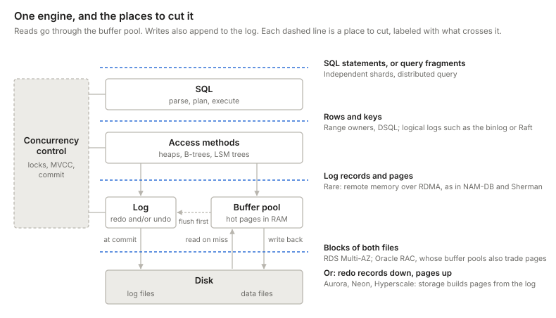
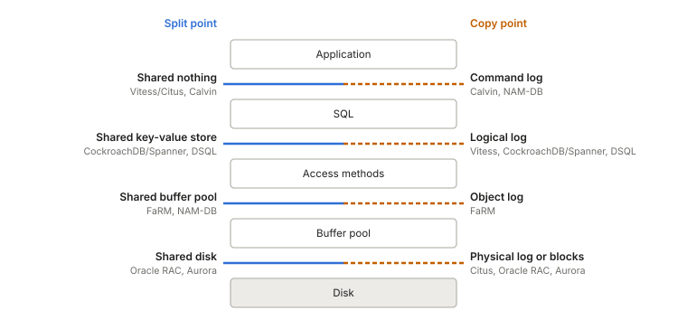
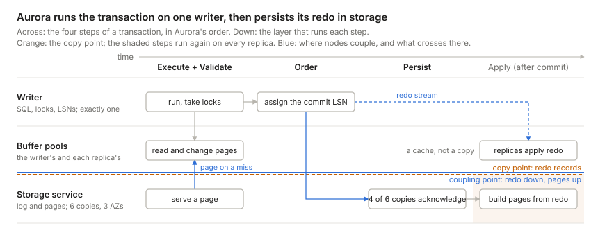
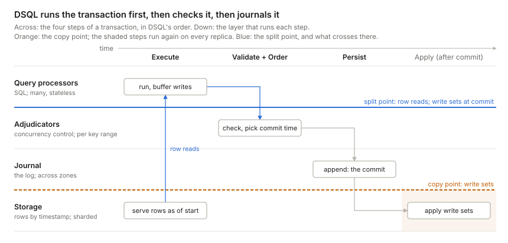
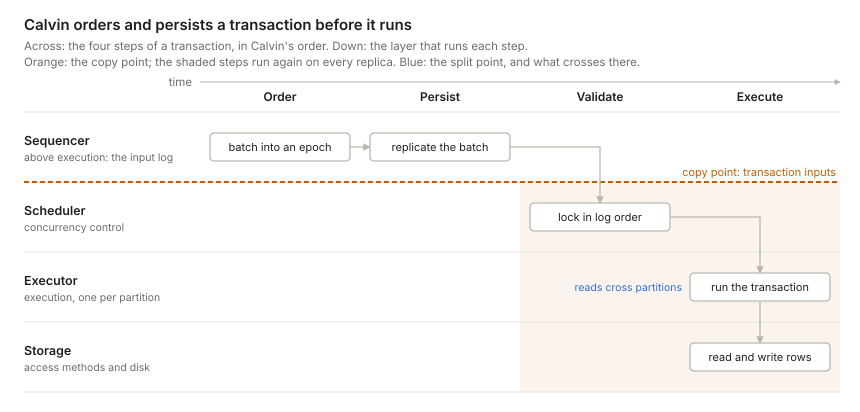
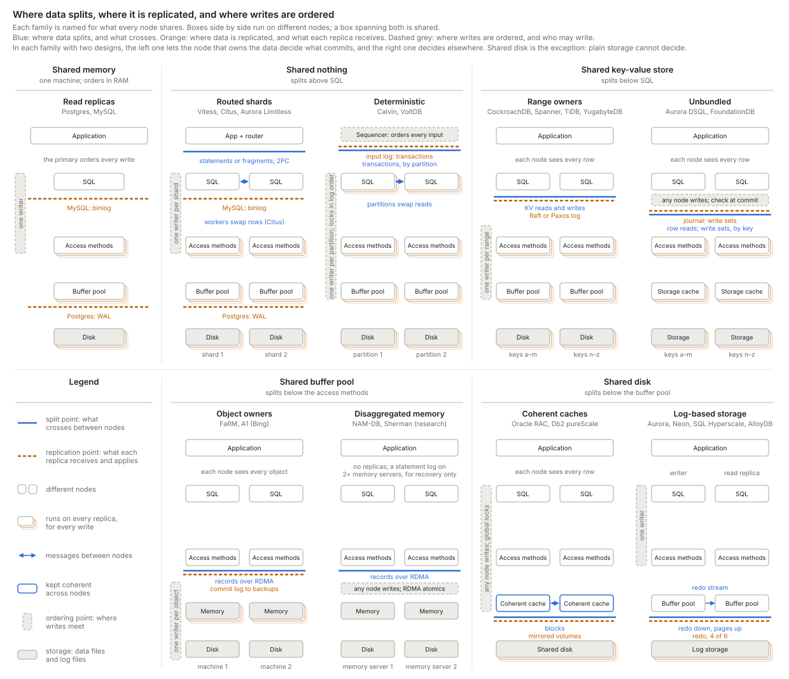

> [The second principle is] that of dividing things again by classes, where the natural joints are, and not trying to break any part, after the manner of a bad carver.
> -- Plato, *Phaedrus* 265e

- [Database engine and its interfaces](#database-engine-and-its-interfaces)
- [Three choices: replicate, split, order](#three-choices-replicate-split-order)
  - [Replication: where data is copied](#replication-where-data-is-copied)
  - [Splitting: where data divides](#splitting-where-data-divides)
  - [Ordering: where writes meet](#ordering-where-writes-meet)
- [How the three points fit together](#how-the-three-points-fit-together)
  - [Space: ordering sits highest](#space-ordering-sits-highest)
  - [Time: persist after ordering](#time-persist-after-ordering)
- [Three designs up close](#three-designs-up-close)
  - [Aurora: the log is the database](#aurora-the-log-is-the-database)
  - [DSQL: every layer its own fleet](#dsql-every-layer-its-own-fleet)
  - [Calvin: the log comes first](#calvin-the-log-comes-first)
- [Conclusion: the whole picture](#conclusion-the-whole-picture)

## Database engine and its interfaces

If Plato were alive today and tasked with scaling a database engine, he would look for the natural joints at which to carve it.

The joints are the interfaces that connect components, from SQL statements at the top to disk blocks at the bottom:[^hellerstein]

- **SQL:** parse, plan, and execute queries. The planner picks an access method for each table, such as an index or a full scan, and the executor asks it for rows.
- **Access methods:** tables and indexes, stored as heaps, B-trees, or LSM trees. They turn a request for a row or a key into reads and writes of pages. Each change to a page also produces a log record.
- **Buffer pool:** hot pages in RAM. Reads stop here, or go to the data files on a miss. Before it writes a dirty page back, the buffer pool flushes the log up to that page's log sequence number (LSN). That way, after a crash, recovery can undo any uncommitted changes the page carried to disk.
- **Log:** the recovery log, kept beside the buffer pool. A commit is durable once its records are on disk. After a crash, recovery rebuilds pages from the redo records in the log.[^log-truth]
- **Disk:** blocks that hold the data files and the log files.
- **Concurrency control:** locks, MVCC versions, and the commit. It sits beside the stack because the executor, the access methods, and the log all take part in it.

[^hellerstein]: Hellerstein, Stonebraker, and Hamilton's [Architecture of a Database System][hellerstein-arch] (2007) draws the main components as blocks, not as a stack. Its Figure 1.1 puts the access methods, buffer manager, lock manager, and log manager side by side in one transactional storage manager, next to a process manager and shared utilities. This post puts the parts in a line for simplicity, so that each interface is one joint. Process management and the shared utilities don't change where a design splits or replicates, so the figure leaves them out.

[^log-truth]: Which copy is the source of truth depends on the design. Without `force`, a commit may reach only the log, so the log is the truth and the data files are a copy. The log then holds redo records, plus undo records if uncommitted changes can reach the data files, as in ARIES. With `force`, every commit is already in the data files, so they are the truth, and the log holds only undo records, as in SQLite's rollback journal.

## Three choices: replicate, split, order

Past one machine, a design makes three choices:

- **Replicating** *copies* the data onto other nodes.
  - Benefits: durability, scalable reads, and lower-latency reads (via geo-replication).
- **Splitting** *shards* the data across several nodes.
  - Benefits: scalable writes, and a database larger than one storage device can hold.
- **Ordering** *decides* between conflicting writes.
  - It sets whether sharding scales writes: only when each slice orders its own writes.

Each choice sits at one of the engine's joints. Sharding splits the data at the **split point**: the interface where each request is routed to the node that owns its slice of the data. Above it, every node sees the whole database. Below it, each slice has one owner. Writes are replicated at the **replication point**: the interface where a write leaves the node that decides it, for its replicas. Writes are ordered at the **ordering point**: the interface where the decisions of different writers meet, and conflicting writes get their final order.

Most people know the classic sharded database. A router above SQL sends each query to the shards that hold its rows. Each shard is an ordinary database: it orders its own writes and has its own replicas. Vitess (sharded MySQL) and Citus (sharded Postgres) both work this way.[^citus] The engines under them still differ in how they replicate. Postgres ships its write-ahead log (WAL), a log of page changes. MySQL ships its binlog, a log of row changes.

[^citus]: Citus is a Postgres extension, not a fork. Postgres lets an extension take over query planning and add its own plan nodes. Citus uses these hooks to rewrite a query into SQL on the shard tables, which are ordinary Postgres tables on the workers. It sends that SQL to the workers over ordinary client connections. When repartition joins are turned on, workers also swap rows with each other, to join on a column other than the shard key. Each worker writes its rows to files, split by the new key, and the other workers fetch them with `COPY`. Commits that span shards use Postgres's own two-phase commit (`PREPARE TRANSACTION`). MySQL has plugins, but none can take over the planner, so Vitess runs as a separate proxy in front of MySQL.

Most designs similarly split first, then replicate each slice. [Calvin](#calvin-the-log-comes-first) replicates first, then splits.

This figure shows only the sequence. Every joint can host a split point or a replication point, and, as we'll see, an ordering point. The three points are not fully independent, though. For example, a design can replicate only what it has already decided.

All three points are places in the stack. Designs also differ in *when* they act: whether they replicate a write before or after it commits, and whether they order writes before, during, or after execution. [How the three points fit together](#how-the-three-points-fit-together) works out how the points constrain each other, in place and in time.

### Replication: where data is copied

A replicated database ships each write from the node that decides it to its replicas, almost always as a log.[^not-a-log] Layers above the replication point handle each write once, on the node that decides it. Layers below it handle each write on every replica: each one receives the stream and applies it. That is why replication never scales writes.

[^not-a-log]: Three exceptions. Leaderless systems, such as Dynamo and Cassandra, have no node that orders writes: a coordinator sends each write to a quorum of replicas, and replicas that miss one catch up by comparing state, not by replaying a log. State-based CRDTs ship their state, or a delta of it, and merge it. And a new replica first copies a snapshot of the data files, then switches to the log to keep up. This post leaves leaderless systems and CRDTs aside, and covers only designs where one node orders the writes to each piece of data.

A higher replication point repeats more work on each replica, but it ties the replicas less tightly to the primary's internals. Each step up buys something:

1. **Physical log.** Postgres ships its WAL, so its replicas only rebuild pages. This is the cheapest way to replicate, but each replica must match the primary byte for byte: same version, same indexes, every table.
2. **Object log.** FaRM ships the new value of each object a transaction wrote, to that object's backups. Its indexes are objects too, so a backup only copies values into memory and never runs the access methods.
3. **Logical log.** MySQL keeps a physical WAL for durability on each node, like Postgres, but ships its binlog to replicas. Its replicas run their own access methods, so they can run another version or storage engine, keep their own indexes, or replicate only some tables. Outside consumers can also read the binlog for change data capture.[^engine-log]
4. **Command log.** Calvin ships the inputs of each transaction, as blockchains do. The log is small, and no replica depends on another to run a transaction. But every replica runs every transaction on its own, and all of them must reach the same result. So execution must be deterministic. That has [benefits][deterministic-overview], and one main cost: transactions can't race for locks, as they do in Postgres or MySQL, because each race could have a different winner on each replica. Instead, every replica takes its locks in the order the log fixes.

[^engine-log]: The engine sets the usual choice, not a hard limit. Postgres also offers logical replication, and Aurora MySQL ships physical redo to its storage instead of the binlog.

Designs also differ in who must acknowledge a write before it commits:[^ack]

- **Asynchronous:** the primary commits alone. This is the default in Postgres and MySQL. A failover can lose the last few commits.
- **Semi-synchronous:** the primary waits for at least one replica. Examples are MySQL's semi-sync and a Postgres primary with one synchronous standby.
- **Quorum:** the primary waits for a majority, or for k of n replicas. CockroachDB waits for a Raft majority, and Aurora for four of six storage copies.

[^ack]: Designs also differ in what a replica acknowledges: that it received the write, flushed it to disk, or applied it. Postgres lets you choose with `synchronous_commit` (`remote_write`, `on`, or `remote_apply`). Only an applied write is visible to a client that reads from the replica.

Unless it acknowledges only applied writes, a replica can lag the primary. So replicas scale only the reads that can tolerate some lag. A read that must see the latest write either asks the node that decides writes, or waits until its replica has caught up.

### Splitting: where data divides

In the [classic picture](#three-choices-replicate-split-order), sharding is a router above SQL. Each shard is a whole engine that owns a horizontal slice of the database, and the router knows which shard holds each row. People call this design shared nothing. The classic alternatives are shared disk, where every compute node sees one address space, and shared memory, which is one machine.

These names fit modern databases poorly, for two reasons:

1. They describe hardware: what the processors physically share. Cloud databases run their parts as services on separate machines, so by that measure almost all of them are shared nothing, and the label stops telling them apart. Spanner and CockroachDB, for example, are shared nothing, yet every SQL node reads and writes one shared key-value store.[^ziegler]
2. They suggest that only shared nothing splits the data. But storage splits a shared disk into segments too, by page address instead of by row. Aurora has no visible shards, yet its storage service is sharded underneath.

[^ziegler]: [Ziegler, Bernstein, Leis and Binnig][ziegler-cidr23] (CIDR 2023) make a similar point: shared nothing versus shared disk no longer predicts how a system scales.

Every design that grows past one machine splits its data into slices somewhere. What tells designs apart is the interface through which requests reach each slice's owner: SQL queries, key-value reads and writes, reads of records in remote memory, or pages and log records. That interface is the split point.

So this post reads "shared X" as the name of a split point, not of hardware. Here, sharing means common access, not copies: any node above X can ask X for any part of the database, and no node holds a copy of the data X holds. Above X, each node runs its own instance of every layer. Below X, the data is split into slices, and each slice has one owner. Read this way, the three classic names grow into five families of "shared X": shared memory, shared nothing, shared key-value store, shared buffer pool, and shared disk. Whether the nodes above can see the slices, as with a key-value store, or not, as with a shared disk, does not change the family. It depends on who orders the writes, as [Ordering](#ordering-where-writes-meet) shows.

**Shared memory** is one machine. Its threads order their writes in RAM, through one buffer pool and one lock table.[^per-core] Scaling it up means buying a bigger machine. **Read replicas** add machines for reads, but every write still goes through one primary.

[^per-core]: One machine need not share its memory. VoltDB runs one single-threaded partition per core, and ScyllaDB, built on the Seastar framework, gives each core its own slice of the data and its own memory. Cores talk by passing messages, so inside the box these designs are shared nothing. Across machines, ScyllaDB is leaderless, like Cassandra, so this post leaves it aside.

**Shared nothing** splits above SQL. The two designs differ in who decides: each shard, for its own rows, or one ordered log, before any shard runs.

- **Routed shards.** Each shard is an ordinary database with its own replication, and a router above SQL sends each query to the shards that hold its rows. Routers range from simple to smart, but they all split at the same joint. At the simple end, the application picks the shard itself, or a proxy such as [Figma's DBProxy][figma-dbproxy] forwards each statement, and cross-shard work is the application's problem. Vitess sits in between: it forwards most statements to one shard, but can also fan a query out and merge the results. At the smart end, the router is a query planner, as in Citus, Greenplum, and Teradata. A coordinator splits a query into fragments, sends them to the nodes that own the data, and merges the results. For `SELECT region, sum(amount) FROM orders WHERE status = 'paid' GROUP BY region`, each node sums its own rows and returns a small partial result. Joins on a key other than the shard key must first move rows to the nodes that own the new key, and multi-shard writes add a commit protocol such as two-phase commit (2PC).
- **Deterministic.** Partitions own the data, as with routed shards, but every replica runs every transaction from one ordered input log. Partitions swap the rows they read, so no transaction needs 2PC. [Calvin](#calvin-the-log-comes-first) covers the details.

**Shared key-value store** splits between SQL and the access methods. Every node runs SQL over the whole database and reads and writes rows through one key-value interface. Below the joint, keys are split into ranges, and each range has an owner. The two designs differ in who decides: each range's owner, while the transaction runs, or a separate service, at commit.

- **Range owners.** Each range's owner, its leaseholder, receives key-value reads and writes as a transaction runs, and enforces the locks for its range. Each owner runs its own access methods. Spanner, CockroachDB, TiDB, and YugabyteDB work this way.
- **Unbundled.**[^unbundled] No owner enforces locks while a transaction runs. Concurrency control becomes a service of its own. In DSQL, query processors ask storage for rows directly[^dsql-rows] and keep their writes until commit. Storage can also run the bottom of each query plan, such as filters and projections, next to the data. Then a commit check by the adjudicators, which own key ranges too, decides which writes win. [FoundationDB][foundationdb] has the same shape. [DSQL](#dsql-every-layer-its-own-fleet) covers the details.

[^unbundled]: The name comes from Lomet, Fekete, Weikum, and Zwilling's [Unbundling Transaction Services in the Cloud][lomet-unbundling] (CIDR 2009). It means something narrower than splitting compute from storage. They split the storage engine itself in two: a transactional component that runs concurrency control and recovery over logical records, and a data component that stores the records and knows nothing about transactions. The [FoundationDB paper][foundationdb] uses the word in the same sense. In Lomet's design, the transactional component still takes locks while a transaction runs. DSQL and FoundationDB check for conflicts only at commit.

[^dsql-rows]: DSQL can look as if it belongs one joint lower, in the [shared buffer pool](#splitting-where-data-divides) family, because its query processors keep no cache. But in [Brooker's words][dsql-reads], "the QP doesn't ask for pages, it asks for rows." The access methods moved to storage along with the cache, so storage walks the index, and a lookup costs one round trip.

**Shared buffer pool** splits between the access methods and the buffer pool. Each node runs the access methods itself, and reads records or index nodes straight from other machines' memory. A B-tree lookup touches several nodes one after another, and across this joint each one can cost a round trip. So designs here need fast RDMA networks, where a read skips the remote CPU, and they still work hard to save round trips. The two designs differ in who decides: each object's primary, or the compute server that writes it.

- **Object owners.** Every machine holds part of the data and runs transactions over all of it. Each object has one primary, which locks it at commit, and other machines read it with one-sided RDMA. [FaRM][farm] works this way, and it is the one production example: it runs under [A1][a1], a graph database in Microsoft's Bing.
- **Disaggregated memory.** Compute servers hold no data. Memory servers hold the tables, the indexes, and the logs, and compute servers read and write them directly. In [NAM-DB][nam-db], a research system, any compute server may write: it locks a record by a compare-and-swap on the record's header in remote memory.[^nam-db-durability] Even NAM-DB avoids walking a B-tree across the joint. It sends B-tree lookups to the memory server as messages. [Sherman][sherman], a research B-tree, does walk the tree over RDMA, but caches the upper levels on each compute server.

[^nam-db-durability]: NAM-DB keeps its data in memory. On a power failure, a UPS lets each memory server write a snapshot to disk. Against hardware failure, each compute thread writes a log of the statements it ran, with their read timestamps, to two or more memory servers before it installs its writes. When a memory server fails, NAM-DB halts, restores the last checkpoint, and replays the merged logs. The authors state that high availability is not a design goal.

**Shared disk** puts its split point below the buffer pool and the log: every node shares one disk, and storage splits it into slices that no node sees. Here storage never decides: it only holds pages and logs. The two designs differ in how many nodes decide: many, which must share their locks and caches, or one.

- **Coherent caches.** The buffer pools also talk to each other. Every node runs SQL, access methods, a buffer pool, and its own log over the whole database, and all of them read and write one set of shared volumes. The hard part is keeping the buffer pools coherent and the locks global. This is data shipping: pages and lock messages cross between nodes. Oracle RAC (Cache Fusion) and Db2 pureScale are the long-lived examples. ScaleStore, a research system, keeps buffer pools coherent the same way, over RDMA and without shared disk.
- **Log-based storage.** The log is the interface. The writer sends redo records to a storage service, and storage sends pages back on a miss. Aurora, Neon, Azure SQL Hyperscale, and AlloyDB work this way, each with one writer. [Aurora](#aurora-the-log-is-the-database) shows why.

### Ordering: where writes meet

The **ordering point** says where writes meet: where conflicting writes get their final order. Concurrency control runs there, and it settles two questions: who may write, and who decides which transactions commit.

The ordering point often sits at the same joint as the split point, but not always. A conflict is two writes to the same item, and each item lives in one slice, so the slice's owner already sees every conflict on its data. The ordering point moves elsewhere when the owners can't decide, or when a design orders everything in one place so the slices never have to agree. Oracle RAC orders above its split point, through global locks and coherent buffer pools. Calvin orders at the very top, in its input log. DSQL orders at the same joint as its split, but on other nodes: the adjudicators. And Aurora orders in its one writer, above its split point.

**Who may write.** Splitting adds write capacity only when each slice orders its own writes. That takes the state that orders writes: locks, cached pages, and the log. Below the split point, each piece of that state covers one slice. Above it, each node keeps its own private copy, over the whole database. [Stonebraker][stonebraker-sn] named these three as the problems of shared disk in 1985. Private state is safe only while one node writes. Two writers with private locks could lock the same row and never know it. Two writers with private caches could each update a stale copy of the same page. So a design with many writers must order their writes again, at every piece of state they keep, in one of two ways:[^multi-leader]

- **Share the state.** Oracle RAC keeps its locks global and its buffer pools coherent. Each node writes its own log, and recovery merges the logs in commit order. This is why a shared disk alone never gives you many writers: the nodes must also share their caches and locks.
- **Move the state below the split point.** Routed shards get this for free: splitting above SQL puts the whole engine, with all three, below the split. Range owners move all three to each key's owner. DSQL moves its locks to the adjudicators, its cache into storage, and its log into the journal. NAM-DB keeps no cache, and puts its locks and its logs in the memory servers.

A design that does neither keeps one writer, and that writer is its ordering point. Aurora shares its storage but nothing above it, so it has [exactly one writer](#aurora-the-log-is-the-database).

**Who decides.** The ordering point has a place and an owner. Within a family, the place rarely changes. The owner does: is it the node that holds the data, or something else? That is why [Splitting](#splitting-where-data-divides) gives each family two designs, one of each kind. Only shared disk moves the place too, one joint up, because its storage cannot decide. Its two designs differ instead in how many nodes decide.

![Each row is a joint and the family that splits there, with two ordering columns: on the data owners, or elsewhere. Shared nothing: routed shards lock per shard and use 2PC; Calvin's input log fixes the order. Shared key-value store: leaseholders lock their ranges; DSQL's adjudicators check at commit. Shared buffer pool: FaRM's primaries lock at commit; NAM-DB's writer locks by compare-and-swap; Oracle RAC also orders here, one joint above its split. Shared disk: storage never decides, and Aurora's one writer orders every write, above its split](/assets/db-cuts/03d-who-orders.svg)

Calvin's partitions do take locks, but in an order the log has already fixed. So a partition never votes on whether a transaction commits.

**Where the shards show.** A slice boundary must show to whoever coordinates commits across it, and that coordinator pays for a commit protocol each time a transaction crosses the boundary. When the data owners decide, the coordinator is the layer just above the split. When something else decides, no one needs to coordinate across the slices, so they can stay hidden.

- **Routed shards** show their shards to the schema. Each shard is a whole database, so a transaction that spans shards needs 2PC. Someone must pick a shard key for each table, and that choice decides which queries are cheap.
- **Range owners** show their shards to the engine only. The engine runs the commit protocol across ranges, so the application writes ordinary SQL. It sees ranges only through speed: a transaction over many ranges is slower, and keys that only increase pile up on one range.
- **Where something else decides,** no layer coordinates across the data shards, so they stay out of sight. Aurora's storage splits each volume into 10 GB segments that no SQL node thinks about. Calvin's partitions and DSQL's storage are split by key too, but a transaction pays no commit protocol to touch several of them. DSQL's adjudicators do own key ranges, so a commit that spans several of them still needs a protocol among them.

This is also why designs below SQL split and move their data on their own. A range below SQL is small, and moving it changes only who serves it, never which queries are legal. A shard above SQL is a whole database. Citus and Vitess can move data between shards online, but an operator starts the move, and changing the shard key is a schema change.

[^multi-leader]: Many writers here does not mean multi-leader replication. Conflicting writes are still ordered before they commit, through shared locks or a check at commit.

## How the three points fit together

The three points are not independent. One rule ties them together: the ordering point is never below the other two. The rule constrains where each point can sit in the stack, and the order in which a design runs its steps.

### Space: ordering sits highest

**Replication sits at or below ordering.** A design can replicate only what it has already decided. A replica that received an undecided write would have to decide it alone, and two replicas could decide differently. So a design replicates at or below the point where its decisions become final. Range owners decide at each range and replicate there, through a Raft group per range. Vitess decides at each shard, and gives each shard its own primary and replicas. Aurora's one writer decides above its split point, and storage replicates the redo below it. DSQL's adjudicators decide, and the journal replicates their result. [Calvin](#calvin-the-log-comes-first) replicates right at its ordering point: the input log fixes the order of transactions before anything runs, and every replica reaches the same result on its own, as [replication](#replication-where-data-is-copied) explained.

**Ordering sits at or above the split.** Either the slice owners order their own writes, at the split, or something that sees every slice orders them, above it. Below the split, each node sees only its own slice, so ordering there still means the owners decide. [Ordering](#ordering-where-writes-meet) showed both kinds.

**Splitting and replication are free only when ordering sits above the split.** If the slice owners decide, ordering sits at the split, so replication must sit at or below it: the design splits first, then replicates each slice. Most designs work this way. Only when something above the split orders the writes can replication sit above the split too. Calvin replicates its input log above SQL, and each replica then splits the data among its partitions. Aurora can go either way: its storage replicates redo below the split, and Aurora MySQL can also ship its binlog to another cluster, above it.

### Time: persist after ordering

[Alex Miller][miller-decomposing] divides every transaction into four steps: execute, order, validate, and persist. In his terms, the ordering point is where a design orders and validates writes, and the replication point is where it persists them. Systems run the steps in different sequences, but the rule above fixes one thing: a design persists only after it orders. Calvin persists before it executes, yet still after it orders.

Ordering can come before, during, or after execution. A design can order writes before execution, as Calvin's input log does. That forces its ordering point above everything that executes, to the very top of the stack. It can order them during execution, with locks, as CockroachDB's leaseholders do. Or it can order them after execution, with a check at commit, as DSQL's adjudicators do. CockroachDB and DSQL order at the same joint, the key-value interface, but at different times. Optimistic or pessimistic concurrency control is a choice of time, not of place.

When a design persists sets how high its replication point sits. Every step after persist runs again on each replica, so the later a design persists, the lower its replication point sits. Aurora persists after execution, so its replicas only build pages. Calvin persists before execution, so every replica runs every transaction.

[Three designs up close](#three-designs-up-close) charts both axes for each design, and [the map at the end](#conclusion-the-whole-picture) draws all the designs side by side, with where each splits, replicates, and orders, and who may write.

## Three designs up close

Aurora, DSQL, and Calvin each divide the engine in a different way. They differ most in where they put the log:

- **Aurora** puts it at the bottom: redo records, written after the writer runs the transaction. It keeps one writer.
- **DSQL** puts it in the middle: write sets, written once the adjudicators approve them. Any node may write.
- **Calvin** puts it at the top: transaction inputs, written before anything runs. Each partition writes its own rows, and conflicts make transactions wait instead of abort.

I picked Aurora and DSQL because I know them best, and Calvin because no other design here puts the log above execution. None of them is alone. Azure SQL Hyperscale ([Socrates][socrates]), Google's AlloyDB, and Neon have Aurora's shape: one writer over shared, log-based storage. Socrates and Neon go one step further and separate the log service from the page servers. FoundationDB has DSQL's shape, as a key-value store without SQL on top. VoltDB, like Calvin, replicates transactions rather than their results.

Each design below gets a chart with two axes. Across is time: that design's sequence of Miller's four steps. Down is space: the layer that runs each step. The orange line is the replication point, and the shaded area holds the steps that every replica repeats.

### Aurora: the log is the database

Aurora keeps a single writer running the full SQL and transaction engine, but moves logging and page storage into a shared, quorum-replicated service. The writer sends storage only redo records, never pages.

In [Werner Vogels' description][aurora-ascendant] (2019), Aurora treated caching and logging as the layers ripe for reinvention. The storage service builds page images from the log on demand, so instances never flush dirty pages. Every write goes to six copies across three AZs and succeeds once four acknowledge. Up to 15 read replicas share the same volume.

**Why the cache sits on the joint.** The buffer pool is RAM on each instance, so physically it belongs to compute. Its rules, though, are set by the storage contract:

- **Misses:** a miss is a request to storage for a page at a specific LSN.
- **Eviction:** a dirty page can be dropped once its redo is durable, because storage can always rebuild it. There is no flush.
- **Replicas:** a read replica gets no copy of the data, because it reads the writer's storage. The writer still streams its redo to each replica. Per the [Aurora paper][aurora-paper], the replica applies each record to a page it has cached and drops the rest. That stream keeps caches fresh: it is a cache-coherence protocol, not a durability one.

**Why there is still exactly one writer.** The lock manager and the buffer pool are in-memory structures inside one process, and the writer assigns every LSN. Storage persists the log and replays it, but never decides its order. Aurora offloaded the log's durability and page construction, not its authorship. A second writer would need global locks and coherent caches, which brings back [Stonebraker's three shared-disk problems](#ordering-where-writes-meet). Aurora sits in the shared-disk family but avoids all three, because it has one writer.

**Getting more writers.** AWS has tried three ways. Only sharding adds real write capacity:

| Approach | How it works | More write capacity? |
| --- | --- | --- |
| Multi-Master (MySQL 5.6 only, discontinued) | Several writers on one volume; conflicting writes abort at the storage layer | Not reliably |
| [Global Database write forwarding][aurora-write-forwarding] | Replicas in secondary regions accept writes and forward them to the one writer | No |
| [Aurora Limitless Database][aurora-limitless] (PostgreSQL) | Tables sharded behind a router; each shard is a single-writer Aurora | Yes |

Limitless splits above SQL, like [routed shards](#splitting-where-data-divides): there are more writers in total, but every key range still has exactly one owner.

### DSQL: every layer its own fleet

Aurora DSQL keeps Postgres's SQL engine but replaces everything beneath it with separately scaled services. Marc Brooker's walkthrough ([Reads and Compute][dsql-reads], [Transactions and Durability][dsql-writes]) describes each piece.

- **Query processors** run a customized Postgres engine. They never talk to each other, and they cache no table data, only rarely-changing metadata such as table definitions.
- **Adjudicators** own key ranges and check each write set at commit. A transaction aborts if another one has written its keys since it started. Isolation is snapshot isolation, so write skew is possible.
- **The journal** orders and persists committed transactions. Appending is the commit.
- **Storage** is sharded, and serves rows as of a timestamp rather than pages.

**How it gets many writers.** Aurora avoids Stonebraker's three shared-disk problems by having one writer. DSQL removes each one instead. Concurrency control lives in the adjudicators, so no query processor keeps a lock table. Query processors cache no data, so there are no buffer pools to keep coherent. And the journal is the log that many writers share, built as a service that scales. The price: contention becomes aborts, and every read and commit crosses the network.

### Calvin: the log comes first

[Calvin][calvin] runs the steps in the opposite sequence from Aurora and DSQL. It agrees on the order of transactions first, makes that order durable, and only then runs them. It began as a research system, and FaunaDB later built a commercial database on its design.

- **Sequencers** collect transaction requests into 10 ms batches, called epochs, and replicate each batch by Paxos. Once the batch is replicated, the transaction will run: this is the commit. Calvin can also replicate batches asynchronously. That is faster, but a failed sequencer can then lose its last batches.
- **Schedulers**, one per partition (Calvin's name for a shard of each replica), take the locks each transaction needs, in log order. Replicas that read the same log take the same locks in the same order.
- **Executors** run the transaction. When it spans partitions, each partition reads its own rows and sends them to the partitions that write. Each writing partition then has every input, and computes the same result.
- **Storage** can be any store that reads and writes by key.

**How it gets many writers without aborts.** Every partition, on every replica, sees the same order. Nothing that happens after the order is fixed can change the outcome, so no partition needs to vote: there is no two-phase commit. A crashed node recovers by replaying the input log. And because locks follow the log order, contention makes transactions wait, not abort.

**What it pays.** A transaction must be deterministic, and the scheduler must know which keys it will touch before it runs. When those keys depend on data, Calvin first runs a read-only query to find them, then restarts the transaction if that data has changed. This is the one case where contention costs a retry. And one slow transaction holds its locks while every later transaction that needs them waits.

## Conclusion: the whole picture

Every design in this post comes down to three choices: [where it splits](#splitting-where-data-divides), [where it replicates](#replication-where-data-is-copied), and [where it orders](#ordering-where-writes-meet).

Then follow one request through it: pick a design, and step a read-write or a read-only transaction through the joints.



## References <!-- omit in toc -->

1. [Amazon Aurora ascendant][aurora-ascendant] — Vogels, 2019; why Aurora reinvented the caching and logging layers
2. [Amazon Aurora: Design Considerations for High Throughput Cloud-Native Relational Databases][aurora-paper] — Verbitski et al., SIGMOD 2017; the log is the database, and how replica caches follow it
3. [Aurora Global Database write forwarding][aurora-write-forwarding] — AWS docs; secondary regions forward writes to the one writer
4. [Aurora PostgreSQL Limitless Database][aurora-limitless] — AWS docs; single-writer shards behind a router
5. [DSQL Vignette: Reads and Compute][dsql-reads] — Brooker, 2024; query processors and timestamped reads
6. [DSQL Vignette: Transactions and Durability][dsql-writes] — Brooker, 2024; adjudicators, the journal, and optimistic commits
7. [Is Scalable OLTP in the Cloud a Solved Problem?][ziegler-cidr23] — Ziegler, Bernstein, Leis, Binnig, CIDR 2023; why shared nothing versus shared disk no longer predicts how a system scales
8. [FoundationDB: A Distributed Unbundled Transactional Key Value Store][foundationdb] — Zhou et al., SIGMOD 2021; proxies, resolvers, and logs
9. [How Figma's databases team lived to tell the scale][figma-dbproxy] — Figma, 2024; DBProxy, colos, and logical before physical sharding
10. [The Case for Shared Nothing][stonebraker-sn] — Stonebraker, HPTS 1985; shared memory, shared disk, and shared nothing, compared on twelve points
11. [Calvin: Fast Distributed Transactions for Partitioned Database Systems][calvin] — Thomson et al., SIGMOD 2012; deterministic ordering before execution
12. [Socrates: The New SQL Server in the Cloud][socrates] — Antonopoulos et al., SIGMOD 2019; Azure SQL Hyperscale, with the log service apart from the page servers
13. [Architecture of a Database System][hellerstein-arch] — Hellerstein, Stonebraker, Hamilton, Foundations and Trends in Databases, 2007; the components of a relational engine
14. [Decomposing Transactional Systems][miller-decomposing] — Miller, 2025; execute, order, validate, and persist, and the orders systems run them in
15. [Unbundling Transaction Services in the Cloud][lomet-unbundling] — Lomet, Fekete, Weikum, Zwilling, CIDR 2009; a transactional component apart from a data component
16. [An Overview of Deterministic Database Systems][deterministic-overview] — Abadi and Faleiro, CACM 2018; what deterministic execution buys and what it costs
17. [No compromises: distributed transactions with consistency, availability, and performance][farm] — Dragojević et al., SOSP 2015; FaRM's one-sided RDMA reads, commit-time locks at primaries, and primary-backup replication
18. [A1: A Distributed In-Memory Graph Database][a1] — Buragohain et al., SIGMOD 2020; Bing's graph database, built on FaRM and run in production
19. [The End of a Myth: Distributed Transactions Can Scale][nam-db] — Zamanian, Binnig, Kraska, Harris, PVLDB 2017; NAM-DB, snapshot isolation over remote memory
20. [Sherman: A Write-Optimized Distributed B+Tree Index on Disaggregated Memory][sherman] — Wang et al., SIGMOD 2022; a B-tree walked over RDMA, with upper levels cached on compute

[aurora-ascendant]: https://www.allthingsdistributed.com/2019/03/amazon-aurora-design-cloud-native-relational-database.html "Amazon Aurora ascendant: How we designed a cloud-native relational database"
[aurora-paper]: https://www.allthingsdistributed.com/files/p1041-verbitski.pdf "Amazon Aurora: Design Considerations for High Throughput Cloud-Native Relational Databases"
[aurora-write-forwarding]: https://docs.aws.amazon.com/AmazonRDS/latest/AuroraUserGuide/aurora-global-database-write-forwarding.html "Aurora Global Database write forwarding"
[aurora-limitless]: https://docs.aws.amazon.com/AmazonRDS/latest/AuroraUserGuide/limitless.html "Aurora PostgreSQL Limitless Database"
[dsql-reads]: https://brooker.co.za/blog/2024/12/04/inside-dsql.html "DSQL Vignette: Reads and Compute"
[dsql-writes]: https://brooker.co.za/blog/2024/12/05/inside-dsql-writes.html "DSQL Vignette: Transactions and Durability"
[ziegler-cidr23]: https://www.cidrdb.org/cidr2023/papers/p50-ziegler.pdf "Is Scalable OLTP in the Cloud a Solved Problem?"
[foundationdb]: https://www.foundationdb.org/files/fdb-paper.pdf "FoundationDB: A Distributed Unbundled Transactional Key Value Store"
[figma-dbproxy]: https://www.figma.com/blog/how-figmas-databases-team-lived-to-tell-the-scale/ "How Figma's databases team lived to tell the scale"
[stonebraker-sn]: https://dsf.berkeley.edu/papers/hpts85-nothing.pdf "The Case for Shared Nothing"
[calvin]: http://cs.yale.edu/homes/thomson/publications/calvin-sigmod12.pdf "Calvin: Fast Distributed Transactions for Partitioned Database Systems"
[socrates]: https://www.microsoft.com/en-us/research/wp-content/uploads/2019/05/socrates.pdf "Socrates: The New SQL Server in the Cloud"
[hellerstein-arch]: https://dsf.berkeley.edu/papers/fntdb07-architecture.pdf "Architecture of a Database System"
[miller-decomposing]: https://transactional.blog/blog/2025-decomposing-transactional-systems "Decomposing Transactional Systems"
[lomet-unbundling]: https://arxiv.org/abs/0909.1768 "Unbundling Transaction Services in the Cloud"
[deterministic-overview]: https://cacm.acm.org/research/an-overview-of-deterministic-database-systems/ "An Overview of Deterministic Database Systems"
[farm]: https://pdos.csail.mit.edu/6.824/papers/farm-2015.pdf "No compromises: distributed transactions with consistency, availability, and performance"
[a1]: https://arxiv.org/abs/2004.05712 "A1: A Distributed In-Memory Graph Database"
[nam-db]: https://www.vldb.org/pvldb/vol10/p685-zamanian.pdf "The End of a Myth: Distributed Transactions Can Scale"
[sherman]: https://arxiv.org/abs/2112.07320 "Sherman: A Write-Optimized Distributed B+Tree Index on Disaggregated Memory"

## Footnotes <!-- omit in toc -->
