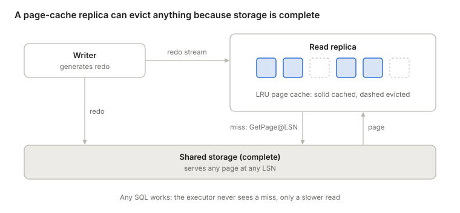
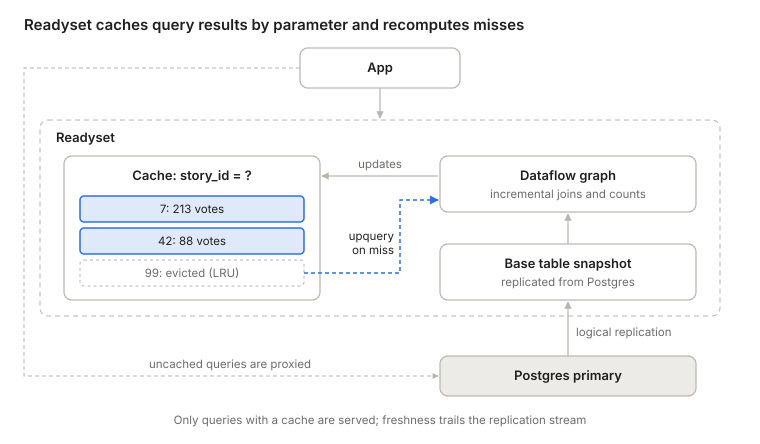
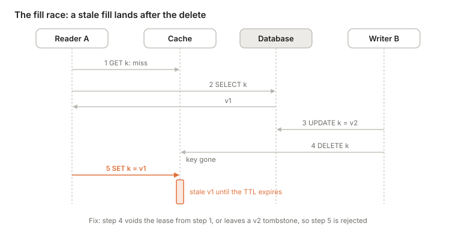
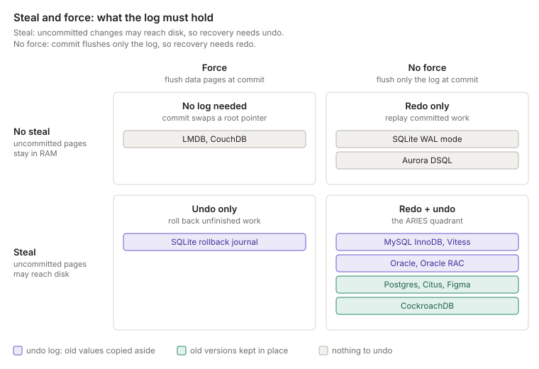

- [A cache is a copy that may be missing data](#a-cache-is-a-copy-that-may-be-missing-data)
- [What happens on a miss](#what-happens-on-a-miss)
  - [Pages: Aurora and Neon](#pages-aurora-and-neon)
  - [Query results: Readyset](#query-results-readyset)
  - [Keys: ElastiCache, cache-aside](#keys-elasticache-cache-aside)
  - [No cache in compute: DSQL](#no-cache-in-compute-dsql)
  - [The four side by side](#the-four-side-by-side)
  - [The cost of a miss path](#the-cost-of-a-miss-path)
- [Who keeps it fresh](#who-keeps-it-fresh)
  - [Fresh enough for this client](#fresh-enough-for-this-client)
  - [The latest value, period](#the-latest-value-period)
  - [What production systems do](#what-production-systems-do)
  - [Which keys a write touches](#which-keys-a-write-touches)
  - [Delete, don't set](#delete-dont-set)
  - [The fill race](#the-fill-race)
  - [What each mechanism buys](#what-each-mechanism-buys)
- [When the cache holds writes](#when-the-cache-holds-writes)
  - [Steal and force](#steal-and-force)
  - [Undo log or old versions in place](#undo-log-or-old-versions-in-place)
- [Two answers for every cache](#two-answers-for-every-cache)
- [References](#references)

## A cache is a copy that may be missing data

[Carving a database at its joints](/programming/where-to-cut-a-database.html) drew an engine as a stack: SQL, then access methods, then the buffer pool and the log side by side, then disk. Every interface in that stack is a place to cut the engine apart. It is also a place to put a cache, and the cache holds whatever unit crosses that interface: pages below the buffer pool, rows below SQL (as in DSQL's storage), query results at the SQL interface, and application-defined keys above it.

A cache is one kind of copy, and not every copy is a cache. Copies differ in what decides which rows they hold:

| What decides which rows a copy holds | Examples | Needs a miss path? |
| --- | --- | --- |
| Nothing: it holds every row | Physical replica, plain index | No |
| A predicate on the row | Partial index, logical replica with a row filter | No |
| The row's timestamp and the clock | Materialize view with a temporal filter | No; a timer expires old rows |
| Demand: what was read recently | Buffer pool, Readyset, memcached | Yes |

For the first three, the query alone says whether the copy can answer it. A partial index on `WHERE status = 'active'` holds every active row, so the planner can prove that a query for active EU rows is covered, and send a query for closed rows elsewhere. When the copy lacks a row, the row doesn't exist.

A demand-filled copy is different. What it holds depends on which keys were read recently and what was evicted since, and nothing in the query says that. When a row is absent, it may not exist, or it may have been evicted. Only a complete source behind the copy can tell. Asking that source is the miss path, and a demand-filled copy with a miss path is a cache.

A plain Postgres replica has no miss path, which is why it can't drop rows from its data files LRU-style. Its buffer pool evicts pages, but only because the full data sits on disk behind it. The replica answers queries by scanning its own data, so after evicting some rows it can't tell that `SELECT count(*) FROM orders WHERE region = 'EU'` is wrong.

So every cache answers two questions: what happens on a miss, and who keeps the entries it holds fresh. The two are separate. Eviction decides which entries are in the cache, and an evicted entry may have been perfectly fresh. Freshness decides whether the entries that are there still match the source. A TTL is the one knob that touches both, and in this post it is a freshness bound: it drops an entry because the entry may be stale, not to make room.

## What happens on a miss

The unit a cache holds decides who can resolve a miss, and with it how much of SQL still works on top of the cache.

### Pages: Aurora and Neon

An Aurora read replica caches pages in its buffer pool, and fetches a missing page from shared storage. The executor believes it is scanning complete tables, so arbitrary SQL keeps working. A miss is invisible to it and just becomes a slower read. Eviction is safe because storage is complete and versioned: it can return the page as of exactly the LSN the replica has applied. MVCC then decides visibility inside the page, as it would on a single node. [Neon][neon-architecture] has the same shape: a local file cache on the compute node, in front of a pageserver.

### Query results: Readyset

[Readyset][readyset] keeps results only for the parameter values that have been requested, keeps them fresh by pushing the replication stream through a dataflow graph, and recomputes an evicted key with an "upquery", a technique from the [Noria][noria] research system it grew out of. A miss is well defined because each cache is keyed on its query's parameters. That is also the limit: Readyset serves only queries that have a cache, written in the subset of SQL it supports, and everything else goes straight to Postgres. Freshness is automatic but eventual. So writes push changes forward through the graph, and misses pull results back. [Incremental computation](/programming/incremental-computation.html) follows that push–pull split well beyond databases.

[Materialize][materialize-indexes] runs the same kind of dataflow, built on Timely and Differential Dataflow, but without a miss path. An index on a view holds the full result, for every key, in memory. By the [table above](#a-cache-is-a-copy-that-may-be-missing-data), that makes it a complete copy, not a cache: when a key is absent, it doesn't exist. Two things follow. No burst of misses can overload the upstream database, because there are no misses. And every update carries a logical timestamp, so a read can wait until every view it touches is complete as of one time. That is how Materialize offers [strict serializability by default][materialize-isolation]. Readyset's caches each catch up on their own, so two of them can reflect different moments. The [Noria paper][noria] says it plainly: an update "may appear in different views at different times."

### Keys: ElastiCache, cache-aside

With cache-aside, the application talks to two stores: the database, and a key-value cache such as ElastiCache (Redis or Memcached). The two stores never talk to each other. Everything outside the database is the application's job: choosing what a key means, serializing values, filling the cache on a miss, and invalidating keys on writes. TTLs cap how stale an entry can get.

### No cache in compute: DSQL

DSQL removes the miss instead of resolving it. Its query processors cache no table data, only metadata that rarely changes, such as table definitions. So there are no misses to resolve and nothing to invalidate. Two changes make that affordable:

- **One round trip per lookup.** With a page interface, a point lookup walks the B-tree itself (root, internal pages, leaf), and each page is a separate network round trip on a cold cache. DSQL storage serves rows and runs the index traversal next to the data, so the same lookup is one round trip. Filters, projections, and aggregations can be pushed down too.
- **The cache lives inside the authority.** Storage replicas hold the rows themselves, so any memory caching they do is shared by every query processor. It can't serve a wrong value either: every read asks for data as of a timestamp, and a replica answers only once it has applied the journal up to that time.

The cost is a network round trip where Aurora with a warm cache would read memory. DSQL wins when a transaction does a few targeted reads, and loses when a transaction is chatty: N+1 ORM queries, long chains of small statements, or plans that can't be pushed down. [Brooker notes][dsql-reads] this choice is contested, and points to [Ziegler et al.][ziegler-cidr23], the paper behind the [writer archetypes](/programming/where-to-cut-a-database.html#2-concurrency-control-who-may-write-a-row), which argues for large compute-side caches kept coherent.

### The four side by side

|  | Unit of caching | What SQL still works | Who resolves a miss | Who keeps it fresh | Where the cache lives |
| --- | --- | --- | --- | --- | --- |
| Aurora / Neon | Page | Any SQL | Storage, by page and LSN | Redo stream; a consistent snapshot, slightly behind the writer | Compute (buffer pool) |
| Readyset | Result for one query parameter | Supported queries that have a cache | Dataflow upquery | Replication stream, eventual | Separate layer in front of the database |
| ElastiCache | App-defined key | Whatever the app builds | The application | The application, plus TTLs | Beside the database |
| DSQL | Row or key range | Any SQL, with filters and aggregations pushed down to storage | No miss path needed | Nothing to invalidate | Inside storage, the source of truth |

### The cost of a miss path

A miss path also costs something under load. [Brooker][brooker-modes] points out that it makes the system bimodal. While the hit rate is high, the database sees a small share of the load. When the cache goes cold, after a restart or a shift in which keys are popular, the database gets load it was never sized for. A complete replica fed by the log has no such mode: when it falls behind, it serves older data, and database load stays flat. A cache fails by overloading the database. A complete replica fails by serving older data.

## Who keeps it fresh

Underneath "who keeps it fresh" sit two different questions, and they cost very different amounts. Is this entry fresh enough for this client? And is this entry the latest value, period?

### Fresh enough for this client

The client can carry the answer. After each write, it keeps a token: the log position of its commit, such as an LSN or a hybrid logical clock (HLC) timestamp. The cache stores each entry with the log position as of which it was read from the database. Take that position just before the read, or from the same snapshot. Taken after, a commit could slip in between the snapshot and the position, and the entry would claim to be fresher than it is. The cache serves the entry only if that position is at or past the client's token. Otherwise the read falls through to the database.

Store the read position, not the position of the row's last change. Otherwise a row that nobody has touched for a week looks too old to every client that has written since.

This gives read-your-writes. If the client also raises its token to the position of each entry it reads, it gets monotonic reads too: it never sees time go backwards. [Azure Cosmos DB's session consistency][cosmos-consistency] works this way, with a session token per partition. On Postgres, a client can record `pg_current_wal_lsn()` after its commit, and read from a replica only once `pg_last_wal_replay_lsn()` there has passed it.

The token says nothing about other clients' writes. A client with no token, or an old one, will accept a value that someone else has already overwritten.

### The latest value, period

That is linearizability, and the request can't carry enough information to decide it. The newer write may be one this client has never heard of. Only the authority knows, so freshness has to come from the authority, in one of four ways:

- **Validate on read.** Ask the database whether the cached version is still current, as an HTTP request with an ETag in `If-None-Match` does. This is correct, but every read pays a round trip to the authority. The cache saves bandwidth and work, not latency.
- **Invalidate synchronously.** A write is not acknowledged until every cache holding the key has dropped it. CPU caches work this way: under MESI, a core takes exclusive ownership of a line before writing it, which invalidates every other copy. Oracle RAC's Cache Fusion and ScaleStore's page directory apply the same idea to database pages. Every copy slows the write, and a write stalls while a cache holding the key is unreachable.
- **Leases.** In [Gray and Cheriton's design][gray-cheriton-leases] (SOSP 1989), the authority grants a cache the right to serve a key for T seconds. A write must revoke the outstanding leases or wait for them to expire. "Contact every cache" becomes "wait at most T". The price is a dependence on clocks: they need not agree, but they must not drift apart faster than a known rate. [Chubby][chubby] combines both: a write proceeds once every caching client has acknowledged the invalidation or let its lease expire.
- **Put the cache inside the authority.** Then nothing can change the data behind the cache's back. Aurora's writer caches only data that no other node writes, so its buffer pool is always current without any protocol. DSQL's storage replicas [answer a read only once they have caught up to its timestamp](#no-cache-in-compute-dsql). [TAO][tao], Facebook's cache for the social graph, does the same one level up. Every write to a shard goes through that shard's leader cache, which writes MySQL, so the paper calls the leader "naturally consistent". Its followers are invalidated asynchronously, except the one that forwarded the write, which gets the new value in the reply. That gives read-your-writes to the clients of that follower tier.

### What production systems do

Most caches give up on "latest, period" and invalidate after the fact. The write commits to the database first, and the invalidation follows. Staleness is bounded, not zero.

The invalidation can come from two places. The application can delete the key after it writes, as in cache-aside. Or a separate process can tail the WAL or binlog. The log wins on two counts. It can't lose an invalidation because an application server crashed between the commit and the delete. And it delivers changes in commit order. The log holds rows, though, not cache keys, so something has to map one to the other. At Facebook, web servers embed the keys to delete in the SQL statements they commit. mcsqueal daemons tail MySQL's commit log, pull those keys out, and broadcast deletes to every memcache cluster in the region ([Nishtala et al.][memcache-facebook], NSDI 2013). The web server that made the write also deletes the key in its own cluster, which gives that user read-your-writes. Readyset and Aurora replicas follow the log too, but they apply each change instead of deleting the entry.

Staleness is then usually about the replication lag, which AWS puts at [usually much less than 100 milliseconds][aurora-replication] for Aurora replicas. The TTL stays, but as a safety net for lost invalidations and bugs, not as the main mechanism.

Bugs do happen, so it pays to measure staleness, not just bound it. Meta's [Polaris][meta-polaris] poses as a cache server and receives the same invalidations. It then queries the cache replicas, and confirms each mismatch against the database once it has outlasted a timescale such as one, five, or ten minutes. With it, Meta reports raising TAO's consistency from six nines to ten: 99.99999999 percent of cache writes are consistent within five minutes.

### Which keys a write touches

Mapping rows to keys is easy when each key caches one row. It gets hard when an entry is built from many rows, such as a user's network status computed from dozens of tables. In the [Hacker News discussion][hn-meta-cache] of Meta's post, commenters called this the hard part of invalidation. Lu Pan, the post's author, split invalidation in two: knowing when and whom to invalidate, and actually processing the invalidation. The post was about the second part. Pan argued that a simple data model keeps the first part manageable.

The argument turns on where the joins happen. Cache the result of a join, and every write must find each cached result it feeds. That is a join on the write path. Its fanout is "a function of data in the database", not of the schema, so nothing bounds it. TAO instead caches objects and association lists, and stitches them together on the read path. For harder queries, Pan suggested caching secondary indexes too. Each write then touches a bounded set of entries, the way a database updates its index entries, and the reads that do the joining hit the cache. Pan's [companion post][pan-when-how] describes the rest of the pipeline: collect the affected keys inside the write's own transaction, then deliver the invalidations at least once from a durable log.

Caching derived results can still work, under two conditions Pan named. The pipeline must know what each entry is: the query has to be declared to it, not hidden in application code. And it must compute each update against a snapshot as of the write's commit, not against a database that has moved on since. Pan's example was Spanner, whose commits return a timestamp to read at. Readyset and Materialize meet the first condition: they take the query in SQL and derive the dependency graph from it, so a change flows to exactly the results it affects. Materialize also meets the second, because it labels every change with a timestamp. At that point, as Pan put it, the hard part is "materialization/denormalization", which is "not even unique to cache". Keeping a derived result current by redoing only the work a change affects is [incremental computation](/programming/incremental-computation.html).

### Delete, don't set

An application could update the cache by setting the new value after it writes the database. Two concurrent writers can then interleave as `DB ← v1`, `DB ← v2`, `cache ← v2`, `cache ← v1`, and the cache holds v1 until the TTL expires. That is why Facebook and most memcached setups delete on write instead. Deletes commute: two of them in either order leave the same empty slot. Two sets don't.

### The fill race

Deleting instead of setting leaves one race, between a reader's fill and a writer's delete. A fill is a read-modify-write across two systems: it reads the database, then writes the cache, and nothing guards the gap between them.

1. Reader A misses and reads v1 from the database.
2. Writer B writes v2 and deletes the key.
3. Reader A fills the cache with v1.

The delete lands before the stale fill, so it removes nothing, and v1 lives until its TTL expires. Both fixes guard the gap the way compare-and-swap does: the fill succeeds only if no write has landed since the read.

- **Fill leases.** [Facebook's memcache][memcache-facebook] hands out a lease token with each miss. A delete voids the outstanding tokens for that key, and memcache rejects a fill that carries a void token. The same tokens also soften [the cost of a miss path](#the-cost-of-a-miss-path): memcache issues at most one per key every 10 seconds, and other readers that miss wait briefly and retry instead of all hitting the database.
- **Versioned fills.** The delete leaves a tombstone carrying v2's version instead of an empty slot. A fill succeeds only if its version is at least the stored one, so v1 bounces off the tombstone. The reader must learn its version along with the value, from a version column or the LSN of its read. The tombstone must also outlive any fill still in flight. If the cache evicts it to make room, or never had it, the empty slot accepts v1 and the race is back. A version must also name exactly one value. In a bug [Meta describes][meta-polaris] in TAO, the cache ended up holding a stale value under the current version number. An error handler then called `drop_cache(key, version)`, which drops an entry only if its version is older, so the stale entry stayed.

### What each mechanism buys

A TTL-only cache is a bounded-staleness replica: everything it serves was read from the database at most one TTL ago, or longer if it fills from a lagging replica. Everything else on this list either shrinks that bound or removes it.

| Mechanism | Guarantee | What it costs | Examples |
| --- | --- | --- | --- |
| TTL only | Stale by at most one TTL | Every write is invisible for up to a TTL | Plain cache-aside |
| Invalidation from the log | Stale by about the replication lag; the TTL is the backstop | A log consumer, plus the fill race if invalidation deletes entries | mcsqueal, Readyset, Aurora replicas |
| Session token | Read-your-writes and monotonic reads, for one client | Nothing for other clients' writes | Cosmos DB sessions, LSN waits on a Postgres replica |
| Validate on read | Latest value | A round trip to the authority on every read | HTTP ETags |
| Synchronous invalidation | Latest value | Writes wait for every copy, and stall on an unreachable cache | MESI, Oracle RAC, ScaleStore |
| Leases | Latest value, if clock drift is bounded | Writes wait up to one lease term | Chubby |
| Cache inside the authority | Latest value | Every write goes through one node (Aurora's writer, a TAO leader per shard), or a network hop per read (DSQL) | Aurora's writer, TAO leaders (reads served by the leader), DSQL storage |

## When the cache holds writes

Every cache so far holds copies of data the source already has. The buffer pool also holds writes. It is a write-back cache: a change lands in RAM first and reaches disk later. So it must answer a third question: what survives a crash? The [engine stack](/programming/where-to-cut-a-database.html) puts the log beside the buffer pool to answer it.

### Steal and force

Logs differ in what they hold. A log can hold new values, old values, or both. It can hold only committed work, or everything. The choice follows from two rules for the buffer pool. [Härder and Reuter][harder-reuter] (1983) named them:

- **Steal:** may the buffer pool write a page to disk while it holds changes from an uncommitted transaction? This happens when it evicts a dirty page to make room.
- **Force:** must a commit write all of the transaction's pages to disk before it returns?

Each answer creates a recovery job. With steal, the disk can hold changes from transactions that abort or die in a crash, so recovery needs **undo** to remove them. With no-force, a committed change may exist only in RAM when the machine crashes, so recovery needs **redo** to replay it.

**Steal and no-force: redo and undo.** The buffer pool gets the most freedom: it can evict any page at any time, and a commit flushes only the log. Almost every engine picks this, and [ARIES][aries] (Mohan et al., 1992) is the textbook recovery algorithm for it. Recovery must redo committed work, and must either undo uncommitted changes or make readers skip them. Aurora is the extreme case. Its writer never writes data pages, so a commit is just its redo reaching storage. Storage applies redo from uncommitted transactions too, so in effect Aurora steals.

**No steal and no-force: redo only.** Uncommitted changes never reach the data files, so there is nothing to undo. DSQL holds a transaction's writes in the query processor until commit, so an abort just discards them. SQLite's WAL mode works the same way: only a checkpoint copies committed pages into the database file.

**Steal and force: undo only.** SQLite's rollback journal copies a page's old contents aside before it overwrites the page, and a commit syncs the database file. Every committed page is already on disk, so there is nothing to redo.

**No steal and force: no log.** A commit must put all of a transaction's pages on disk at once, which in-place writes can't do. So LMDB and CouchDB write new pages elsewhere and commit by swapping a root pointer. Copy-on-write lets only one writer commit at a time, which is why almost everyone moved to logging.

### Undo log or old versions in place

Steal needs an undo log only if a write overwrites the old value. The ARIES quadrant splits on this, and the split follows where each system's MVCC keeps old row versions. [Wu et al.][wu-mvcc] (VLDB 2017) call the two designs delta storage and append-only storage.

|  | Undo log | Old versions in place |
| --- | --- | --- |
| Examples | InnoDB, Oracle, Aurora MySQL | Postgres, Aurora PostgreSQL, CockroachDB |
| An update | Overwrites the row, and copies the old value into the undo log | Writes a new version, and leaves the old one where it is |
| A reader with an older snapshot | Follows the chain from the row back into the undo log | Skips versions whose transaction never committed |
| An abort | Rolls back from the undo log | Leaves dead versions behind |
| Who pays | Long-running readers, who rebuild old versions | Every table, in bloat and garbage collection |

The undo log lives in ordinary pages that pass through the buffer pool, and redo protects them like any other page. So in these engines, the log beside the buffer pool holds only redo.

DSQL is MVCC too, but it never needs old versions to roll back, because uncommitted writes never leave the query processor.

## Two answers for every cache

What happens on a miss? The interface the cache sits at decides. A page cache hides its misses and keeps every query working. A key cache serves only what the application built, and leaves every miss to it. Who keeps it fresh? First ask how fresh. "Fresh enough for this client" is cheap: the client carries a token, and the cache checks it. "The latest value, period" is expensive: only the authority knows it, so every answer costs a round trip, a wait on writes, or a single write path. Most systems settle for the cheap answer plus invalidation from the log, and each mechanism buys a [different guarantee](#what-each-mechanism-buys). A cache that holds writes, like the buffer pool, must also say what survives a crash, and [the log](#when-the-cache-holds-writes) answers that.

## References

1. [Neon architecture overview][neon-architecture] — Neon docs; compute with a local file cache in front of pageservers
2. [Readyset][readyset] — query-result caching kept fresh from the replication stream
3. [Noria: dynamic, partially-stateful data-flow for high-performance web applications][noria] — Gjengset et al., OSDI 2018; partial state and upqueries
4. [DSQL Vignette: Reads and Compute][dsql-reads] — Brooker, 2024; query processors, timestamped reads, and the footnote on coherent caches
5. [Is Scalable OLTP in the Cloud a Solved Problem?][ziegler-cidr23] — Ziegler, Bernstein, Leis, Binnig, CIDR 2023; the data-access archetypes
6. [Caches, Modes, and Unstable Systems][brooker-modes] — Brooker, 2021; bimodal load from caches
7. [Consistency levels in Azure Cosmos DB][cosmos-consistency] — Microsoft docs; session tokens for read-your-writes
8. [Leases: An Efficient Fault-Tolerant Mechanism for Distributed File Cache Consistency][gray-cheriton-leases] — Gray and Cheriton, SOSP 1989; bounding invalidation by time
9. [The Chubby lock service for loosely-coupled distributed systems][chubby] — Burrows, OSDI 2006; invalidation acknowledged or lease expired
10. [TAO: Facebook's Distributed Data Store for the Social Graph][tao] — Bronson et al., USENIX ATC 2013; leader and follower cache tiers, read-after-write within a tier
11. [Scaling Memcache at Facebook][memcache-facebook] — Nishtala et al., NSDI 2013; mcsqueal, delete-on-write, and fill leases
12. [Replication with Amazon Aurora][aurora-replication] — AWS docs; replica lag
13. [Indexes][materialize-indexes] and [Isolation levels][materialize-isolation] — Materialize docs; full results in memory, strict serializability by default
14. [Cache made consistent: Meta's cache invalidation solution][meta-polaris] — Lu Pan, Meta Engineering, 2022; Polaris, ten nines, and a versioning bug
15. [Hacker News discussion of Meta's post][hn-meta-cache] — 2022; knowing what to invalidate versus processing the invalidation, and joins on the read or write path
16. [When and how to invalidate cache][pan-when-how] — Lu Pan, 2022; collecting keys in the transaction, and at-least-once delivery from a log
17. [Principles of Transaction-Oriented Database Recovery][harder-reuter] — Härder and Reuter, ACM Computing Surveys 1983; the steal and force terms
18. [ARIES: A Transaction Recovery Method Supporting Fine-Granularity Locking and Partial Rollbacks Using Write-Ahead Logging][aries] — Mohan et al., TODS 1992; redo and undo recovery for steal and no-force
19. [An Empirical Evaluation of In-Memory Multi-Version Concurrency Control][wu-mvcc] — Wu et al., VLDB 2017; append-only versus delta version storage

[dsql-reads]: https://brooker.co.za/blog/2024/12/04/inside-dsql.html "DSQL Vignette: Reads and Compute"
[neon-architecture]: https://neon.com/docs/introduction/architecture-overview "Neon architecture overview"
[readyset]: https://github.com/readysettech/readyset "Readyset"
[noria]: https://www.usenix.org/conference/osdi18/presentation/gjengset "Noria: dynamic, partially-stateful data-flow for high-performance web applications"
[ziegler-cidr23]: https://www.cidrdb.org/cidr2023/papers/p50-ziegler.pdf "Is Scalable OLTP in the Cloud a Solved Problem?"
[brooker-modes]: https://brooker.co.za/blog/2021/08/27/caches.html "Caches, Modes, and Unstable Systems"
[cosmos-consistency]: https://learn.microsoft.com/en-us/azure/cosmos-db/consistency-levels "Consistency levels in Azure Cosmos DB"
[gray-cheriton-leases]: https://dl.acm.org/doi/10.1145/74850.74870 "Leases: An Efficient Fault-Tolerant Mechanism for Distributed File Cache Consistency"
[chubby]: https://research.google/pubs/the-chubby-lock-service-for-loosely-coupled-distributed-systems/ "The Chubby lock service for loosely-coupled distributed systems"
[tao]: https://www.usenix.org/system/files/conference/atc13/atc13-bronson.pdf "TAO: Facebook's Distributed Data Store for the Social Graph"
[memcache-facebook]: https://www.usenix.org/conference/nsdi13/technical-sessions/presentation/nishtala "Scaling Memcache at Facebook"
[aurora-replication]: https://docs.aws.amazon.com/AmazonRDS/latest/AuroraUserGuide/Aurora.Replication.html "Replication with Amazon Aurora"
[materialize-indexes]: https://materialize.com/docs/concepts/indexes/ "Materialize: Indexes"
[materialize-isolation]: https://materialize.com/docs/get-started/isolation-level/ "Materialize: Isolation levels"
[meta-polaris]: https://engineering.fb.com/2022/06/08/core-data/cache-invalidation/ "Cache made consistent: Meta's cache invalidation solution"
[hn-meta-cache]: https://news.ycombinator.com/item?id=31671252 "Hacker News: Cache made consistent"
[pan-when-how]: https://uvdn7.github.io/when-and-how-to-invalidate-cache/ "When and how to invalidate cache"
[harder-reuter]: https://dl.acm.org/doi/10.1145/289.291 "Principles of Transaction-Oriented Database Recovery"
[aries]: https://dl.acm.org/doi/10.1145/128765.128770 "ARIES: A Transaction Recovery Method Supporting Fine-Granularity Locking and Partial Rollbacks Using Write-Ahead Logging"
[wu-mvcc]: https://www.vldb.org/pvldb/vol10/p781-Wu.pdf "An Empirical Evaluation of In-Memory Multi-Version Concurrency Control"
