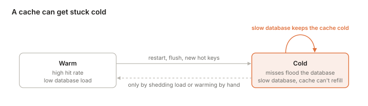
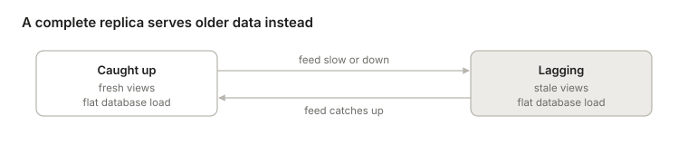

- [Every interface is a place to cache](#every-interface-is-a-place-to-cache)
- [Caches as partial replicas](#caches-as-partial-replicas)
- [Caches by granularity](#caches-by-granularity)
  - [Page granularity: Aurora and Neon](#page-granularity-aurora-and-neon)
  - [Row granularity: DSQL, with no cache in front](#row-granularity-dsql-with-no-cache-in-front)
  - [Query-result granularity: Readyset](#query-result-granularity-readyset)
  - [Key granularity: ElastiCache cache-aside](#key-granularity-elasticache-cache-aside)
- [Cache models: who fills, and where writes go](#cache-models-who-fills-and-where-writes-go)
- [How fresh can a cache be?](#how-fresh-can-a-cache-be)
  - [Fresh enough for this client](#fresh-enough-for-this-client)
  - [The latest value, period](#the-latest-value-period)
  - [What production systems do](#what-production-systems-do)
  - [The fill race](#the-fill-race)
  - [What each mechanism buys](#what-each-mechanism-buys)
- [Cold caches and metastable failure](#cold-caches-and-metastable-failure)
- [Indexes and other derived views](#indexes-and-other-derived-views)
- [Time windows: why subsets must be predicates on rows](#time-windows-why-subsets-must-be-predicates-on-rows)
- [Two questions for every copy](#two-questions-for-every-copy)
- [References](#references)

## Every interface is a place to cache

[Where to cut a database](/programming/where-to-cut-a-database.html) ordered an engine along its data path: SQL, access methods, buffer pool, log, and disk. Every interface on that path is a place to cut the engine apart. Every interface is also a place to put a cache, and the unit a cache holds is just the interface it sits at:

- **Pages** sit below the buffer pool: Aurora's and Neon's compute caches.
- **Rows** sit below SQL: DSQL keeps them inside storage, with no cache in front.
- **Query results** sit at the SQL interface: Readyset keeps one entry per query and parameter values.
- **Keys** sit above SQL, and mean whatever the application decides: Redis or memcached, used cache-aside.

Each is a copy of the data that answers some reads, and each has to answer two questions: what happens on a miss, and who keeps it fresh. This post works through both, then looks at how caches fail under load, and at indexes, the copies every database already keeps.

## Caches as partial replicas

A cache is a replica that is allowed to be missing data. That only works with two things behind it: a complete source that can answer a miss, and a mechanism that keeps cached entries fresh.

This is why a plain Postgres replica can't evict rows LRU-style. A replica answers queries by scanning its own data, so after evicting some rows it can't tell that `SELECT count(*) FROM orders WHERE region = 'EU'` is wrong. The Postgres executor has no notion of a miss that falls back to an upstream source.

## Caches by granularity

Each design below picks a unit of caching, and with it a miss path and a freshness mechanism, the two things [a partial replica](#caches-as-partial-replicas) needs.

### Page granularity: Aurora and Neon

The executor still believes it is scanning complete tables, so arbitrary SQL keeps working. A miss is invisible to it and just becomes a slower read. Eviction is safe because storage is complete and versioned, and can return exactly the page version a query's snapshot needs. [Neon][neon-architecture] has the same shape: a local file cache on the compute node, in front of a pageserver.

### Row granularity: DSQL, with no cache in front

DSQL removes the problem instead of solving it. Its query processors cache no data, so there are no misses to resolve and nothing to invalidate. Two changes make that affordable:

- **One round trip per lookup.** With a page interface, a point lookup walks the B-tree itself (root, internal pages, leaf), and each page is a separate network round trip on a cold cache. DSQL storage serves rows and runs the index traversal next to the data, so the same lookup is one round trip. Filters, projections, and aggregations can be pushed down too.
- **The cache lives inside the authority.** Storage replicas hold the rows themselves, so any memory caching they do is shared by every query processor. It can't serve a wrong value either: every read asks for data as of a timestamp, and a replica answers only once it has applied the journal up to that time.

The cost is a network round trip where Aurora with a warm cache would read memory. DSQL wins when a transaction does a few targeted reads, and loses when a transaction is chatty: N+1 ORM queries, long chains of small statements, or plans that can't be pushed down. [Brooker notes][dsql-reads] this choice is contested, and points to [Ziegler et al.][ziegler-cidr23], the paper behind the [writer archetypes](/programming/where-to-cut-a-database.html#who-may-write-a-row), which argues for large compute-side caches kept coherent.

### Query-result granularity: Readyset

[Readyset][readyset] keeps results only for the parameter values that have been requested, keeps them fresh by pushing the replication stream through a dataflow graph, and recomputes an evicted key with an "upquery", a technique from the [Noria][noria] research system it grew out of. A miss is well defined because each cache is keyed on its query's parameters. That is also the limit: only queries registered in advance can be cached, and everything else goes straight to Postgres. Freshness is automatic but eventual.

### Key granularity: ElastiCache cache-aside

Everything outside the database is the application's job: choosing what a key means, serializing values, and invalidating keys on writes. AWS's console shortcut for [creating an ElastiCache cluster from Aurora settings][elasticache-from-aurora] copies network and security settings, and the application still has to be built to use the cache. TTLs cap how stale an entry can get. Cache-aside also has a classic race between a reader's fill and a writer's delete, covered in [the fill race](#the-fill-race).

|  | Unit of caching | Where the cache lives | Who resolves a miss | Who keeps it fresh | Queries supported |
| --- | --- | --- | --- | --- | --- |
| Aurora / Neon | Page | Compute (buffer pool) | Storage, by page and LSN | Redo stream, consistent | Any SQL |
| DSQL | Row or key range, plus pushed-down work | Inside storage, the source of truth | No miss path needed | Nothing to invalidate | Any SQL |
| Readyset | Result for one query parameter | Separate layer in front of the database | Dataflow upquery | Replication stream, eventual | Registered queries only |
| ElastiCache | App-defined key | Beside the database | The application | The application, plus TTLs | Whatever the app builds |

## Cache models: who fills, and where writes go

Two choices define a cache. On a miss, who fetches the value: the application (cache-aside) or the cache itself (read-through)? On a write, where does the value go: to the cache and the store together (write-through), to the cache now and the store later (write-back), or to the store only, with the cache entry deleted or bypassed (write-around)?

|  | **Write-through:** cache and store together | **Write-back:** cache now, store later | **Write-around:** store only; cache deleted or bypassed |
| --- | --- | --- | --- |
| **Cache-aside:** the app fills on a miss | The app writes the database, then `SET`s the new value in Redis or memcached | The app buffers hot counters (views, likes, rate limits) in Redis and flushes them to the database periodically | Facebook's memcache: write the database, then delete the key, from the app or from a process that tails the database's log. The textbook cache-aside setup |
| **Read-through:** the cache fills itself | [DynamoDB DAX][dax-consistency] item cache; [Hazelcast][hazelcast-mapstore] or Coherence with a MapStore and `write-delay-seconds=0`; Linux page cache under [`O_SYNC`][linux-open]; write-through L1 data caches (IBM POWER, AMD Bulldozer) | Linux page cache by default, with dirty pages flushed by writeback threads; most CPU L1, L2 and L3 caches; Hazelcast MapStore with `write-delay-seconds>0`; battery-backed RAID controllers | CDNs: writes go to the origin, then a purge or a TTL; Readyset; Linux [`O_DIRECT`][linux-open], which bypasses the page cache and invalidates overlapping pages; x86 non-temporal stores (`MOVNT*`) |

**Setting on write races.** In cache-aside with write-through, the app writes the database and then sets the new value in the cache. Two concurrent writers can interleave as `DB ← v1`, `DB ← v2`, `cache ← v2`, `cache ← v1`, and the cache holds v1 until the TTL expires. That is why Facebook and most memcached setups delete on write instead. Deletes commute: two of them in either order leave the same empty slot. Two sets don't.

**Write-back makes the cache responsible for durability.** In cache-aside, that means the application: if Redis dies before the flush, the writes are gone. That is only acceptable where losing a few seconds of updates is fine, which is why the examples are all counters. A database's buffer pool is write-back too, made safe by writing the log through: a commit waits for its redo records, never for its pages. That is [no-force](/programming/where-to-cut-a-database.html#what-the-log-holds). Aurora takes this to the end. The log is written through to storage, and the pages are never written back at all.

**Readyset only half fits its cell.** Its write path is write-around, since it passes writes through to the database. But a write never deletes a cached entry: it updates results from the replication stream instead.

## How fresh can a cache be?

Every cache has to answer "who keeps it fresh". Underneath sit two different questions, and they cost very different amounts. Is this entry fresh enough for this client? And is this entry the latest value, period?

### Fresh enough for this client

The client can carry the answer. After each write, it keeps a token: the log position of its commit, such as an LSN or a hybrid logical clock (HLC) timestamp. The cache stores each entry with the log position as of which it was read from the database. It serves the entry only if that position is at or past the client's token. Otherwise the read falls through to the database.

Store the read position, not the position of the row's last change. Otherwise a row that nobody has touched for a week looks too old to every client that has written since.

This gives read-your-writes. If the client also raises its token to the position of each entry it reads, it gets monotonic reads too: it never sees time go backwards. [Azure Cosmos DB's session consistency][cosmos-consistency] works this way, with a session token per partition. On Postgres, a client can record `pg_current_wal_lsn()` after its commit, and read from a replica only once `pg_last_wal_replay_lsn()` there has passed it.

The token says nothing about other clients' writes. A client with no token, or an old one, will accept a value that someone else has already overwritten.

### The latest value, period

That is linearizability, and the request can't carry enough information to decide it. The newer write may be one this client has never heard of. Only the authority knows, so freshness has to come from the authority, in one of four ways:

- **Validate on read.** Ask the database whether the cached version is still current, as an HTTP request with an ETag in `If-None-Match` does. This is correct, but every read pays a round trip to the authority. The cache saves bandwidth and work, not latency.
- **Invalidate synchronously.** A write is not acknowledged until every cache holding the key has dropped it. CPU caches work this way: under MESI, a core takes exclusive ownership of a line before writing it, which invalidates every other copy. Oracle RAC's Cache Fusion and ScaleStore's page directory apply the same idea to database pages. Every copy slows the write, and a write stalls while a cache holding the key is unreachable.
- **Leases.** In [Gray and Cheriton's design][gray-cheriton-leases] (SOSP 1989), the authority grants a cache the right to serve a key for T seconds. A write must revoke the outstanding leases or wait for them to expire. "Contact every cache" becomes "wait at most T". The price is a dependence on clocks: they need not agree, but they must not drift apart faster than a known rate. [Chubby][chubby] combines both: a write proceeds once every caching client has acknowledged the invalidation or let its lease expire.
- **Put the cache inside the authority.** Aurora's writer caches only data that no other node writes, so nothing can change it behind its back. This is the other side of Aurora's single writer: its buffer pool is always current without any protocol. DSQL's storage replicas follow the journal and can lag it, but every read names a timestamp, and a replica answers only once it has applied the journal up to that time.

### What production systems do

Most caches give up on "latest, period" and invalidate after the fact. The write commits to the database first, and the invalidation follows. Staleness is bounded, not zero.

The invalidation can come from two places. The application can delete the key after it writes, as in cache-aside. Or a separate process can tail the WAL or binlog. The log wins on two counts. It can't lose an invalidation because an application server crashed between the commit and the delete. And it delivers changes in commit order. At Facebook, mcsqueal daemons tail MySQL's commit log and broadcast deletes to every memcache cluster in the region ([Nishtala et al.][memcache-facebook], NSDI 2013). The web server that made the write also deletes the key in its own cluster, which gives that user read-your-writes. Readyset and Aurora replicas follow the log too, but they apply each change instead of deleting the entry.

Staleness is then usually bounded by replication lag, which AWS puts at [usually much less than 100 milliseconds][aurora-replication] for Aurora replicas. The TTL stays, but as a safety net for lost invalidations and bugs, not as the main mechanism.

### The fill race

Deleting instead of setting leaves one race, between a reader's fill and a writer's delete:

1. Reader A misses and reads v1 from the database.
2. Writer B writes v2 and deletes the key.
3. Reader A fills the cache with v1.

The delete lands before the stale fill, so it removes nothing, and v1 lives until its TTL expires. There are two fixes:

- **Fill leases.** [Facebook's memcache][memcache-facebook] hands out a lease token with each miss. A delete voids the outstanding tokens for that key, and memcache rejects a fill that carries a void token. The same tokens also tame thundering herds: memcache issues at most one per key every 10 seconds, and other readers that miss wait briefly and retry.
- **Versioned fills.** The delete leaves a tombstone carrying v2's version instead of an empty slot. A fill succeeds only if its version is at least the stored one, so v1 bounces off the tombstone. Without the tombstone, the empty slot accepts v1 and the race is back.

### What each mechanism buys

A TTL-only cache is a bounded-staleness replica: everything it serves was read from the database at most one TTL ago, or longer if it fills from a lagging replica. Everything else on this list either shrinks that bound or removes it.

| Mechanism | Guarantee | Where it pays | Examples |
| --- | --- | --- | --- |
| TTL only | Stale by at most one TTL | Every write is invisible for up to a TTL | Plain cache-aside |
| Invalidation from the log | Stale by about the replication lag; the TTL is the backstop | A log consumer, plus the fill race if invalidation deletes entries | mcsqueal, Readyset, Aurora replicas |
| Session token | Read-your-writes and monotonic reads, for one client | Nothing for other clients' writes | Cosmos DB sessions, LSN waits on a Postgres replica |
| Validate on read | Latest value | A round trip to the authority on every read | HTTP ETags |
| Synchronous invalidation | Latest value | Writes wait for every copy, and stall on an unreachable cache | MESI, Oracle RAC, ScaleStore |
| Leases | Latest value, if clock drift is bounded | Writes wait up to one lease term | Chubby |
| Cache inside the authority | Latest value | One writer (Aurora), or a network hop per read (DSQL) | Aurora's writer, DSQL storage |

## Cold caches and metastable failure

Freshness is one way a cache can fail. Load is the other. [Marc Brooker][brooker-modes] (2021) points out that a cache with a miss path makes the system **bimodal**. With a high hit rate, the database sees a small share of the load. When the hit rate drops, after a restart, a flush or a shift in which keys are popular, the database gets load it was never sized for.

The cold state can hold itself in place. Misses slow the database, slow fills keep the cache cold, and timeouts and retries add load on top. The system stays down after the trigger is gone, which is a **metastable failure**. Getting back to warm takes outside help: shedding load, or warming the cache by hand.

Most caches run **open loop**: nothing slows the incoming load when the database slows. Brooker's fix is to close the loop with feedback:

- **Coalesce misses.** One fill per key, with other readers waiting for it. [Facebook's fill leases](#the-fill-race) do this as a side effect.
- **Cap concurrent misses.** Past the cap, fail fast instead of queueing on the database.
- **Apply backpressure** to callers when the database slows.

Normal load tests run warm, so they miss the bad state. Test a cold start and a shift in the popular keys.

**A complete replica has no cold mode.** A view fed by the log and holding all its data, such as a leaderboard sorted set or a timeline rebuilt from a replication stream, never sends a read to the database. When its feed falls behind, it serves older data, and database load stays flat:

A cache fails by **overloading the database**. A complete replica fails by **serving older data**, and its lag is measurable. The guarantee lasts only while the replica stays complete. Cap it, say at the last 500 items per timeline, and it becomes a [partial replica](#caches-as-partial-replicas) with a miss path again. The cold mode comes back for whatever falls outside the cap.

## Indexes and other derived views

An index is a derived copy of a table: a projection, sometimes a subset, stored in a different sort order and kept in sync by the database. That makes it a close relative of a replica, and the ways it differs explain what indexes are for.

**Filtered copies share one rule.** The logical replica with a row filter and the partial index both drop the inactive rows using a predicate on the row's contents, and both forbid non-immutable functions such as `now()`. Expression indexes such as `ON lower(email)` have the same rule. The next section explains why.

**Values versus pointers.** The Postgres index and the DynamoDB global secondary index (GSI) hold the same sorted keys. Postgres stores a pointer to each row, so reading any other column means a trip back to the heap. Postgres indexes also carry no MVCC visibility information, so even a covering index (`INCLUDE (...)`) can skip the heap only for pages the visibility map marks all-visible. The GSI copies `status` in and can answer for it alone, but it is maintained asynchronously, while Postgres updates an index in the same transaction as the table write.

**Indexes are optional for reads.** The planner never depends on an index for correctness, because it can always fall back to scanning the complete table. Unique indexes and exclusion constraints are the exception: they enforce constraints, so dropping one changes which writes the database accepts. That is the same property that makes an Aurora page cache safe, and it is what a partial-data replica lacks.

**Distribution turns indexes into replication.** When a table is sharded by primary key, a secondary index sorted by another key can't live on the same shards, so keeping it current becomes a cross-shard replication problem. DynamoDB answers with asynchronous GSIs. Spanner and CockroachDB keep secondary indexes synchronous, at the cost of making those writes multi-shard transactions.

In Martin Kleppmann's framing of ["turning the database inside out"][kleppmann-inside-out], the log is the source of truth, and tables, indexes, replicas, caches, and materialized views are all derived from it. They differ in shape, which rows they keep, sort order, and how fresh they are.

## Time windows: why subsets must be predicates on rows

Postgres can keep a subset of a table elsewhere, but only a subset defined by the row's own contents, never by the clock or by access patterns. The reason is that replication and index maintenance both run when a row is written.

Physical replication can't take a subset at all: WAL describes page changes for the whole cluster. Logical replication can, with per-table publications, column lists, and (since PostgreSQL 15) [row filters][pg-row-filters]. Postgres keeps the subscriber consistent with the filter as rows move in and out, turning an UPDATE into a DELETE or an INSERT on the subscriber when the filter result changes.

**Why "keep the last 10 minutes" doesn't fit.** The visible reason is that a row filter can't call non-immutable functions, so `WHERE ts > now() - interval '10 min'` is rejected. The deeper reason is that a filter is evaluated only when a WAL record for the row passes through. A row ageing out of a window is not a change to that row, so nothing writes WAL when the clock advances. Supporting it would mean a timer that invents DELETEs for rows nobody touched. Partial and expression indexes carry the same immutability rule for the same reason.

**Workarounds and systems that do support it:**

- **Expire on the subscriber.** Subscriber tables are writable, so publish with `publish = 'insert'`, partition the subscriber's table by time, and drop old partitions with `pg_cron`. Dropping a partition is cheap, unlike DELETE plus vacuum. This only fits append-only tables. Updates and deletes never reach the subscriber, so any other table drifts from the source without an error.
- **TimescaleDB** retention policies drop whole chunks, but they run on the primary, and Timescale's replicas are physical, so the window applies to the whole cluster. A short-window copy means a separate node fed by logical replication with its own policy.
- **Materialize** makes time an input. A [temporal filter][materialize-temporal-filters] such as `WHERE mz_now() <= event_ts + INTERVAL '10 minutes'` keeps a view's contents current and retracts rows as they expire, and Materialize can ingest Postgres's replication stream.
- **Storage-level TTLs** express the same idea outside Postgres: ClickHouse table TTLs, Kafka topic retention, and Redis streams trimmed with `MINID`.

An LRU subset is harder still, because it needs a miss path: something complete behind it that can answer a request for evicted data. That is exactly what separates the cache designs in [Caches as partial replicas](#caches-as-partial-replicas).

## Two questions for every copy

Every copy beside the engine answers the same two questions. What happens on a miss? A complete replica has no misses, and it fails by serving older data. A partial one needs a complete source behind it, and it fails by overloading that source when it goes cold. And who keeps it fresh? The application, a process that tails the log, or the authority itself, each buying a [different guarantee](#what-each-mechanism-buys). The unit a cache holds decides how much of SQL still works on top of it: a page cache keeps every query working, while a key cache serves only what the application built.

## References

1. [DSQL Vignette: Reads and Compute][dsql-reads] — Brooker, 2024; query processors, timestamped reads, and the footnote on coherent caches
2. [Neon architecture overview][neon-architecture] — Neon docs; compute with a local file cache in front of pageservers
3. [Readyset][readyset] — query-result caching kept fresh from the replication stream
4. [Noria: dynamic, partially-stateful data-flow for high-performance web applications][noria] — Gjengset et al., OSDI 2018; partial state and upqueries
5. [Creating an ElastiCache cache using Aurora DB cluster settings][elasticache-from-aurora] — AWS docs; what the console shortcut does and doesn't do
6. [Is Scalable OLTP in the Cloud a Solved Problem?][ziegler-cidr23] — Ziegler, Bernstein, Leis, Binnig, CIDR 2023; the data-access archetypes
7. [Consistency levels in Azure Cosmos DB][cosmos-consistency] — Microsoft docs; session tokens for read-your-writes
8. [Leases: An Efficient Fault-Tolerant Mechanism for Distributed File Cache Consistency][gray-cheriton-leases] — Gray and Cheriton, SOSP 1989; bounding invalidation by time
9. [The Chubby lock service for loosely-coupled distributed systems][chubby] — Burrows, OSDI 2006; invalidation acknowledged or lease expired
10. [Scaling Memcache at Facebook][memcache-facebook] — Nishtala et al., NSDI 2013; mcsqueal, delete-on-write, and fill leases
11. [Replication with Amazon Aurora][aurora-replication] — AWS docs; replica lag
12. [DAX and DynamoDB consistency models][dax-consistency] — AWS docs; a read-through, write-through item cache
13. [Hazelcast MapStore configuration][hazelcast-mapstore] — Hazelcast docs; `write-delay-seconds` switches write-through to write-behind
14. [open(2)][linux-open] — Linux man page; `O_SYNC` and `O_DIRECT`
15. [Turning the database inside out][kleppmann-inside-out] — Kleppmann, 2015; the log as source of truth, everything else derived
16. [Logical replication row filters][pg-row-filters] — PostgreSQL docs; filters must be immutable predicates on the row
17. [Temporal filters][materialize-temporal-filters] — Materialize docs; time as an input to a view
18. [Caches, Modes, and Unstable Systems][brooker-modes] — Brooker, 2021; bimodal load from caches, and closing the loop

[dsql-reads]: https://brooker.co.za/blog/2024/12/04/inside-dsql.html "DSQL Vignette: Reads and Compute"
[neon-architecture]: https://neon.com/docs/introduction/architecture-overview "Neon architecture overview"
[readyset]: https://github.com/readysettech/readyset "Readyset"
[noria]: https://www.usenix.org/conference/osdi18/presentation/gjengset "Noria: dynamic, partially-stateful data-flow for high-performance web applications"
[elasticache-from-aurora]: https://docs.aws.amazon.com/AmazonRDS/latest/AuroraUserGuide/creating-elasticache-cluster-with-RDS-settings.html "Creating an ElastiCache cache using Aurora DB cluster settings"
[ziegler-cidr23]: https://www.cidrdb.org/cidr2023/papers/p50-ziegler.pdf "Is Scalable OLTP in the Cloud a Solved Problem?"
[cosmos-consistency]: https://learn.microsoft.com/en-us/azure/cosmos-db/consistency-levels "Consistency levels in Azure Cosmos DB"
[gray-cheriton-leases]: https://dl.acm.org/doi/10.1145/74850.74870 "Leases: An Efficient Fault-Tolerant Mechanism for Distributed File Cache Consistency"
[chubby]: https://research.google/pubs/the-chubby-lock-service-for-loosely-coupled-distributed-systems/ "The Chubby lock service for loosely-coupled distributed systems"
[memcache-facebook]: https://www.usenix.org/conference/nsdi13/technical-sessions/presentation/nishtala "Scaling Memcache at Facebook"
[aurora-replication]: https://docs.aws.amazon.com/AmazonRDS/latest/AuroraUserGuide/Aurora.Replication.html "Replication with Amazon Aurora"
[dax-consistency]: https://docs.aws.amazon.com/amazondynamodb/latest/developerguide/DAX.consistency.html "DAX and DynamoDB consistency models"
[hazelcast-mapstore]: https://docs.hazelcast.com/hazelcast/latest/mapstore/configuration-guide "Hazelcast MapStore configuration"
[linux-open]: https://man7.org/linux/man-pages/man2/open.2.html "open(2)"
[kleppmann-inside-out]: https://martin.kleppmann.com/2015/03/04/turning-the-database-inside-out.html "Turning the database inside-out with Apache Samza"
[pg-row-filters]: https://www.postgresql.org/docs/17/logical-replication-row-filter.html "Logical replication row filters"
[materialize-temporal-filters]: https://materialize.com/docs/guides/temporal-filters/ "Temporal filters"
[brooker-modes]: https://brooker.co.za/blog/2021/08/27/caches.html "Caches, Modes, and Unstable Systems"
