- [The one question every design answers](#the-one-question-every-design-answers)
- [Theory](#theory)
  - [The classic three: sharding, shared nothing, shared disk](#the-classic-three-sharding-shared-nothing-shared-disk)
  - [Who may write a row](#who-may-write-a-row)
  - [Caches as partial replicas](#caches-as-partial-replicas)
  - [How fresh can a cache be?](#how-fresh-can-a-cache-be)
    - [Fresh enough for this client](#fresh-enough-for-this-client)
    - [The latest value, period](#the-latest-value-period)
    - [What production systems do](#what-production-systems-do)
    - [Cache models: who fills, and where writes go](#cache-models-who-fills-and-where-writes-go)
    - [The fill race](#the-fill-race)
    - [What each mechanism buys](#what-each-mechanism-buys)
  - [Cold caches and metastable failure](#cold-caches-and-metastable-failure)
  - [Indexes and other derived views](#indexes-and-other-derived-views)
  - [Time windows: why subsets must be predicates on rows](#time-windows-why-subsets-must-be-predicates-on-rows)
- [Examples](#examples)
  - [Aurora: the log is the database](#aurora-the-log-is-the-database)
  - [Escaping the single writer inside Aurora](#escaping-the-single-writer-inside-aurora)
  - [DSQL: every layer its own fleet](#dsql-every-layer-its-own-fleet)
  - [Caches by granularity](#caches-by-granularity)
    - [Page granularity: Aurora and Neon](#page-granularity-aurora-and-neon)
    - [Query-result granularity: Readyset](#query-result-granularity-readyset)
    - [Key granularity: ElastiCache cache-aside](#key-granularity-elasticache-cache-aside)
    - [No cache in front: DSQL](#no-cache-in-front-dsql)
- [The full comparison](#the-full-comparison)
- [Every design moves the cost somewhere](#every-design-moves-the-cost-somewhere)
- [References](#references)

## The one question every design answers

Every way of scaling a relational database is an answer to one question: which layers of the stack do nodes share, and where do they have to coordinate? The answer decides who may write a given row, what a cache miss costs, and where contention turns into waiting.

A classic engine is one process stacking five layers:

- **SQL:** parse, plan, and execute queries.
- **Transactions:** locks, MVCC, and commit.
- **Caching:** the buffer pool of hot pages.
- **Logging:** the write-ahead (redo) log that makes commits durable.
- **Storage:** pages on disk.

Scaling out means either running many copies of that whole stack and connecting them somewhere, or pulling layers out of the process and turning them into shared services. The classic designs do the first. Aurora pulls out logging. DSQL pulls out everything.

The same lens explains the caches and replicas that sit beside a database (Aurora read replicas, Readyset, Redis) and even indexes. Each is a derived copy of the data, and each has to answer two questions: what happens on a miss, and who keeps it fresh.

The [theory](#theory) builds the vocabulary for four questions:

1. Where do nodes couple?
2. Who may write a given row?
3. Where is hot data cached, and how is a miss resolved?
4. How is the cache kept fresh?

The [examples](#examples) answer them for Aurora, DSQL, and the caches beside them. The [full comparison](#the-full-comparison) then places every design on one map.

## Theory

### The classic three: sharding, shared nothing, shared disk

All three classic designs run complete copies of the stack. They differ only in where the copies connect, and that choice decides what has to travel between nodes.

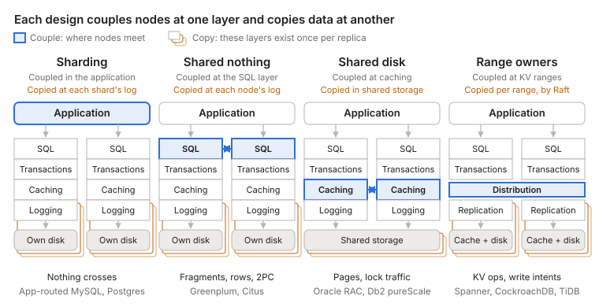

**Sharding** connects nothing. Each shard is an independent database, and the application decides which one to talk to. Cross-shard queries and transactions are the application's problem. A routing proxy such as Vitess, or AWS's Aurora Limitless router, moves that logic out of the application, and the more of it the proxy takes on, the closer the design gets to shared nothing.

**Shared nothing** connects at the SQL layer. Each node owns its partition outright, including its pages, cache, locks, and log, and no node ever touches another's data. A query that spans partitions is split into fragments, sent to the nodes that own the data, and merged. This is function shipping. For `SELECT region, sum(amount) FROM orders GROUP BY region`, each node sums its own rows and returns a small partial result. Joins on a non-partition key shuffle rows between nodes mid-query, and multi-partition writes add a commit protocol such as two-phase commit (2PC).

**Shared disk** connects at caching and storage. Every node can read every page, so the hard part is keeping their caches coherent and their locks global. This is data shipping: pages and lock messages cross between nodes. Oracle RAC (Cache Fusion) and Db2 pureScale are the long-lived examples.

A single primary with read replicas is not in this picture. It has one stack that writes, plus copies that only follow it. That is the starting point for [Aurora](#aurora-the-log-is-the-database).

### Who may write a row

[Ziegler, Bernstein, Leis and Binnig][ziegler-cidr23] (CIDR 2023) argue that shared nothing versus shared disk no longer predicts how a system scales. Aurora and SQL Hyperscale share storage but allow only one writer, and a MySQL primary with private-storage replicas behaves the same way. They classify systems by who may update a data item instead:

- **Single-Writer:** one read-write node; reads scale with replicas, writes do not.
- **Partitioned-Writer:** one writer per partition; uniform writes scale, but a hot key is always handled by the same node.
- **Shared-Writer, coherent cache:** any node writes, and compute caches are kept consistent by a coherence protocol. Hot data is replicated on demand, so skewed reads scale too.
- **Shared-Writer, no coherent cache:** any node writes, and every access goes to shared storage, which can become the bottleneck under skew.

In their analysis no archetype scales skewed writes, and they advocate the coherent-cache design, building it as ScaleStore.

### Caches as partial replicas

A cache is a replica that is allowed to be missing data. That only works with two things behind it: a complete source that can answer a miss, and a mechanism that keeps cached entries fresh. The common designs differ in the unit they cache, and DSQL avoids putting a cache in front of the source at all. The [examples](#caches-by-granularity) go through each.

This is why a plain Postgres replica can't evict rows LRU-style. A replica answers queries by scanning its own data, so after evicting some rows it can't tell that `SELECT count(*) FROM orders WHERE region = 'EU'` is wrong. The Postgres executor has no notion of a miss that falls back to an upstream source.

### How fresh can a cache be?

Every cache has to answer "who keeps it fresh". Underneath sit two different questions, and they cost very different amounts. Is this entry fresh enough for this client? And is this entry the latest value, period?

#### Fresh enough for this client

The client can carry the answer. After each write, it keeps a token: the log position of its commit, such as an LSN or a hybrid logical clock (HLC) timestamp. The cache stores each entry with the log position as of which it was read from the database. It serves the entry only if that position is at or past the client's token. Otherwise the read falls through to the database.

Store the read position, not the position of the row's last change. Otherwise a row that nobody has touched for a week looks too old to every client that has written since.

This gives read-your-writes. If the client also raises its token to the position of each entry it reads, it gets monotonic reads too: it never sees time go backwards. [Azure Cosmos DB's session consistency][cosmos-consistency] works this way, with a session token per partition. On Postgres, a client can record `pg_current_wal_lsn()` after its commit, and read from a replica only once `pg_last_wal_replay_lsn()` there has passed it.

The token says nothing about other clients' writes. A client with no token, or an old one, will accept a value that someone else has already overwritten.

#### The latest value, period

That is linearizability, and the request can't carry enough information to decide it. The newer write may be one this client has never heard of. Only the authority knows, so freshness has to come from the authority, in one of four ways:

- **Validate on read.** Ask the database whether the cached version is still current, as an HTTP request with an ETag in `If-None-Match` does. This is correct, but every read pays a round trip to the authority. The cache saves bandwidth and work, not latency.
- **Invalidate synchronously.** A write is not acknowledged until every cache holding the key has dropped it. CPU caches work this way: under MESI, a core takes exclusive ownership of a line before writing it, which invalidates every other copy. Oracle RAC's Cache Fusion and ScaleStore's page directory apply the same idea to database pages. Every copy slows the write, and a write stalls while a cache holding the key is unreachable.
- **Leases.** In [Gray and Cheriton's design][gray-cheriton-leases] (SOSP 1989), the authority grants a cache the right to serve a key for T seconds. A write must revoke the outstanding leases or wait for them to expire. "Contact every cache" becomes "wait at most T". The price is a dependence on clocks: they need not agree, but they must not drift apart faster than a known rate. [Chubby][chubby] combines both: a write proceeds once every caching client has acknowledged the invalidation or let its lease expire.
- **Put the cache inside the authority.** Aurora's writer and DSQL's storage replicas cache only data they own, so nothing can change it behind their back. This is the other side of Aurora's single writer: its buffer pool is always current without any protocol, because no other node writes.

#### What production systems do

Most caches give up on "latest, period" and invalidate after the fact. The write commits to the database first, and the invalidation follows. Staleness is bounded, not zero.

The invalidation can come from two places. The application can delete the key after it writes, as in cache-aside. Or a separate process can tail the WAL or binlog. The log wins on two counts. It can't lose an invalidation because an application server crashed between the commit and the delete. And it delivers changes in commit order. At Facebook, mcsqueal daemons tail MySQL's commit log and broadcast deletes to every memcache cluster in the region ([Nishtala et al.][memcache-facebook], NSDI 2013). The web server that made the write also deletes the key in its own cluster, which gives that user read-your-writes. Readyset and Aurora replicas follow the log too, but they apply each change instead of deleting the entry.

Staleness is then usually bounded by replication lag, which AWS puts at [usually much less than 100 milliseconds][aurora-replication] for Aurora replicas. The TTL stays, but as a safety net for lost invalidations and bugs, not as the main mechanism.

#### Cache models: who fills, and where writes go

Two choices define a cache. On a miss, who fetches the value: the application (cache-aside) or the cache itself (read-through)? On a write, where does the value go: to the cache and the store together (write-through), to the cache now and the store later (write-back), or to the store only, with the cache entry deleted or bypassed (write-around)?

|  | **Write-through:** cache and store together | **Write-back:** cache now, store later | **Write-around:** store only; cache deleted or bypassed |
| --- | --- | --- | --- |
| **Cache-aside:** the app fills on a miss | The app writes the database, then `SET`s the new value in Redis or memcached | The app buffers hot counters (views, likes, rate limits) in Redis and flushes them to the database periodically | Facebook's memcache: write the database, then delete the key, from the app or from mcsqueal. The textbook cache-aside setup |
| **Read-through:** the cache fills itself | [DynamoDB DAX][dax-consistency] item cache; [Hazelcast][hazelcast-mapstore] or Coherence with a MapStore and `write-delay-seconds=0`; Linux page cache under [`O_SYNC`][linux-open]; write-through L1 data caches (IBM POWER, AMD Bulldozer) | Linux page cache by default, with dirty pages flushed by writeback threads; most CPU L1, L2 and L3 caches; Hazelcast MapStore with `write-delay-seconds>0`; battery-backed RAID controllers | CDNs: writes go to the origin, then a purge or a TTL; Readyset; Linux [`O_DIRECT`][linux-open], which bypasses the page cache and invalidates overlapping pages; x86 non-temporal stores (`MOVNT*`) |

**Setting on write races.** In cache-aside with write-through, the app writes the database and then sets the new value in the cache. Two concurrent writers can interleave as `DB ← v1`, `DB ← v2`, `cache ← v2`, `cache ← v1`, and the cache holds v1 until the TTL expires. That is why Facebook and most memcached setups delete on write instead. Deletes commute: two of them in either order leave the same empty slot. Two sets don't.

**Write-back makes the cache responsible for durability.** In cache-aside, that means the application: if Redis dies before the flush, the writes are gone. That is only acceptable where losing a few seconds of updates is fine, which is why the examples are all counters. A database's buffer pool is write-back too, made safe by writing the log through: a commit waits for its redo records, never for its pages. Aurora takes this to the end. The log is written through to storage, and the pages are never written back at all.

**Write-allocate follows the column.** On a write miss, does the cache load the line? Write-back caches almost always do, so that the next write hits. Write-through caches usually don't, since the store gets the write anyway. A non-temporal store asks for no-write-allocate one instruction at a time: the program says it won't reread this data, so the CPU shouldn't evict something useful to make room for it.

**Readyset only half fits its cell.** Its write path is write-around, since it passes writes through to the database. But it never deletes a cached entry: as the previous section describes, it updates results from the replication stream instead.

#### The fill race

Deleting instead of setting leaves one race, between a reader's fill and a writer's delete:

1. Reader A misses and reads v1 from the database.
2. Writer B writes v2 and deletes the key.
3. Reader A fills the cache with v1.

The delete lands before the stale fill, so it removes nothing, and v1 lives until its TTL expires. There are two fixes:

- **Fill leases.** [Facebook's memcache][memcache-facebook] hands out a lease token with each miss. A delete voids the outstanding tokens for that key, and memcache rejects a fill that carries a void token. The same tokens also tame thundering herds: memcache issues at most one per key every 10 seconds, and other readers that miss wait briefly and retry.
- **Versioned fills.** The delete leaves a tombstone carrying v2's version instead of an empty slot. A fill succeeds only if its version is at least the stored one, so v1 bounces off the tombstone. Without the tombstone, the empty slot accepts v1 and the race is back.

#### What each mechanism buys

A TTL-only cache is a bounded-staleness replica: everything it serves was read from the database at most one TTL ago, or longer if it fills from a lagging replica. Everything else on this list either shrinks that bound or removes it.

| Mechanism | Guarantee | Where it pays | Examples |
| --- | --- | --- | --- |
| TTL only | Stale by at most one TTL | Every write is invisible for up to a TTL | Plain cache-aside |
| Invalidation from the log | Stale by about the replication lag; the TTL is the backstop | A log consumer, plus the fill race | mcsqueal, Readyset, Aurora replicas |
| Session token | Read-your-writes and monotonic reads, for one client | Nothing for other clients' writes | Cosmos DB sessions, LSN waits on a Postgres replica |
| Validate on read | Latest value | A round trip to the authority on every read | HTTP ETags |
| Synchronous invalidation | Latest value | Writes wait for every copy, and stall on an unreachable cache | MESI, Oracle RAC, ScaleStore |
| Leases | Latest value, if clock drift is bounded | Writes wait up to one lease term | Chubby |
| Cache inside the authority | Latest value | One writer (Aurora), or a network hop per read (DSQL) | Aurora's writer, DSQL storage |

### Cold caches and metastable failure

Freshness is one way a cache can fail. Load is the other. [Marc Brooker][brooker-modes] (2021) points out that a cache with a miss path makes the system **bimodal**. With a high hit rate, the database sees a small share of the load. When the hit rate drops, after a restart, a flush or a shift in which keys are popular, the database gets load it was never sized for.

The cold state can hold itself in place. Misses slow the database, slow fills keep the cache cold, and timeouts and retries add load on top. The system stays down after the trigger is gone, which is a **metastable failure**. Getting back to warm takes outside help: shedding load, or warming the cache by hand.

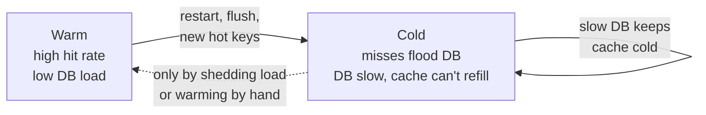

Most caches run **open loop**: nothing slows the incoming load when the database slows. Brooker's fix is to close the loop with feedback:

- **Coalesce misses.** One fill per key, with other readers waiting for it. [Facebook's fill leases](#the-fill-race) do this as a side effect.
- **Cap concurrent misses.** Past the cap, fail fast instead of queueing on the database.
- **Apply backpressure** to callers when the database slows.

Normal load tests run warm, so they miss the bad state. Test a cold start and a shift in the popular keys.

**A complete replica has no cold mode.** A view fed by the log and holding all its data, such as a leaderboard sorted set or a timeline rebuilt from a replication stream, never sends a read to the database. When its feed falls behind, it serves older data, and database load stays flat:

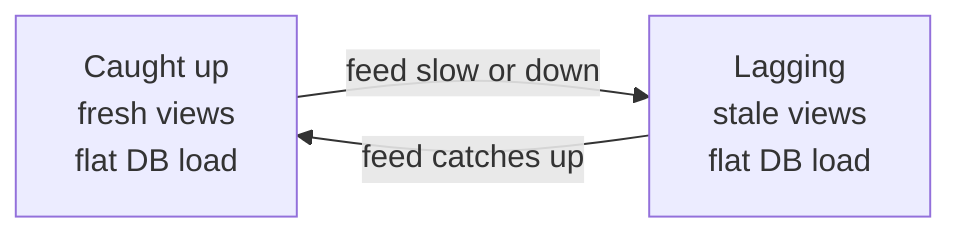

A cache fails by **overloading the database**. A complete replica fails by **serving older data**, and its lag is measurable. The guarantee lasts only while the replica stays complete. Cap it, say at the last 500 items per timeline, and it becomes a [partial replica](#caches-as-partial-replicas) with a miss path again. The cold mode comes back for whatever falls outside the cap.

### Indexes and other derived views

An index is a derived copy of a table: a projection, sometimes a subset, stored in a different sort order and kept in sync by the database. That makes it a close relative of a replica, and the ways it differs explain what indexes are for.

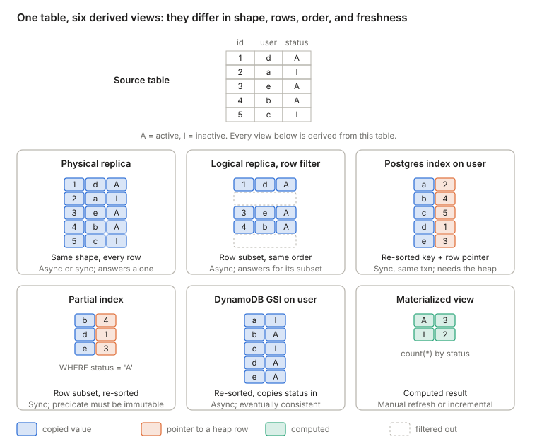

**Filtered copies share one rule.** The logical replica with a row filter and the partial index both drop the inactive rows using a predicate on the row's contents, and both forbid non-immutable functions such as `now()`. Expression indexes such as `ON lower(email)` have the same rule. The next section explains why.

**Values versus pointers.** The Postgres index and the DynamoDB global secondary index (GSI) hold the same sorted keys. Postgres stores a pointer to each row, so reading any other column means a trip back to the heap. Postgres indexes also carry no MVCC visibility information, so even a covering index (`INCLUDE (...)`) can skip the heap only for pages the visibility map marks all-visible. The GSI copies `status` in and can answer for it alone, but it is maintained asynchronously, while Postgres updates an index in the same transaction as the table write.

**Indexes are optional.** The planner never depends on an index for correctness, because it can always fall back to scanning the complete table. That is the same property that makes an Aurora page cache safe, and it is what a partial-data replica lacks.

**Distribution turns indexes into replication.** When a table is sharded by primary key, a secondary index sorted by another key can't live on the same shards, so keeping it current becomes a cross-shard replication problem. DynamoDB answers with asynchronous GSIs. Spanner and CockroachDB keep secondary indexes synchronous, at the cost of making those writes multi-shard transactions.

In Martin Kleppmann's framing of ["turning the database inside out"][kleppmann-inside-out], the log is the source of truth, and tables, indexes, replicas, caches, and materialized views are all derived from it. They differ in shape, which rows they keep, sort order, and how fresh they are.

### Time windows: why subsets must be predicates on rows

Postgres can keep a subset of a table elsewhere, but only a subset defined by the row's own contents, never by the clock or by access patterns. The reason is that replication and index maintenance both run when a row is written.

Physical replication can't take a subset at all: WAL describes page changes for the whole cluster. Logical replication can, with per-table publications, column lists, and (since PostgreSQL 15) [row filters][pg-row-filters]. Postgres keeps the subscriber consistent with the filter as rows move in and out, turning an UPDATE into a DELETE or an INSERT on the subscriber when the filter result changes.

**Why "keep the last 10 minutes" doesn't fit.** The visible reason is that a row filter can't call non-immutable functions, so `WHERE ts > now() - interval '10 min'` is rejected. The deeper reason is that a filter is evaluated only when a WAL record for the row passes through. A row ageing out of a window is not a change to that row, so nothing writes WAL when the clock advances. Supporting it would mean a timer that invents DELETEs for rows nobody touched. Partial and expression indexes carry the same immutability rule for the same reason.

**Workarounds and systems that do support it:**

- **Expire on the subscriber.** Subscriber tables are writable, so publish with `publish = 'insert'`, partition the subscriber's table by time, and drop old partitions with `pg_cron`. Dropping a partition is cheap, unlike DELETE plus vacuum.
- **TimescaleDB** retention policies drop whole chunks, but they run on the primary, and Timescale's replicas are physical, so the window applies to the whole cluster. A short-window copy means a separate node fed by logical replication with its own policy.
- **Materialize** makes time an input. A [temporal filter][materialize-temporal-filters] such as `WHERE mz_now() <= event_ts + INTERVAL '10 minutes'` keeps a view's contents current and retracts rows as they expire, and Materialize can ingest Postgres's replication stream.
- **Storage-level TTLs** express the same idea outside Postgres: ClickHouse table TTLs, Kafka topic retention, and Redis streams trimmed with `MINID`.

An LRU subset is harder still, because it needs a miss path: something complete behind it that can answer a request for evicted data. That is exactly what separates the cache designs in [Caches as partial replicas](#caches-as-partial-replicas).

## Examples

### Aurora: the log is the database

Aurora keeps a single writer running the full SQL and transaction engine, but moves logging and page storage into a shared, quorum-replicated service. The writer sends storage only redo records, never pages.

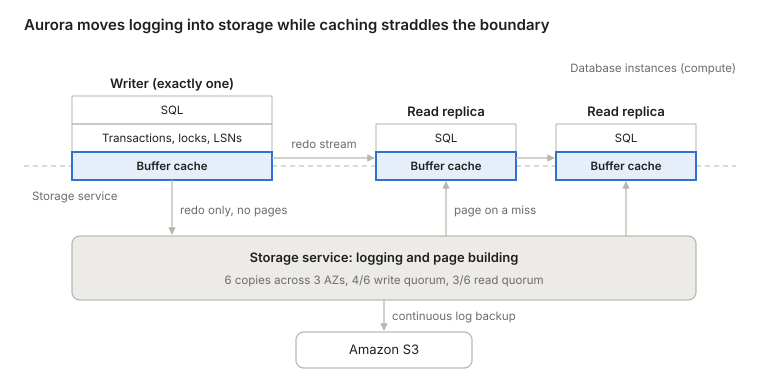

In [Werner Vogels' description][aurora-ascendant] (2019), Aurora treated caching and logging as the layers ripe for reinvention. The storage service builds page images from the log on demand, so instances never flush dirty pages. Every write goes to six copies across three AZs and succeeds once four acknowledge. Up to 15 read replicas share the same volume.

**Why the cache sits on the boundary.** The buffer pool is RAM on each instance, so physically it belongs to compute. Its rules, though, are set by the storage contract:

- **Misses:** a miss is a request to storage for a page at a specific log sequence number (LSN).
- **Eviction:** a dirty page can be dropped once its redo is durable, because storage can always rebuild it. There is no flush.
- **Replica caches:** each replica follows the writer's redo stream, applying records to pages it holds and, per the [Aurora paper][aurora-paper], discarding the rest.

**Why there is still exactly one writer.** The lock manager and the buffer pool are in-memory structures inside one process, and the writer assigns every LSN. Storage persists the log and replays it, but never decides its order. Aurora offloaded the log's durability and page construction, not its authorship. A second writer would need distributed locking and cache coherence, which brings back the shared-disk problem.

### Escaping the single writer inside Aurora

AWS has tried three ways to get more than one writer out of Aurora. Two of them still have exactly one writer underneath, and the one that adds real write capacity does it by sharding.

- **Multi-Master** (Aurora MySQL 5.6 only) was the shared-disk column from the first picture: several writers on one volume, with conflicting writes surfacing as aborts at the storage layer. It never caught on and has been discontinued.
- **[Global Database write forwarding][aurora-write-forwarding]** lets read replicas in secondary regions accept writes, but they forward them to the primary region's writer. It is a convenience, not a second writer.
- **[Aurora Limitless Database][aurora-limitless]** (PostgreSQL) shards tables behind a router. Each shard is a full single-writer Aurora stack, and the router runs distributed transactions when a statement spans shards.

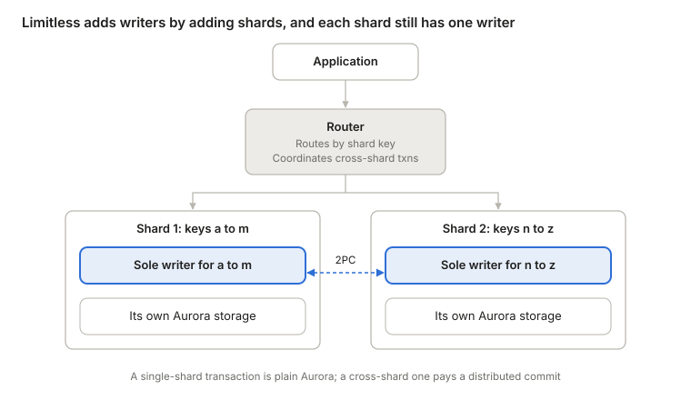

Limitless gives more writers in aggregate because there are more shards. It is not a symmetric multi-writer design: every key range has exactly one owner, and a write must reach that owner. In the first picture it sits between sharding and shared nothing, with the coupling moved out of the application into AWS's router.

### DSQL: every layer its own fleet

Aurora DSQL keeps Postgres's SQL engine but replaces everything beneath it with separately scaled services, so any query processor can write any row. Aurora pulled one layer out of the stack; DSQL pulls out all of them.

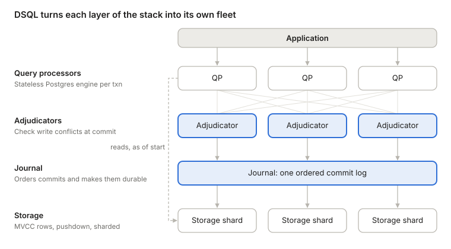

Marc Brooker's walkthrough ([Reads and Compute][dsql-reads], [Transactions and Durability][dsql-writes]) describes each piece:

- **Query processors** run a customized Postgres engine in a Firecracker microVM per transaction. They never talk to each other, and they keep no buffer pool apart from rarely-changing metadata such as table definitions.
- **Reads** pick a start timestamp from EC2's precision clock and ask storage for data as of that time, using MVCC. They take no locks, need no leader, and can go to the nearest replica.
- **Commits** use optimistic concurrency control. The write set goes to the adjudicators that own its keys, which abort the transaction if another one has written those keys since its start. Isolation is snapshot isolation (Postgres REPEATABLE READ), so write skew is possible.
- **The journal** orders and persists committed transactions. Unlike Aurora's storage, which persists one writer's log, the journal is the log that many independent writers append to. Appending is the commit.
- **Storage** is sharded and serves rows, not pages, and can run filters, projections, and aggregations next to the data.

In the classic picture, DSQL is closest to shared disk, because it shares everything below SQL. But the coupling moves from caching to commit and log, and no node runs the whole stack.

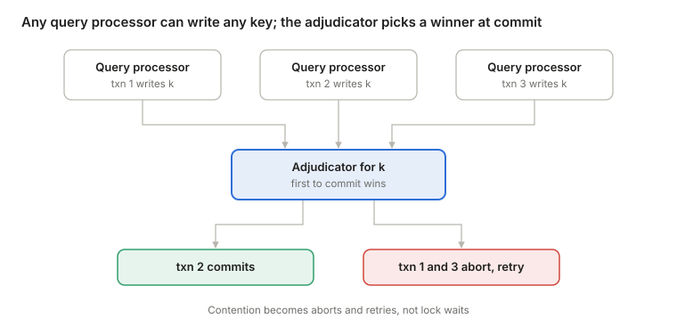

The cost moves rather than disappears. Lock waits become aborts the client must retry, so hot keys can cause abort storms. Every commit pays a round trip through the adjudicators and the journal, which crosses regions in a multi-region cluster. Transactions also have size and duration limits, and some Postgres features were missing at launch; check the current docs before relying on one.

### Caches by granularity

Each design below picks a unit of caching, and with it a miss path and a freshness mechanism, the two things [a partial replica](#caches-as-partial-replicas) needs.

#### Page granularity: Aurora and Neon

The executor still believes it is scanning complete tables, so arbitrary SQL keeps working. A miss is invisible to it and just becomes a slower read. Eviction is safe because storage is complete and versioned, and can return exactly the page version a query's snapshot needs. [Neon][neon-architecture] has the same shape: a local file cache on the compute node, in front of a pageserver.

#### Query-result granularity: Readyset

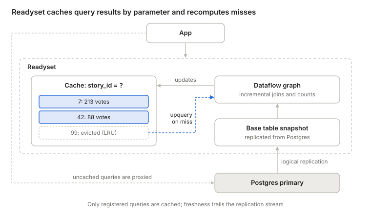

[Readyset][readyset] keeps results only for the parameter values that have been requested, keeps them fresh by pushing the replication stream through a dataflow graph, and recomputes an evicted key with an "upquery", a technique from the [Noria][noria] research system it grew out of. A miss is well defined because each cache is keyed on its query's parameters. That is also the limit: only queries registered in advance can be cached, and everything else goes straight to Postgres. Freshness is automatic but eventual.

#### Key granularity: ElastiCache cache-aside

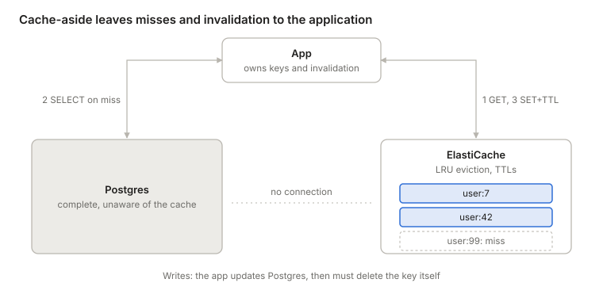

Everything outside the database is the application's job: choosing what a key means, serializing values, and invalidating keys on writes. AWS's console shortcut for [creating an ElastiCache cluster from Aurora settings][elasticache-from-aurora] copies network and security settings, and the application still has to be built to use the cache. TTLs cap how stale an entry can get. Cache-aside also has a classic race between a reader's fill and a writer's delete, covered in [the fill race](#the-fill-race).

#### No cache in front: DSQL

DSQL removes the problem instead of solving it. Its query processors cache no data, so there are no misses to resolve and nothing to invalidate. Two changes make that affordable:

- **One round trip per lookup.** With a page interface, a point lookup walks the B-tree itself (root, internal pages, leaf), and each page is a separate network round trip on a cold cache. DSQL storage serves rows and runs the index traversal next to the data, so the same lookup is one round trip. Filters, projections, and aggregations can be pushed down too.
- **The cache lives inside the authority.** Storage replicas own their shards, so any memory caching they do can't go stale, is shared by every query processor, and is versioned because every read asks for data as of a timestamp.

The cost is a network round trip where Aurora with a warm cache would read memory. DSQL wins when a transaction does a few targeted reads, and loses when a transaction is chatty: N+1 ORM queries, long chains of small statements, or plans that can't be pushed down. [Brooker notes][dsql-reads] this choice is contested, and points to [Ziegler et al.][ziegler-cidr23], the paper behind the [writer archetypes](#who-may-write-a-row), which argues for large compute-side caches kept coherent.

|  | Unit of caching | Where the cache lives | Who resolves a miss | Who keeps it fresh | Queries supported |
| --- | --- | --- | --- | --- | --- |
| Aurora / Neon | Page | Compute (buffer pool) | Storage, by page and LSN | Redo stream, consistent | Any SQL |
| Readyset | Result for one query parameter | Separate layer in front of the database | Dataflow upquery | Replication stream, eventual | Registered queries only |
| ElastiCache | App-defined key | Beside the database | The application | The application, plus TTLs | Whatever the app builds |
| DSQL | Row or key range, plus pushed-down work | Inside storage, the source of truth | No miss path needed | Nothing to invalidate | Any SQL |

## The full comparison

Place every design on two axes: where its nodes couple, and who may write a row, using the [writer archetypes](#who-may-write-a-row) from Ziegler et al. Any-node writes then only appear where something below SQL arbitrates them, either a coherent cache or a commit-time conflict check.

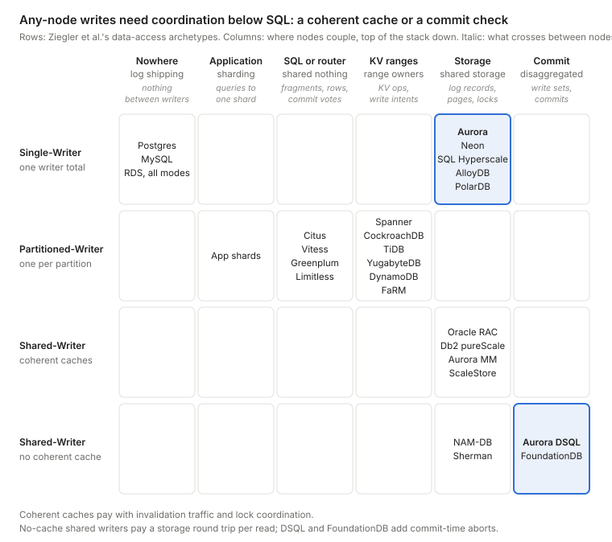

DSQL, which postdates the paper, is a Shared-Writer without a coherent cache, by my classification: any query processor writes and none of them caches data. That is the archetype the paper scores weakest on latency, and DSQL counters it with row-level storage and pushdown, a lever the paper itself names. It is the choice Brooker's footnote invites readers to compare with this paper. [FoundationDB][foundationdb] has the same shape, with commit proxies, conflict-checking resolvers, and transaction logs lining up with DSQL's query processors, adjudicators, and journal.

The paper also sharpens a few placements. Aurora Multi-Master was a Shared-Writer that checked conflicts optimistically at storage and kept caches only weakly coherent by propagating committed updates. PolarDB Serverless uses a coherence protocol for its read-only nodes but stays Single-Writer. FaRM lets any node read any other node's memory, but writes go to the partition owner, so it is Partitioned-Writer. The paper separates true multi-master, where several nodes update their own replicas of an item, from pseudo multi-master, where any node accepts a write and forwards it to the owner; Aurora Global Database write forwarding is the second kind. Deterministic databases such as [Calvin][calvin] are left out of the taxonomy.

| System | Archetype (Ziegler et al.) | Nodes couple at | Who writes a row | Concurrency control | Hot data cached in |
| --- | --- | --- | --- | --- | --- |
| Postgres or MySQL, primary + replicas | Single-Writer | Nowhere: replicas replay the primary's log | Primary only | Locks + MVCC | Each node's buffer pool |
| Amazon RDS, Multi-AZ instance | Single-Writer | Below the engine: synchronous block-level replication to a standby that serves no reads | Primary only | Locks + MVCC | Primary's buffer pool |
| Amazon RDS, read replicas | Single-Writer | Nowhere: the engine's native asynchronous replication | Primary only | Locks + MVCC | Each instance's buffer pool |
| Amazon RDS, Multi-AZ DB cluster | Single-Writer | Native replication, semisynchronous: one of two readers must acknowledge each commit | Writer only | Locks + MVCC | Each instance's buffer pool |
| Aurora (provisioned) | Single-Writer | Shared storage (log is the database) | One writer | Locks + MVCC on the writer | Compute buffer pool; misses served by storage |
| Neon | Single-Writer | WAL service + pageservers | One writer | Postgres locks + MVCC | Buffer pool + local file cache |
| Azure SQL Hyperscale | Single-Writer | Log service + page servers | One writer | SQL Server locks + versioning | Compute memory + local SSD cache |
| AlloyDB | Single-Writer | Log-based shared storage | One writer | Postgres locks + MVCC | Buffer pool + columnar cache |
| PolarDB, PolarDB Serverless | Single-Writer | Shared storage; Serverless keeps read-only nodes current with a coherence protocol | One writer | Locks + MVCC | Buffer pool |
| App-level sharding | Partitioned-Writer | Application | One writer per shard | Per shard | Per shard |
| Citus, Vitess, Aurora Limitless | Partitioned-Writer | Router or SQL layer | One writer per shard | Per shard; 2PC across shards | Per shard |
| Teradata, Greenplum | Partitioned-Writer | SQL layer (MPP) | Partition owner | Per node; 2PC across nodes | Per node |
| Spanner, CockroachDB, TiDB, YugabyteDB | Partitioned-Writer | Transactional KV layer | Leader of each range | Timestamps + 2PC over consensus groups | Per node, per range |
| DynamoDB | Partitioned-Writer | Partitioned key-value storage | Leader of each partition | Per item; transactions across items | Per partition |
| FaRM (research) | Partitioned-Writer | Shared memory over RDMA for reads; writes go to owners | Partition owner | Optimistic | Distributed memory |
| Oracle RAC, Db2 pureScale | Shared-Writer, coherent cache | Caching + storage | Any node | Global locks, coherent cache | Coherent cache across nodes |
| Aurora Multi-Master (retired) | Shared-Writer, weakly coherent cache | Caching + storage | Any writer | OCC at storage; losing writes abort | Per node, refreshed by update propagation |
| ScaleStore (research) | Shared-Writer, coherent cache | Directory-based page invalidation | Any node | Page-level consistency; transactions not yet built | Each compute node, kept coherent |
| NAM-DB, Sherman (research) | Shared-Writer, no coherent cache | Remote memory over RDMA | Any node | NAM-DB: timestamp-based snapshot isolation | Little or none on compute |
| Aurora DSQL | Shared-Writer, no coherent cache (my classification) | Commit + journal | Any query processor | OCC at adjudicators; snapshot isolation | Inside storage; rows + pushdown |
| FoundationDB | Shared-Writer, no coherent cache (my classification) | Commit + transaction logs | Any client | OCC at resolvers; serializable | Storage servers |
| Calvin (research) | Not covered: deterministic | Sequencer orders transactions before execution | Partition owners, in the agreed order | Deterministic; no 2PC | Per partition |
| Readyset | Read path only | Replication stream | Reads only | Not applicable | Query results by parameter, LRU |
| ElastiCache (cache-aside) | Read path only | Application | Reads only | Not applicable | App-defined keys, LRU + TTL |
| Materialize | Read path only | Replication stream | Reads only | Not applicable | Incrementally maintained views, including time windows |

The RDS rows follow AWS's [Multi-AZ DB cluster documentation][rds-multi-az-cluster]. The Aurora, DSQL, Readyset, ElastiCache, and Materialize rows follow the sources linked earlier. Archetypes and the PolarDB, FaRM, ScaleStore, NAM-DB, Sherman, and Aurora Multi-Master details come from Ziegler et al. Other details are summarized from public descriptions; check each system's current docs before relying on one.

## Every design moves the cost somewhere

No design removes the cost of coordination; each chooses where to pay it.

| Design | What it buys | Where it pays |
| --- | --- | --- |
| Sharding | Independent shards, no coordination | Application code for anything that spans shards |
| Shared nothing | Transparent cross-partition queries | Fragment shipping, shuffles, and 2PC for multi-partition writes |
| Shared disk | Any node writes any row | Cache coherence and global locking |
| Aurora | Cheap durability, fast failover, read replicas sharing one volume | One writer; a cold cache costs page round trips |
| DSQL | Any query processor writes; every layer scales on its own | Contention becomes aborts; every read and commit crosses the network |
| Caches beside the database | Cheap reads at a chosen granularity | A miss path and a freshness mechanism, owned by someone |

Two questions sort almost any new system quickly. Where do its nodes have to agree, and what crosses the wire when they do? And for every copy of the data, what happens on a miss, and who keeps it fresh?

## References

1. [Amazon Aurora ascendant][aurora-ascendant] — Vogels, 2019; why Aurora reinvented the caching and logging layers
2. [Amazon Aurora: Design Considerations for High Throughput Cloud-Native Relational Databases][aurora-paper] — Verbitski et al., SIGMOD 2017; the log is the database, and how replica caches follow it
3. [Aurora Global Database write forwarding][aurora-write-forwarding] — AWS docs; secondary regions forward writes to the one writer
4. [Aurora PostgreSQL Limitless Database][aurora-limitless] — AWS docs; single-writer shards behind a router
5. [DSQL Vignette: Reads and Compute][dsql-reads] — Brooker, 2024; query processors, timestamped reads, and the footnote on coherent caches
6. [DSQL Vignette: Transactions and Durability][dsql-writes] — Brooker, 2024; adjudicators, the journal, and optimistic commits
7. [Neon architecture overview][neon-architecture] — Neon docs; compute with a local file cache in front of pageservers
8. [Readyset][readyset] — query-result caching kept fresh from the replication stream
9. [Noria: dynamic, partially-stateful data-flow for high-performance web applications][noria] — Gjengset et al., OSDI 2018; partial state and upqueries
10. [Creating an ElastiCache cache using Aurora DB cluster settings][elasticache-from-aurora] — AWS docs; what the console shortcut does and doesn't do
11. [Is Scalable OLTP in the Cloud a Solved Problem?][ziegler-cidr23] — Ziegler, Bernstein, Leis, Binnig, CIDR 2023; the data-access archetypes
12. [Consistency levels in Azure Cosmos DB][cosmos-consistency] — Microsoft docs; session tokens for read-your-writes
13. [Leases: An Efficient Fault-Tolerant Mechanism for Distributed File Cache Consistency][gray-cheriton-leases] — Gray and Cheriton, SOSP 1989; bounding invalidation by time
14. [The Chubby lock service for loosely-coupled distributed systems][chubby] — Burrows, OSDI 2006; invalidation acknowledged or lease expired
15. [Scaling Memcache at Facebook][memcache-facebook] — Nishtala et al., NSDI 2013; mcsqueal, delete-on-write, and fill leases
16. [Replication with Amazon Aurora][aurora-replication] — AWS docs; replica lag
17. [DAX and DynamoDB consistency models][dax-consistency] — AWS docs; a read-through, write-through item cache
18. [Hazelcast MapStore configuration][hazelcast-mapstore] — Hazelcast docs; `write-delay-seconds` switches write-through to write-behind
19. [open(2)][linux-open] — Linux man page; `O_SYNC` and `O_DIRECT`
20. [Turning the database inside out][kleppmann-inside-out] — Kleppmann, 2015; the log as source of truth, everything else derived
21. [Logical replication row filters][pg-row-filters] — PostgreSQL docs; filters must be immutable predicates on the row
22. [Temporal filters][materialize-temporal-filters] — Materialize docs; time as an input to a view
23. [FoundationDB: A Distributed Unbundled Transactional Key Value Store][foundationdb] — Zhou et al., SIGMOD 2021; proxies, resolvers, and logs
24. [Calvin: Fast Distributed Transactions for Partitioned Database Systems][calvin] — Thomson et al., SIGMOD 2012; deterministic ordering before execution
25. [Multi-AZ DB cluster deployments][rds-multi-az-cluster] — AWS docs; semisynchronous replication to two readers

[aurora-ascendant]: https://www.allthingsdistributed.com/2019/03/amazon-aurora-design-cloud-native-relational-database.html "Amazon Aurora ascendant: How we designed a cloud-native relational database"
[aurora-paper]: https://www.allthingsdistributed.com/files/p1041-verbitski.pdf "Amazon Aurora: Design Considerations for High Throughput Cloud-Native Relational Databases"
[aurora-write-forwarding]: https://docs.aws.amazon.com/AmazonRDS/latest/AuroraUserGuide/aurora-global-database-write-forwarding.html "Aurora Global Database write forwarding"
[aurora-limitless]: https://docs.aws.amazon.com/AmazonRDS/latest/AuroraUserGuide/limitless.html "Aurora PostgreSQL Limitless Database"
[dsql-reads]: https://brooker.co.za/blog/2024/12/04/inside-dsql.html "DSQL Vignette: Reads and Compute"
[dsql-writes]: https://brooker.co.za/blog/2024/12/05/inside-dsql-writes.html "DSQL Vignette: Transactions and Durability"
[neon-architecture]: https://neon.com/docs/introduction/architecture-overview "Neon architecture overview"
[readyset]: https://github.com/readysettech/readyset "Readyset"
[noria]: https://www.usenix.org/conference/osdi18/presentation/gjengset "Noria: dynamic, partially-stateful data-flow for high-performance web applications"
[elasticache-from-aurora]: https://docs.aws.amazon.com/AmazonRDS/latest/AuroraUserGuide/creating-elasticache-cluster-with-RDS-settings.html "Creating an ElastiCache cache using Aurora DB cluster settings"
[ziegler-cidr23]: https://www.cidrdb.org/cidr2023/papers/p50-ziegler.pdf "Is Scalable OLTP in the Cloud a Solved Problem?"
[cosmos-consistency]: https://learn.microsoft.com/en-us/azure/cosmos-db/consistency-levels "Consistency levels in Azure Cosmos DB"
[gray-cheriton-leases]: https://dl.acm.org/doi/10.1145/74850.74870 "Leases: An Efficient Fault-Tolerant Mechanism for Distributed File Cache Consistency"
[chubby]: https://research.google/pubs/the-chubby-lock-service-for-loosely-coupled-distributed-systems/ "The Chubby lock service for loosely-coupled distributed systems"
[memcache-facebook]: https://www.usenix.org/conference/nsdi13/technical-sessions/presentation/nishtala "Scaling Memcache at Facebook"
[aurora-replication]: https://docs.aws.amazon.com/AmazonRDS/latest/AuroraUserGuide/Aurora.Replication.html "Replication with Amazon Aurora"
[dax-consistency]: https://docs.aws.amazon.com/amazondynamodb/latest/developerguide/DAX.consistency.html "DAX and DynamoDB consistency models"
[hazelcast-mapstore]: https://docs.hazelcast.com/hazelcast/latest/mapstore/configuration-guide "Hazelcast MapStore configuration"
[linux-open]: https://man7.org/linux/man-pages/man2/open.2.html "open(2)"
[kleppmann-inside-out]: https://martin.kleppmann.com/2015/03/04/turning-the-database-inside-out.html "Turning the database inside-out with Apache Samza"
[pg-row-filters]: https://www.postgresql.org/docs/17/logical-replication-row-filter.html "Logical replication row filters"
[materialize-temporal-filters]: https://materialize.com/docs/guides/temporal-filters/ "Temporal filters"
[foundationdb]: https://www.foundationdb.org/files/fdb-paper.pdf "FoundationDB: A Distributed Unbundled Transactional Key Value Store"
[calvin]: http://cs.yale.edu/homes/thomson/publications/calvin-sigmod12.pdf "Calvin: Fast Distributed Transactions for Partitioned Database Systems"
[rds-multi-az-cluster]: https://docs.aws.amazon.com/AmazonRDS/latest/UserGuide/multi-az-db-clusters-concepts.html "Multi-AZ DB cluster deployments"
