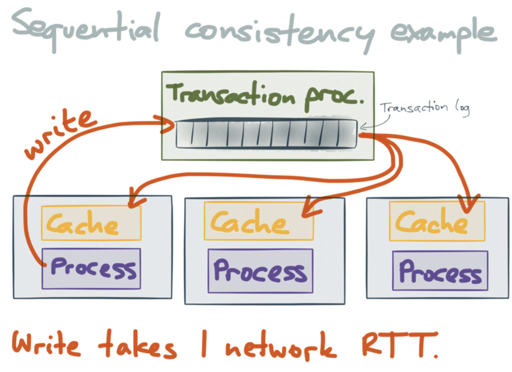
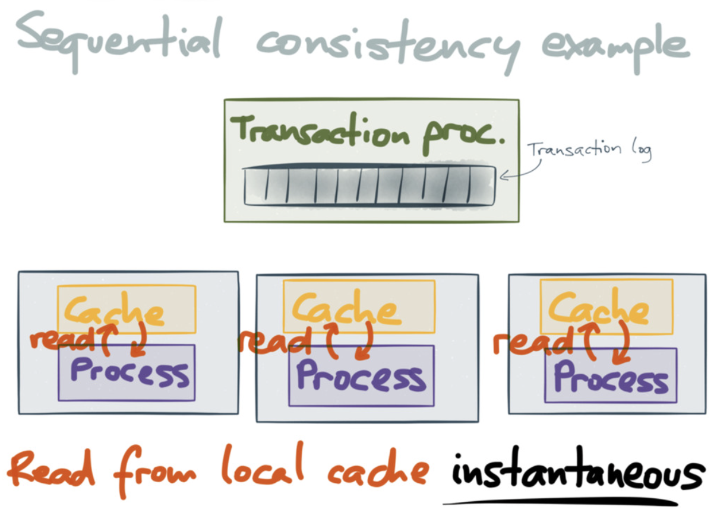

How fast can reads be? Every read pays for the answers to two questions. How fresh must it be? And does anyone need to know it happened?

These are the two axes that [Abadi][abadi-iso-cons] pulls apart: consistency and isolation. Consistency says what an operation must see of the operations that finished before it began. Isolation says how concurrent transactions may interleave. Most named levels bundle one of each, so this post takes the axes one at a time and asks what each costs a read. Writes pay on both axes too, and [Carving a database at its joints](/programming/carving-a-database-at-its-joints.html) covers who checks their conflicts.

Picture a replicated system as one log of writes. Each replica applies some prefix of the log, and a read on a replica returns the state after that prefix. The first question, consistency, asks how far along the log a read must land. The weaker the rule, the more replicas can serve the read, and the less they must talk to anyone first.

If every read and write goes through one place, such as one shared memory or one leader, you get the strongest answer for free. But every operation pays a trip to that place. Weaker rules get cheaper only once you add caches or local replicas and serve reads from them.

The second question, isolation, matters only inside read-write transactions. A read whose value feeds a write must be visible to whoever checks conflicts, or a later write could change the value before the transaction commits. Snapshot isolation answers "no one needs to know," which makes its reads cheap. Serializability answers "someone does," and there are three ways to tell them.

- [How fresh must a read be?](#how-fresh-must-a-read-be)
  - [Any prefix](#any-prefix)
  - [Your own order](#your-own-order)
  - [Real time](#real-time)
  - [Linearizable reads off the leader](#linearizable-reads-off-the-leader)
- [Does anyone need to know a read happened?](#does-anyone-need-to-know-a-read-happened)
  - [Snapshot isolation: no](#snapshot-isolation-no)
  - [Serializable: yes](#serializable-yes)
- [Both axes at once](#both-axes-at-once)

## How fresh must a read be?

Consistency is a ladder, and each rung adds one rule. Each rung has a name for one object, and a name for serializable transactions: [Abadi][abadi-iso-cons] points out that one-copy, strong session, and strict serializability differ only in consistency. The last column is what each rung costs a replica:

| A read must respect… | One object | Serializable transactions | So the replica must have caught up with… |
| --- | --- | --- | --- |
| some prefix of the writes | consistent prefix | one-copy serializable | nothing: any prefix will do |
| plus each client's own order | sequential consistency | strong session serializable | this client's own writes and reads |
| plus real-time order | linearizable | strict serializable | everyone's finished writes |

The sections below climb the ladder, mostly with one-object examples. Each rung costs reads more.

### Any prefix

A read that may land on any prefix is the cheapest kind: any replica can answer, in one round. A client may even read a new value from replica A, then an old one from replica B. [Terry's][terry-baseball] *bounded staleness* caps how far behind a read may be.

CockroachDB's [follower reads][crdb-follower] offer both. Any replica serves a read a few seconds in the past, at a timestamp the leaseholder has *closed*: it has promised that no write will land at or below that time. A bounded-staleness read picks the freshest closed timestamp within the bound.

### Your own order

[Attiya and Welch][attiya-welch] (1994) build sequential consistency from one sequencer and a cache per process, and use it to show what each rung costs:

From [Kleppmann's talk][kleppmann-aw] on the paper.

Every write goes through one sequencer, which broadcasts the writes in order to every process's cache. There are two ways to make one operation free:

- **Fast reads:** a write waits until it comes back to the writer's own cache, one round trip. Reads are local.
- **Fast writes:** a write returns at once. A read waits until all of this process's pending writes have reached its cache.

You can't make both free. A read plus a write must take at least d, the message delay. Most workloads read far more than they write, so most designs pick fast reads.

What you lose is real-time order across processes: a write that has returned may still be missing from another process's cache.

Each process here reads its own cache. A client that hops between replicas must carry a token, such as its last log position, and read only from replicas at least that far along. For transactions, the same rule is what [Daudjee and Salem][daudjee-salem] call strong session serializability.

When the delay is the same on every link, with no uncertainty, this design is also linearizable. A write reaches every process at the same moment, so when the writer sees it, everyone does. Attiya and Welch show the same thing for clocks: with perfectly synchronized clocks, the two models cost the same.

### Real time

Linearizability adds real-time order, and it has a price that sequential consistency doesn't. Attiya and Welch prove that when message delay can vary by u, no algorithm has reads faster than u/4 or writes faster than u/2. So neither operation can be free.

### Linearizable reads off the leader

A linearizable read must see every write that finished before the read started. A replica can know it is caught up in only three ways: ask someone who knows, be told by every write, or rely on a promise about time.

Each of the first two takes a trick from sequential consistency and widens "my own" to "everyone's":

| | Sequential consistency | Linearizable |
| --- | --- | --- |
| Fast reads | a write waits until **its own** replica has it | a write waits until **every** replica that serves reads has it (be told) |
| Fast writes | a read waits until **its own** pending writes are applied | a read waits until the replica has caught up with **everyone's** finished writes (ask) |
| No delay uncertainty | — | waiting a known time proves a write reached everyone (promise about time) |

**1. Ask someone who knows.** Reads pay a message. Writes stay fast.

- [ABD][abd] (Attiya, Bar-Noy, Dolev 1995): read from a majority and take the newest value. Then write it back to a majority before returning. Without the write-back, two readers can see the new value and then the old one while a write is in flight. A read costs two majority round trips. Dynamo-style `R + W > N` without the write-back is not linearizable.
- [Gryff][gryff] (NSDI 2020) runs reads and writes as multi-writer ABD, and read-modify-writes through EPaxos. A read-modify-write returns only once a quorum has executed it, so later quorum reads see it. A read finishes in one round when every replica in its quorum reports the same version. Otherwise it writes the newest value back. Reads and writes never wait on consensus, so they finish even when it stalls.
- [Ellis Michael][michael-waitfree-reads] (2020) applies the same idea to Multi-Paxos. The leader replies to a writer only once a majority has executed the write and knows it's committed, so writes pay one more round. A read asks a majority. If they all report the same decisions, the read is done in one round. If not, the reader hands out the missing decisions until a majority is up to date, then returns. Reads never wait for the log to make progress, so they finish even when the log is stuck: they are wait-free.
- Raft ReadIndex ([Ongaro's thesis][raft-thesis], §6.4; etcd, TiKV follower reads): the follower asks the leader for its commit index. The leader confirms with a majority that it is still leader. The follower waits until it has applied up to that index, then reads locally. The leader sends one small message, and the follower serves the data. Spanner's strong reads on followers work the same way, with a timestamp in place of an index.
- [Chain replication][chain] (van Renesse and Schneider 2004): writes enter at the head and flow down to the tail. Reads go to the tail. That is linearizable, but every read hits one node, so reads don't scale. [CRAQ][craq] (Terrace and Freedman 2009) lets every node serve reads. A node whose latest version of a key is still *dirty*, not yet acknowledged by the tail, asks the tail which version is committed. Keys that are mostly read stay clean, so nodes rarely ask.

**2. Be told by every write.** Writes pay. Reads are local.

- [Hermes][hermes] (2020), [Paxos quorum leases][quorum-leases] (2014), and [Megastore][megastore] (2011): a write must reach every replica that serves local reads before it completes. One slow replica slows every write.

**3. Rely on a promise about time.** Clocks pay.

- Leader leases: the leader reads locally, because no one else can become leader until its lease expires. This is correct only while clock drift stays within its bound. CockroachDB's leaseholder works this way.
- Closed timestamps in the future: CockroachDB's [global tables][crdb-global]. The leaseholder promises that no write will land below a time slightly in the future. Writes take future timestamps and wait for those times to pass before they return. Followers then serve current reads.
- Bounded clocks over multiversioned storage: DSQL. Each transaction picks a start time from EC2's precision clock, which [Brooker][dsql-reads] describes as "an accurate clock with strong error bounds." Every read asks storage for data as of that time, on any shard or replica, and sees every transaction that committed before it. No leader or lease is involved, only the clock bound.

Which way fits depends on how writes replicate. A fresh read must overlap the replicas a write reached, or ask someone who knows which writes committed. [Replication in four cells](/programming/replication-in-four-cells.html) sorts replica groups by two questions: does one leader order the writes, and does each write reach a quorum or every replica? Each way fits one kind of group:

| Way | Fits | Why it works |
| --- | --- | --- |
| Ask the leader | one leader, writes reach a quorum: Raft ReadIndex | the leader knows the commit index |
| Ask a quorum | no leader, writes reach a quorum: ABD, Gryff | any read quorum overlaps every write quorum |
| Be told by every write | writes reach every replica that serves reads: Hermes, quorum leases | every reader holds every write, so one reader is enough |
| Rely on a promise about time | one leader with a lease, or bounded clocks with no leader: DSQL | the clock stands in for the round to a quorum |

The trade-off doesn't go away. For local reads to be both linearizable and cheap, writes must pay: they reach every reader, or they wait out the clock. Otherwise, reads pay with a message to someone who knows.

## Does anyone need to know a read happened?

A read-only transaction at a fixed snapshot needs no one to know about it. The snapshot is already fixed, and no later write can change what it saw. A read inside a read-write transaction is different, because its value feeds the transaction's writes.

The classic example is two doctors on call, where at least one must stay on call. Transactions T1 and T2 each read both rows, see two doctors on call, and each takes their own doctor off. T1 read the row T2 writes, and T2 read the row T1 writes. If no one notices those reads, both commit, and nobody is on call. That anomaly is called write skew.

### Snapshot isolation: no

Snapshot isolation ([Berenson et al. 1995][berenson-critique]) gives each transaction a snapshot as of its start. At commit, it aborts the transaction only if a concurrent transaction wrote one of the same keys. Reads go straight to storage at the snapshot and leave no trace, which makes snapshot isolation the isolation level whose reads go brrrr.

The price is write skew. The doctors write different rows, so there's no write-write conflict, and both commit. Postgres's REPEATABLE READ is snapshot isolation, and so is Oracle's SERIALIZABLE, despite its name.

DSQL takes this route on purpose. Its adjudicators see only each transaction's write set at commit, and reads never reach them. [Brooker][dsql-writes] describes the result as "strong consistency and snapshot isolation": reads are fresh, but write skew is possible. A query that needs a read checked can opt in with `SELECT … FOR UPDATE`, which adds the row to the write set.

### Serializable: yes

Under serializability, someone must learn about reads. Every multiversion (MVCC) design keeps old versions so that reads don't block writes. What sets the protocols apart is who learns about reads, and when:

| How reads become known | Protocol | When it's checked | Examples |
| --- | --- | --- | --- |
| Read locks | MV2PL | as the read happens | Spanner's read-write transactions, YugabyteDB under serializable |
| Read timestamps at the data owner | MVTO | when a later write arrives | CockroachDB's timestamp cache, TiKV's `max_ts` |
| The reader sends its read set at commit | MVOCC | at commit | FoundationDB's resolvers |
| Read markers, plus edges between concurrent transactions | SSI | at commit | Postgres SERIALIZABLE (SIREAD locks) |

The doctors meet each protocol differently:

- **MV2PL:** each transaction holds read locks on both rows. Each one's write waits for the other's read lock. The deadlock detector aborts one.
- **MVTO** (T1 at 10, T2 at 11): T2 read T1's row at 11, so T1's write at 10 would land beneath that read, and it is refused. CockroachDB pushes T1 to 12 instead. Then T1 must *refresh*: check that nothing it read changed between 10 and 12. It finds T2's intent on a row it read, so T1 waits or retries.
- **MVOCC:** at commit, each transaction checks whether anything in its read set was written since it read it. The first to commit passes. The second finds the first one's write and aborts.
- **SSI** ([Cahill, Röhm, Fekete 2008][cahill-ssi]): each transaction runs under snapshot isolation, but reads leave markers. T1 read what T2 wrote, and T2 read what T1 wrote, so the read-write edges run both ways. One transaction aborts at commit. The check is conservative, so it sometimes aborts transactions that were safe.

This is also why CockroachDB's follower reads are safe. A follower can't update the leaseholder's timestamp cache. But it serves only reads at or below the closed timestamp, where no write can land anyway, so nobody needs to learn about them.

## Both axes at once

The two questions are independent, and every system answers both. Strict serializability is the top of both ladders: serializable isolation plus linearizable consistency. A serializable protocol gives you one order. Strict serializability asks that order to match real time. Real systems sit all over the grid:

| | Stale reads allowed | Linearizable reads |
| --- | --- | --- |
| Single-key operations | etcd's serializable reads | etcd's default reads |
| Snapshot isolation | Postgres REPEATABLE READ on an async replica | Postgres REPEATABLE READ on the primary, DSQL |
| Serializable | CockroachDB's follower reads | Spanner, Postgres SERIALIZABLE on the primary |

Spanner reaches the bottom-right corner by making each commit wait out TrueTime's error bound. [Bailis][bailis-lin-ser] notes that two-phase locking with long read and write locks also gets there, while some MVCC implementations don't.

CockroachDB sits between the two columns, and runs one mechanism for each question:

- The **uncertainty interval** handles freshness. Clocks drift, so a read that finds a value stamped just after its own timestamp can't tell whether that write committed before the read began. CockroachDB treats any value within the maximum clock offset, 500 ms by default, as uncertain. The read moves past that value, and restarts the transaction if the move would change what it has already read. Spanner pays at write time instead: each commit waits out TrueTime's error bound, a few milliseconds, before it returns. So in CockroachDB reads pay for freshness, and in Spanner writes do.
- The **timestamp cache** handles conflicts. A write is pushed above any read of its key.

Both live at the leaseholder, which makes them easy to blur. And CockroachDB stops short of strict serializability. Two transactions on disjoint keys can commit in an order that contradicts real time, which [Cockroach Labs][crdb-atomic-clocks] calls "causal reverse." In their words: "While Spanner provides linearizability, CockroachDB only goes as far as to claim serializability." Abadi calls this level strong partition serializable: linearizable for transactions that touch the same keys, and weaker across keys.

So MVTO gives you one order, and strict serializability needs timestamps that respect real time. One timestamp server, like TiDB's, hands out timestamps in real-time order. So do clocks with bounded error plus a commit wait, as in Spanner.

## References <!-- omit in toc -->

1. [Linearizability versus Serializability][bailis-lin-ser] — Bailis, 2014; one object in real time versus transactions in any order, and strict serializability as both
2. [Replicated Data Consistency Explained Through Baseball][terry-baseball] — Terry, CACM 2013; consistent prefix, bounded staleness, and other read guarantees
3. [Follower Reads][crdb-follower] — CockroachDB docs; stale and bounded-staleness reads from any replica, at a closed timestamp
4. [Sequential Consistency versus Linearizability][attiya-welch] — Attiya, Welch, TOCS 1994; why linearizability costs more than sequential consistency when message delays vary
5. [Attiya and Welch: Sequential Consistency versus Linearizability][kleppmann-aw] — Kleppmann, Papers We Love, 2015; a talk on the paper, with the cache figures used here
6. [Lazy Database Replication with Ordering Guarantees][daudjee-salem] — Daudjee, Salem, ICDE 2004; strong session serializability
7. [Sharing Memory Robustly in Message-Passing Systems][abd] — Attiya, Bar-Noy, Dolev, JACM 1995; quorum reads with a write-back phase (ABD)
8. [Gryff: Unifying Consensus and Shared Registers][gryff] — Burke, Cheng, Lloyd, NSDI 2020; ABD for reads and writes, EPaxos for read-modify-writes
9. [Consensus: Bridging Theory and Practice][raft-thesis] — Ongaro, PhD thesis, Stanford, 2014; Raft, and ReadIndex in §6.4
10. [Chain Replication for Supporting High Throughput and Availability][chain] — van Renesse, Schneider, OSDI 2004; writes at the head, reads at the tail
11. [Object Storage on CRAQ][craq] — Terrace, Freedman, USENIX ATC 2009; chain replication with reads at every node
12. [Hermes: A Fast, Fault-Tolerant and Linearizable Replication Protocol][hermes] — Katsarakis et al., ASPLOS 2020; writes invalidate every replica, so reads stay local
13. [Paxos Quorum Leases][quorum-leases] — Moraru, Andersen, Kaminsky, SoCC 2014; read leases on a subset of replicas, which every write must reach
14. [Megastore: Providing Scalable, Highly Available Storage for Interactive Services][megastore] — Baker et al., CIDR 2011; local reads from any up-to-date replica
15. [Global Tables][crdb-global] — CockroachDB docs; closed timestamps in the future, for current reads from any replica
16. [DSQL Vignette: Reads and Compute][dsql-reads] — Brooker, 2024; reads as of a start time from a clock with bounded error
17. [A Critique of ANSI SQL Isolation Levels][berenson-critique] — Berenson et al., SIGMOD 1995; defines snapshot isolation and shows it allows write skew
18. [DSQL Vignette: Transactions and Durability][dsql-writes] — Brooker, 2024; optimistic commits that check only write sets
19. [Serializable Isolation for Snapshot Databases][cahill-ssi] — Cahill, Röhm, Fekete, SIGMOD 2008; serializable snapshot isolation (SSI)
20. [Living Without Atomic Clocks][crdb-atomic-clocks] — Cockroach Labs; how CockroachDB orders transactions without TrueTime, and "causal reverse"
21. [An explanation of the difference between Isolation levels vs. Consistency levels][abadi-iso-cons] — Abadi, 2019; isolation covers concurrent transactions, consistency covers what later operations see, and most named levels bundle both
22. [Linearizable, Wait-free Reads of Replicated State Machines][michael-waitfree-reads] — Michael, 2020; ABD-style reads on Multi-Paxos that never wait for the log

[bailis-lin-ser]: http://www.bailis.org/blog/linearizability-versus-serializability/ "Linearizability versus Serializability"
[terry-baseball]: https://dl.acm.org/doi/10.1145/2500500 "Replicated Data Consistency Explained Through Baseball"
[daudjee-salem]: https://doi.org/10.1109/ICDE.2004.1320016 "Lazy Database Replication with Ordering Guarantees"
[gryff]: https://www.usenix.org/conference/nsdi20/presentation/burke "Gryff: Unifying Consensus and Shared Registers"
[kleppmann-aw]: https://martin.kleppmann.com/2015/07/08/attiya-welch-at-papers-we-love.html "Attiya and Welch: Sequential Consistency versus Linearizability"
[attiya-welch]: https://dl.acm.org/doi/10.1145/176575.176576 "Sequential Consistency versus Linearizability"
[abd]: https://dl.acm.org/doi/10.1145/200836.200869 "Sharing Memory Robustly in Message-Passing Systems"
[raft-thesis]: https://github.com/ongardie/dissertation "Consensus: Bridging Theory and Practice"
[chain]: https://www.usenix.org/legacy/event/osdi04/tech/full_papers/renesse/renesse.pdf "Chain Replication for Supporting High Throughput and Availability"
[craq]: https://www.usenix.org/legacy/event/usenix09/tech/full_papers/terrace/terrace.pdf "Object Storage on CRAQ"
[hermes]: https://dl.acm.org/doi/10.1145/3373376.3378496 "Hermes: A Fast, Fault-Tolerant and Linearizable Replication Protocol"
[quorum-leases]: https://dl.acm.org/doi/10.1145/2670979.2671001 "Paxos Quorum Leases"
[megastore]: https://www.cidrdb.org/cidr2011/Papers/CIDR11_Paper32.pdf "Megastore: Providing Scalable, Highly Available Storage for Interactive Services"
[crdb-follower]: https://www.cockroachlabs.com/docs/stable/follower-reads "CockroachDB: Follower Reads"
[crdb-global]: https://www.cockroachlabs.com/docs/stable/global-tables "CockroachDB: Global Tables"
[berenson-critique]: https://dl.acm.org/doi/10.1145/223784.223785 "A Critique of ANSI SQL Isolation Levels"
[dsql-reads]: https://brooker.co.za/blog/2024/12/04/inside-dsql.html "DSQL Vignette: Reads and Compute"
[dsql-writes]: https://brooker.co.za/blog/2024/12/05/inside-dsql-writes.html "DSQL Vignette: Transactions and Durability"
[cahill-ssi]: https://dl.acm.org/doi/10.1145/1376616.1376690 "Serializable Isolation for Snapshot Databases"
[crdb-atomic-clocks]: https://www.cockroachlabs.com/blog/living-without-atomic-clocks/ "Living Without Atomic Clocks"
[abadi-iso-cons]: https://dbmsmusings.blogspot.com/2019/08/an-explanation-of-difference-between.html "An explanation of the difference between Isolation levels vs. Consistency levels"
[michael-waitfree-reads]: https://ellismichael.com/blog/2020/04/13/linearizable-waitfree-reads/ "Linearizable, Wait-free Reads of Replicated State Machines"
