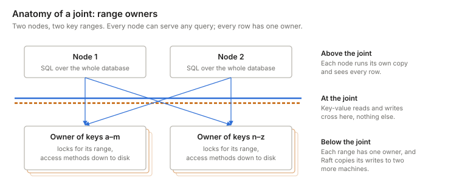
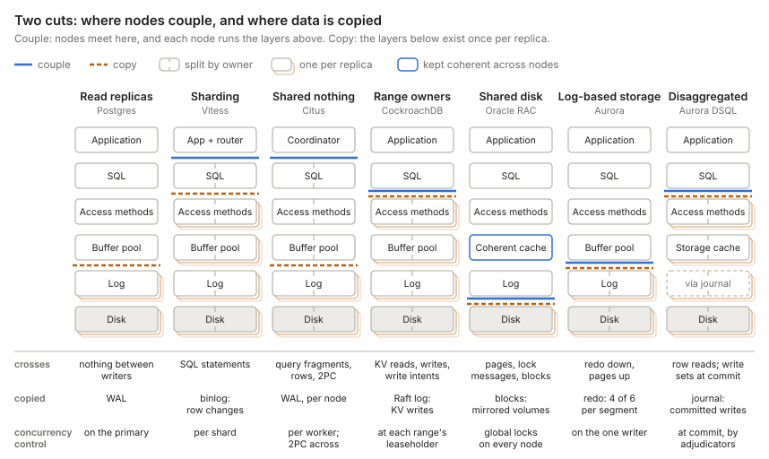
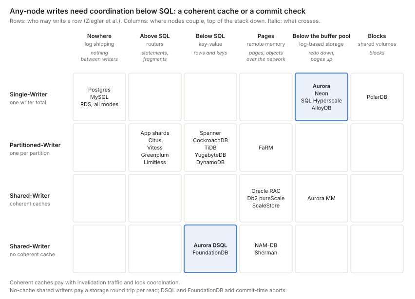
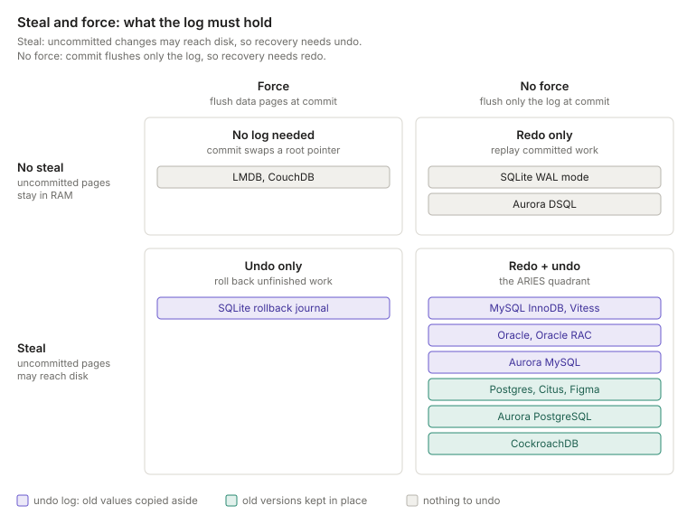

- [The one question every design answers](#the-one-question-every-design-answers)
- [Cutting the engine](#cutting-the-engine)
  - [Where nodes couple](#where-nodes-couple)
  - [Two cuts: couple and copy](#two-cuts-couple-and-copy)
  - [Who may write a row](#who-may-write-a-row)
  - [Aurora: the log is the database](#aurora-the-log-is-the-database)
  - [DSQL: every layer its own fleet](#dsql-every-layer-its-own-fleet)
- [The cache inside the engine](#the-cache-inside-the-engine)
  - [What the log holds](#what-the-log-holds)
    - [Undo log or old versions in place](#undo-log-or-old-versions-in-place)
    - [What each design's log holds](#what-each-designs-log-holds)
- [Every design moves the cost somewhere](#every-design-moves-the-cost-somewhere)
- [Appendix: every system in one table](#appendix-every-system-in-one-table)
- [References](#references)

## The one question every design answers

Every way of scaling a relational database answers one question: where do you cut the engine apart, and what crosses the cut? The answer decides who may write a given row, what a cache miss costs, and where contention turns into waiting.

[Hellerstein, Stonebraker and Hamilton][hss-architecture] (2007) draw a database engine as modules, not layers. Under the query processor sits one box, the transactional storage manager, with four modules inside: access methods, a buffer manager, a lock manager, and a log manager. They call each other in every direction. To talk about cuts, this post orders them along the data path:

- **SQL:** parse, plan, and execute queries. The executor asks for rows.
- **Access methods:** tables and indexes, stored as heaps, B-trees, or LSM trees. They turn a request for a row or a key into reads and writes of pages.
- **Buffer pool:** hot pages in RAM, the buffer manager's cache.
- **Log:** a record of every change. A commit is durable once its log records are on disk. [What the log holds](#what-the-log-holds) shows that its contents vary by design.
- **Disk:** blocks that hold the log and the data files.

In a classic engine, the buffer pool writes pages straight to the data files, so why does the log sit above the disk? The log decides the order: a dirty page may reach disk only after the log records that describe it. And the log is the truth. After a crash, recovery rebuilds pages from the last checkpoint plus the log, so the data files are a copy derived from it. [Aurora](#aurora-the-log-is-the-database) takes this literally and never writes data pages at all.

Concurrency control doesn't fit on the path. The executor and the access methods both call the lock manager, MVCC versions live inside pages, and a commit goes through the log. So the figure draws it beside the stack, and this post treats it as a second axis: where it sits relative to the cut decides [who may write a row](#who-may-write-a-row).

Each interface is a place to cut, and what crosses it is what each network call carries. Sharding cuts above SQL and sends whole statements. Range owners cut below SQL and send key-value reads and writes. Aurora cuts below the buffer pool: redo records go down, and pages come back up. Few designs cut between the access methods and the buffer pool, because a B-tree lookup touches several pages one after another, and each would cost a round trip. Research systems such as NAM-DB and Sherman do it anyway, over RDMA.

Scaling out means either running the whole engine on many nodes and connecting them at one cut, or pulling the layers below a cut out into shared services. The classic designs do the first. Aurora pulls out the log and the disk. DSQL pulls out everything below SQL, and concurrency control with it.

This post has two parts:

1. [Cutting the engine](#cutting-the-engine): where nodes couple, where data is copied, and who may write a row. Aurora and DSQL are the worked examples.
2. [The cache inside the engine](#the-cache-inside-the-engine): the buffer pool, and the log that makes it safe.

A follow-up post, [Database caches](/programming/db-caches.html), uses the same stack to place the caches that sit beside the engine.

## Cutting the engine

### Where nodes couple

Designs that run the whole engine on every node differ in where the nodes connect. Call that cut the coupling layer. Above it, each node runs its own copy of every layer, and that copy sees the whole database. Below it, the data is shared or split among owners, and nodes reach it only through the interface at the cut. Correctness rests on what crosses there. Systems sometimes add messages higher up to go faster, but they never depend on them to stay correct.

The figure shows the three ideas this part builds on, using range owners. Nodes couple where requests cross between them. Each row has an owner that enforces its locks, which decides who may write it. And the data is copied somewhere, so it survives a lost machine.

**Sharding** cuts above SQL. Each shard is an independent database, and the application decides which one to talk to. Cross-shard queries and transactions are the application's problem. A routing proxy such as Vitess, or AWS's Aurora Limitless router, moves that logic out of the application. [Figma's DBProxy][figma-dbproxy] sits at the thin end. It routes by shard key and runs simple scatter-gather queries, but it gives up atomic cross-shard writes, and its shards never talk to each other.

**Shared nothing** cuts in the same place, but its router is a query planner. A coordinator splits a query that spans partitions into fragments, sends them to the nodes that own the data, and merges the results. This is function shipping. For `SELECT region, sum(amount) FROM orders GROUP BY region`, each node sums its own rows and returns a small partial result. Joins on a non-partition key shuffle rows between nodes mid-query, and multi-partition writes add a commit protocol such as two-phase commit (2PC). Strictly, 2PC reaches into concurrency control. The coordinator collects commit votes, but each node still enforces its own locks. Sharding and shared nothing are two ends of one cut, and what differs is how much the router understands.

**Range owners** cut between SQL and the access methods. Every node runs SQL and the transaction coordinator over the whole database. Below the cut, the data is split into small key ranges, and each range has one owner, its leaseholder. Gateways send the owner key-value reads and writes, and the owner enforces the locks for its range. Each owner runs its own access methods: in CockroachDB, a Pebble LSM tree with its own block cache and WAL. [CockroachDB][crdb-layers] names its layers below SQL transaction, distribution, replication, and storage. Spanner, CockroachDB, TiDB, and YugabyteDB work this way.

**Shared disk** cuts at the disk, but its buffer pools also talk to each other. Every node runs SQL, access methods, a buffer pool, and its own log over the whole database, and all of them read and write one set of shared volumes. The hard part is keeping the buffer pools coherent and the locks global. This is data shipping: pages and lock messages cross between nodes. Oracle RAC (Cache Fusion) and Db2 pureScale are the long-lived examples.

**Log-based storage** cuts below the buffer pool and makes the log the interface. The writer sends redo records to a storage service, and storage sends pages back on a miss. Aurora, Neon, Azure SQL Hyperscale, and AlloyDB work this way, each with one writer. [Aurora](#aurora-the-log-is-the-database) shows why.

**DSQL** cuts where range owners do, below SQL, but no owner enforces locks. Query processors read rows straight from storage, and a commit check at the cut decides which writes win. [DSQL](#dsql-every-layer-its-own-fleet) covers the details.

### Two cuts: couple and copy

The coupling layer is one of two cuts through the stack. The other is where the data is copied, so it survives a lost machine. Below the copy cut, every layer exists once per replica. Layers above it can run on each replica too: a Postgres standby has its own buffer pool and SQL engine. Nothing is copied into them. Each replica rebuilds them from the layers below the cut.

The two cuts are independent. Oracle RAC couples at its buffer pools and its disk, and copies at the disk by mirroring its shared volumes. A single primary with read replicas never couples writers at all, but it still copies its log. That is the starting point for [Aurora](#aurora-the-log-is-the-database).

The kind of log a design copies sets the height of its copy cut. A physical log, such as Postgres's WAL or Aurora's redo, describes changes to pages. It copies below the buffer pool, and each replica's pages mirror the primary's. A logical log describes changes to rows or keys: MySQL's binlog, CockroachDB's Raft log, or DSQL's journal. It copies above the access methods, so each replica runs its own access methods and builds its own pages.

Beyond that, designs differ in who must acknowledge a write, and how many layers sit between the two cuts:

- **Sharded systems** couple at the top and copy at a log, per shard. Each shard ships its log to followers that each run a whole engine, so a failover swaps a whole shard. [Vitess][vitess-durability] ships MySQL's binlog, asynchronously or semi-synchronously, and Citus uses Postgres streaming replication of the WAL for each node.
- **Range owners** couple and copy at the same cut, below SQL. Raft both copies each write and elects each range's leader, so every range fails over on its own.
- **Aurora** also makes both cuts in one place, below the buffer pool. The writer sends redo records to shared storage, which keeps six copies of each 10 GB segment and waits for four of them to acknowledge a write.

Sharded systems keep consensus out of the write path. Semi-synchronous replication puts each commit on two machines, but an outside controller decides which replica takes over. That controller usually keeps the cluster's topology in a consensus store such as etcd or ZooKeeper. Range owners put consensus in the write path itself.

### Who may write a row

The bottom row of the diagram above asks where concurrency control sits. [Ziegler, Bernstein, Leis and Binnig][ziegler-cidr23] (CIDR 2023) turn that question into a classification. They argue that shared nothing versus shared disk no longer predicts how a system scales. Aurora and SQL Hyperscale share storage but allow only one writer, and a MySQL primary with private-storage replicas behaves the same way. So they classify systems by who may update a data item:

- **Single-Writer:** one read-write node; reads scale with replicas, writes do not. Concurrency control runs on that node, above the cut.
- **Partitioned-Writer:** one writer per partition; uniform writes scale, but a hot key is always handled by the same node. Concurrency control sits with each owner, below the cut.
- **Shared-Writer, coherent cache:** any node writes, and compute caches are kept consistent by a coherence protocol. Hot data is replicated on demand, so skewed reads scale too. Concurrency control runs on every node, kept global by coherence and global locks.
- **Shared-Writer, no coherent cache:** any node writes, and every access goes to shared storage, which can become the bottleneck under skew. Concurrency control moves to the shared side, for example as a check at commit.

In their analysis no archetype scales skewed writes, and they advocate the coherent-cache design, which their ScaleStore system implements.

Place every design on both axes, and any-node writes appear only where something below SQL arbitrates them: a coherent cache, or a commit-time conflict check.

DSQL and CockroachDB share a column: both cut below SQL, and they differ only in the row. CockroachDB's range owners lock rows as a transaction runs. DSQL lets any query processor run any transaction, and checks for conflicts only at commit. DSQL postdates the paper, so its row is my classification: a Shared-Writer without a coherent cache, since no query processor caches data. The paper scores that archetype weakest on latency, and DSQL counters it with row-level storage and pushdown, a lever the paper itself names. [Brooker][dsql-reads] points to this paper as the main case against DSQL's choice. [FoundationDB][foundationdb] has the same shape, with commit proxies, conflict-checking resolvers, and transaction logs lining up with DSQL's query processors, adjudicators, and journal.

### Aurora: the log is the database

Aurora keeps a single writer running the full SQL and transaction engine, but moves logging and page storage into a shared, quorum-replicated service. The writer sends storage only redo records, never pages.

In [Werner Vogels' description][aurora-ascendant] (2019), Aurora treated caching and logging as the layers ripe for reinvention. The storage service builds page images from the log on demand, so instances never flush dirty pages. Every write goes to six copies across three AZs and succeeds once four acknowledge. Up to 15 read replicas share the same volume.

**Why the cache sits on the boundary.** The buffer pool is RAM on each instance, so physically it belongs to compute. Its rules, though, are set by the storage contract:

- **Misses:** a miss is a request to storage for a page at a specific log sequence number (LSN).
- **Eviction:** a dirty page can be dropped once its redo is durable, because storage can always rebuild it. There is no flush.
- **Replica caches:** each replica follows the writer's redo stream, applying records to pages it holds and, per the [Aurora paper][aurora-paper], discarding the rest.

**Why there is still exactly one writer.** The lock manager and the buffer pool are in-memory structures inside one process, and the writer assigns every LSN. Storage persists the log and replays it, but never decides its order. Aurora offloaded the log's durability and page construction, not its authorship. A second writer would need distributed locking and cache coherence, which brings back the shared-disk problem.

**Getting more writers.** AWS has tried three ways, and only sharding adds real write capacity. Multi-Master (Aurora MySQL 5.6 only, now discontinued) put several writers on one volume, in the [shared-disk](#where-nodes-couple) style, and conflicting writes surfaced as aborts at the storage layer. [Global Database write forwarding][aurora-write-forwarding] lets replicas in secondary regions accept writes, but they forward them to the one writer. [Aurora Limitless Database][aurora-limitless] (PostgreSQL) shards tables behind a router. Each shard is a full single-writer Aurora, and the router runs distributed transactions when a statement spans shards. That cuts above SQL, like [sharding](#where-nodes-couple): there are more writers in total, but every key range still has exactly one owner.

### DSQL: every layer its own fleet

Aurora DSQL keeps Postgres's SQL engine but replaces everything beneath it with separately scaled services, so any query processor can write any row.

Marc Brooker's walkthrough ([Reads and Compute][dsql-reads], [Transactions and Durability][dsql-writes]) describes each piece:

- **Query processors** run a customized Postgres engine in a Firecracker microVM per transaction. They never talk to each other, and they keep no buffer pool apart from rarely-changing metadata such as table definitions.
- **Reads** pick a start timestamp from EC2's precision clock and ask storage for data as of that time, using MVCC. They take no locks, need no leader, and can go to the nearest replica.
- **Commits** use optimistic concurrency control. The write set goes to the adjudicators that own its keys, which abort the transaction if another one has written those keys since its start. Isolation is snapshot isolation (Postgres REPEATABLE READ), so write skew is possible.
- **The journal** orders and persists committed transactions. Unlike Aurora's storage, which persists one writer's log, the journal is the log that many independent writers append to. Appending is the commit.
- **Storage** is sharded and serves rows, not pages, and can run filters, projections, and aggregations next to the data.

The cost moves rather than disappears. Lock waits become aborts the client must retry, so hot keys can cause abort storms. Every commit pays a round trip through the adjudicators and the journal, which crosses regions in a multi-region cluster. Transactions also have size and duration limits, and some Postgres features were missing at launch; check the current docs before relying on one.

## The cache inside the engine

Every engine has one cache built in: the buffer pool. It is a write-back cache of pages: a change lands in RAM first and reaches disk later. That makes durability its problem, and the log is how an engine solves it.

### What the log holds

Logs differ in what they hold. A log can hold new values, old values, or both. It can hold only committed work, or everything. The choice follows from two rules for the buffer pool. [Härder and Reuter][harder-reuter] (1983) named them:

- **Steal:** may the buffer pool write a page to disk while it holds changes from an uncommitted transaction? This happens when it evicts a dirty page to make room.
- **Force:** must a commit write all of the transaction's pages to disk before it returns?

Each answer creates a recovery job. With steal, the disk can hold changes from transactions that abort or die in a crash, so recovery needs **undo** to remove them. With no-force, a committed change may exist only in RAM when the machine crashes, so recovery needs **redo** to replay it.

**Steal and no-force: redo and undo.** The buffer pool gets the most freedom: it can evict any page at any time, and a commit flushes only the log. Almost every engine picks this, and [ARIES][aries] (Mohan et al., 1992) is the textbook recovery algorithm for it. The price is that recovery must redo committed work, and must either undo uncommitted changes or make readers skip them. [Undo log or old versions in place](#undo-log-or-old-versions-in-place) covers the two ways. Aurora is the extreme case. Its writer never writes data pages, so a commit is just its redo reaching four of six storage nodes. Storage applies redo from every transaction, committed or not, so in effect Aurora steals too.

**No steal and no-force: redo only.** Uncommitted changes never reach the data files, so there is nothing to undo. SQLite in WAL mode may spill uncommitted pages into the WAL, but recovery ignores frames without a commit record, and only a checkpoint copies pages into the database file. DSQL holds a transaction's writes in the query processor until commit, so an abort just discards them.

**Steal and force: undo only.** SQLite's rollback journal copies a page's old contents into the journal before it overwrites the page in the database file. At commit, it syncs the database file, then deletes the journal. Every committed page is already on disk, so there is nothing to redo.

**No steal and force: no log.** Now a commit must put all of a transaction's pages on disk at once, which in-place writes can't do. So these designs write new pages elsewhere and commit by swapping a root pointer: CouchDB's append-only B-tree, which commits by appending a header that points to the new root, or LMDB's copy-on-write B-tree with two alternating meta pages. Copy-on-write scatters data and lets only one writer commit at a time, which is why almost everyone moved to logging.

#### Undo log or old versions in place

Steal needs an undo log only if a write overwrites the old value. The ARIES quadrant splits on this, and the split follows where each system's MVCC keeps old row versions. [Wu et al.][wu-mvcc] (VLDB 2017) call the two designs delta storage and append-only storage. Both are MVCC.

- **Undo log: InnoDB, Oracle, Aurora MySQL.** An update overwrites the row in its page and copies the old value into the undo log, with a pointer from the row. A reader with an older snapshot follows the chain back to the version it may see. So the undo log does two jobs: it stores old versions for readers, and it rolls back aborted transactions. Redo protects the undo pages themselves. Oracle's "snapshot too old" error is a reader that follows the chain into undo that has already been recycled.
- **Old versions in place: Postgres, Citus, Figma, Aurora PostgreSQL, CockroachDB.** An update writes a new version and leaves the old one where it is. Postgres adds a new tuple to the heap. CockroachDB writes a new key, `key@timestamp`, as a provisional value called a write intent. Uncommitted versions can reach disk, but readers skip any version whose transaction never committed. They check a commit record: `pg_xact` in Postgres, the transaction record in CockroachDB. Garbage collection removes dead versions later: VACUUM in Postgres, GC and compaction in CockroachDB. No undo log is needed.

Each moves the cost somewhere. An undo log keeps tables compact, and long-running readers pay to rebuild old versions. Versions in place make writes cheap, and the system pays in bloat and garbage collection.

DSQL is MVCC too, but it never needs old versions to roll back, because uncommitted writes never leave the query processor.

#### What each design's log holds

Back to the [two cuts](#two-cuts-couple-and-copy). Here is the log each design copies, and what it holds. The log a system copies is not always the log it recovers from.

| Design | Log | What it holds | Uncommitted changes? | Undo |
| --- | --- | --- | --- | --- |
| Postgres + replicas, Citus, Figma | WAL, shipped to replicas as is | Redo of page changes | Yes | None: old versions stay in the heap |
| Vitess | InnoDB redo log for recovery, binlog for replication | Redo: page changes. Binlog: committed row changes | Redo: yes. Binlog: no | Undo log |
| CockroachDB | Raft log, per range | KV writes, including write intents | Yes | None: an abort removes its intents |
| Aurora | Redo records, sent to storage | The engine's redo, from InnoDB or Postgres | Yes | Undo log (MySQL) or versions in place (PostgreSQL) |
| Oracle RAC | One redo thread per instance, on the shared volumes | Redo of block changes | Yes | Undo tablespace per instance |
| Aurora DSQL | Journal | The write sets of committed transactions | No | None needed |

Vitess is the odd one out. Its copy cut ships the binlog, a log of committed row changes, while each replica's InnoDB keeps its own redo and undo. CockroachDB has a second redo layer: its storage engine, Pebble, keeps its own WAL below the Raft log.

## Every design moves the cost somewhere

No design removes the cost of coordination; each chooses where to pay it.

| Design | What it buys | Where it pays |
| --- | --- | --- |
| Sharding | Independent shards, no coordination | Application code for anything that spans shards |
| Shared nothing | Transparent cross-partition queries | Fragment shipping, shuffles, and 2PC for multi-partition writes |
| Range owners | Any node runs any query; each range fails over on its own | A network hop per key access, 2PC across ranges, and a hot range stuck on one node |
| Shared disk | Any node writes any row | Cache coherence and global locking |
| Aurora | Cheap durability, fast failover, read replicas sharing one volume | One writer; a cold cache costs page round trips |
| DSQL | Any query processor writes; every layer scales on its own | Contention becomes aborts; every read and commit crosses the network |

Two questions sort almost any new system quickly. Where is the engine cut, and what crosses the wire? And where does concurrency control sit, and so who may write a row? [Database caches](/programming/db-caches.html) asks the next one: for every copy of the data, what happens on a miss, and who keeps it fresh?

## Appendix: every system in one table

This table extends [the map](#who-may-write-a-row) with the copy cut, concurrency control, and where hot data is cached. Ziegler et al. also sharpen a few placements. Aurora Multi-Master was a Shared-Writer that checked conflicts optimistically at storage and kept caches only weakly coherent by propagating committed updates. PolarDB Serverless uses a coherence protocol for its read-only nodes but stays Single-Writer. FaRM lets any node read any other node's memory, but writes go to the partition owner, so it is Partitioned-Writer. The paper separates true multi-master, where several nodes update their own replicas of an item, from pseudo multi-master, where any node accepts a write and forwards it to the owner; Aurora Global Database write forwarding is the second kind. Deterministic databases such as [Calvin][calvin] are left out of the taxonomy.

| System | Archetype (Ziegler et al.) | Couples at | Copies at | Who writes a row | Concurrency control | Hot data cached in |
| --- | --- | --- | --- | --- | --- | --- |
| Postgres or MySQL, primary + replicas | Single-Writer | Nowhere | Log of the whole database; replicas replay it, asynchronously or synchronously | Primary only | Locks + MVCC | Each node's buffer pool |
| Amazon RDS, Multi-AZ instance | Single-Writer | Nowhere | Below the engine: synchronous block-level replication to a standby that serves no reads | Primary only | Locks + MVCC | Primary's buffer pool |
| Amazon RDS, read replicas | Single-Writer | Nowhere | Log: the engine's native asynchronous replication | Primary only | Locks + MVCC | Each instance's buffer pool |
| Amazon RDS, Multi-AZ DB cluster | Single-Writer | Nowhere | Log: native replication, semisynchronous; one of two readers must acknowledge each commit | Writer only | Locks + MVCC | Each instance's buffer pool |
| Aurora (provisioned) | Single-Writer | Below the buffer pool: redo down, pages up | Log records: six copies of each 10 GB segment, four must acknowledge | One writer | Locks + MVCC on the writer | Compute buffer pool; misses served by storage |
| Neon | Single-Writer | Below the buffer pool: WAL to safekeepers, pages from pageservers | Log: Paxos across safekeepers | One writer | Postgres locks + MVCC | Buffer pool + local file cache |
| Azure SQL Hyperscale | Single-Writer | Below the buffer pool: log service, page servers | Log, in the log service | One writer | SQL Server locks + versioning | Compute memory + local SSD cache |
| AlloyDB | Single-Writer | Below the buffer pool: log-based shared storage | Log, in regional storage across zones | One writer | Postgres locks + MVCC | Buffer pool + columnar cache |
| PolarDB, PolarDB Serverless | Single-Writer | Blocks on shared PolarFS volumes; Serverless keeps read-only nodes current with a coherence protocol | Storage: PolarFS chunks, by ParallelRaft | One writer | Locks + MVCC | Buffer pool |
| App-level sharding | Partitioned-Writer | Above SQL, in the application | Log, per shard | One writer per shard | Per shard | Per shard |
| Citus, Vitess, Figma DBProxy, Aurora Limitless | Partitioned-Writer | Above SQL, in a router or coordinator | Per shard: log shipping (Citus, Vitess, Figma), Aurora storage (Limitless) | One writer per shard | Per shard; 2PC across shards | Per shard |
| Teradata, Greenplum | Partitioned-Writer | Above SQL, in an MPP coordinator | Per node: mirror segments (Greenplum), fallback copies (Teradata) | Partition owner | Per node; 2PC across nodes | Per node |
| Spanner, CockroachDB, TiDB, YugabyteDB | Partitioned-Writer | Below SQL: key-value reads and writes | Log, per range, by Paxos or Raft | Leader of each range | Timestamps + 2PC over consensus groups | Per node, per range |
| DynamoDB | Partitioned-Writer | Key-value requests to partitions | Log, per partition, by Paxos across three zones | Leader of each partition | Per item; transactions across items | Per partition |
| FaRM (research) | Partitioned-Writer | Shared memory over RDMA for reads; writes go to owners | Per region: primary-backup | Partition owner | Optimistic | Distributed memory |
| Oracle RAC, Db2 pureScale | Shared-Writer, coherent cache | Pages between buffer pools; blocks on shared disk | Storage: mirrored shared volumes | Any node | Global locks, coherent cache | Coherent cache across nodes |
| Aurora Multi-Master (retired) | Shared-Writer, weakly coherent cache | Below the buffer pool, on Aurora storage | Aurora storage | Any writer | OCC at storage; losing writes abort | Per node, refreshed by update propagation |
| ScaleStore (research) | Shared-Writer, coherent cache | Pages between buffer pools, with directory-based invalidation | Not covered | Any node | Page-level consistency; transactions not yet built | Each compute node, kept coherent |
| NAM-DB, Sherman (research) | Shared-Writer, no coherent cache | Remote memory over RDMA | Not covered | Any node | NAM-DB: timestamp-based snapshot isolation | Little or none on compute |
| Aurora DSQL | Shared-Writer, no coherent cache (my classification) | Below SQL: row reads; write sets at commit | Journal, across zones | Any query processor | OCC at adjudicators; snapshot isolation | Inside storage; rows + pushdown |
| FoundationDB | Shared-Writer, no coherent cache (my classification) | Below the client: key reads; write sets at commit | Transaction logs, synchronously | Any client | OCC at resolvers; serializable | Storage servers |
| Calvin (research) | Not covered: deterministic | Sequencer orders transactions before execution | The input log of ordered transactions, before execution | Partition owners, in the agreed order | Deterministic; no 2PC | Per partition |

The RDS rows follow AWS's [Multi-AZ DB cluster documentation][rds-multi-az-cluster]. The Aurora and DSQL rows follow the sources linked earlier. Archetypes and the PolarDB, FaRM, ScaleStore, NAM-DB, Sherman, and Aurora Multi-Master details come from Ziegler et al. Other details are summarized from public descriptions; check each system's current docs before relying on one.

## References

1. [Amazon Aurora ascendant][aurora-ascendant] — Vogels, 2019; why Aurora reinvented the caching and logging layers
2. [Amazon Aurora: Design Considerations for High Throughput Cloud-Native Relational Databases][aurora-paper] — Verbitski et al., SIGMOD 2017; the log is the database, and how replica caches follow it
3. [Aurora Global Database write forwarding][aurora-write-forwarding] — AWS docs; secondary regions forward writes to the one writer
4. [Aurora PostgreSQL Limitless Database][aurora-limitless] — AWS docs; single-writer shards behind a router
5. [DSQL Vignette: Reads and Compute][dsql-reads] — Brooker, 2024; query processors, timestamped reads, and the footnote on coherent caches
6. [DSQL Vignette: Transactions and Durability][dsql-writes] — Brooker, 2024; adjudicators, the journal, and optimistic commits
7. [Is Scalable OLTP in the Cloud a Solved Problem?][ziegler-cidr23] — Ziegler, Bernstein, Leis, Binnig, CIDR 2023; the data-access archetypes
8. [FoundationDB: A Distributed Unbundled Transactional Key Value Store][foundationdb] — Zhou et al., SIGMOD 2021; proxies, resolvers, and logs
9. [Calvin: Fast Distributed Transactions for Partitioned Database Systems][calvin] — Thomson et al., SIGMOD 2012; deterministic ordering before execution
10. [Multi-AZ DB cluster deployments][rds-multi-az-cluster] — AWS docs; semisynchronous replication to two readers
11. [How Figma's databases team lived to tell the scale][figma-dbproxy] — Figma, 2024; DBProxy, colos, and logical before physical sharding
12. [Architecture overview][crdb-layers] — CockroachDB docs; the SQL, transactional, distribution, replication, and storage layers
13. [Durability policy][vitess-durability] — Vitess docs; asynchronous and semi-synchronous replication per shard
14. [Principles of Transaction-Oriented Database Recovery][harder-reuter] — Härder and Reuter, ACM Computing Surveys 1983; the steal and force terms
15. [ARIES: A Transaction Recovery Method Supporting Fine-Granularity Locking and Partial Rollbacks Using Write-Ahead Logging][aries] — Mohan et al., TODS 1992; redo and undo recovery for steal and no-force
16. [An Empirical Evaluation of In-Memory Multi-Version Concurrency Control][wu-mvcc] — Wu et al., VLDB 2017; append-only versus delta version storage
17. [Architecture of a Database System][hss-architecture] — Hellerstein, Stonebraker, Hamilton, Foundations and Trends in Databases 2007; the engine's modules and how they depend on each other

[aurora-ascendant]: https://www.allthingsdistributed.com/2019/03/amazon-aurora-design-cloud-native-relational-database.html "Amazon Aurora ascendant: How we designed a cloud-native relational database"
[aurora-paper]: https://www.allthingsdistributed.com/files/p1041-verbitski.pdf "Amazon Aurora: Design Considerations for High Throughput Cloud-Native Relational Databases"
[aurora-write-forwarding]: https://docs.aws.amazon.com/AmazonRDS/latest/AuroraUserGuide/aurora-global-database-write-forwarding.html "Aurora Global Database write forwarding"
[aurora-limitless]: https://docs.aws.amazon.com/AmazonRDS/latest/AuroraUserGuide/limitless.html "Aurora PostgreSQL Limitless Database"
[dsql-reads]: https://brooker.co.za/blog/2024/12/04/inside-dsql.html "DSQL Vignette: Reads and Compute"
[dsql-writes]: https://brooker.co.za/blog/2024/12/05/inside-dsql-writes.html "DSQL Vignette: Transactions and Durability"
[ziegler-cidr23]: https://www.cidrdb.org/cidr2023/papers/p50-ziegler.pdf "Is Scalable OLTP in the Cloud a Solved Problem?"
[foundationdb]: https://www.foundationdb.org/files/fdb-paper.pdf "FoundationDB: A Distributed Unbundled Transactional Key Value Store"
[calvin]: http://cs.yale.edu/homes/thomson/publications/calvin-sigmod12.pdf "Calvin: Fast Distributed Transactions for Partitioned Database Systems"
[rds-multi-az-cluster]: https://docs.aws.amazon.com/AmazonRDS/latest/UserGuide/multi-az-db-clusters-concepts.html "Multi-AZ DB cluster deployments"
[figma-dbproxy]: https://www.figma.com/blog/how-figmas-databases-team-lived-to-tell-the-scale/ "How Figma's databases team lived to tell the scale"
[crdb-layers]: https://docs.cockroachlabs.com/docs/stable/architecture/overview#layers "CockroachDB architecture overview"
[vitess-durability]: https://vitess.io/docs/user-guides/configuration-basic/durability_policy/ "Vitess durability policy"
[harder-reuter]: https://dl.acm.org/doi/10.1145/289.291 "Principles of Transaction-Oriented Database Recovery"
[aries]: https://dl.acm.org/doi/10.1145/128765.128770 "ARIES: A Transaction Recovery Method Supporting Fine-Granularity Locking and Partial Rollbacks Using Write-Ahead Logging"
[wu-mvcc]: https://www.vldb.org/pvldb/vol10/p781-Wu.pdf "An Empirical Evaluation of In-Memory Multi-Version Concurrency Control"
[hss-architecture]: https://dsf.berkeley.edu/papers/fntdb07-architecture.pdf "Architecture of a Database System"
