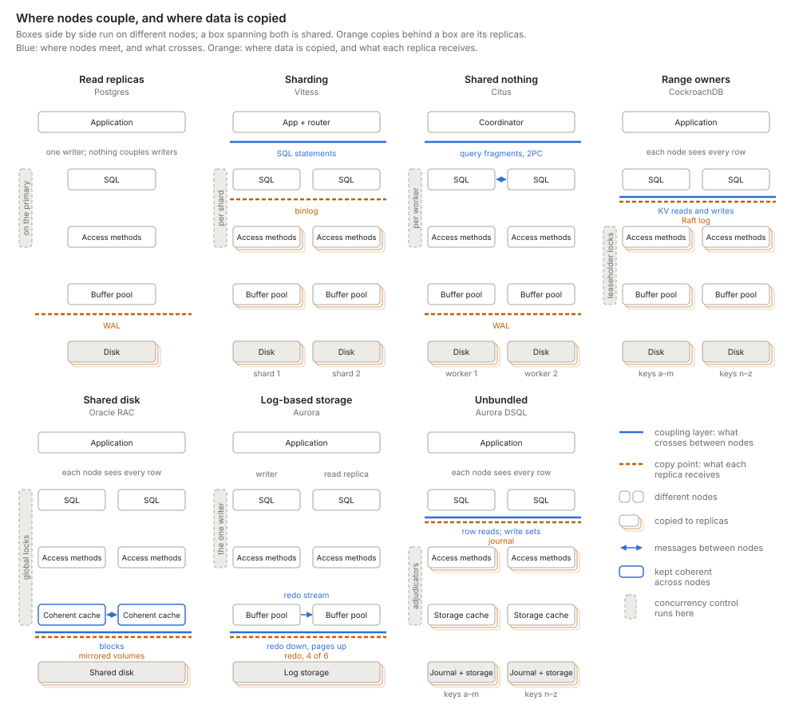

- [The engine and its joints](#the-engine-and-its-joints)
- [Three decisions every design makes](#three-decisions-every-design-makes)
  - [1. Distribution: where nodes couple](#1-distribution-where-nodes-couple)
  - [2. Concurrency control: who may write a row](#2-concurrency-control-who-may-write-a-row)
  - [3. Replication: where data is copied](#3-replication-where-data-is-copied)
- [Disaggregation up close](#disaggregation-up-close)
  - [Aurora: the log is the database](#aurora-the-log-is-the-database)
  - [DSQL: every layer its own fleet](#dsql-every-layer-its-own-fleet)
- [What no cut removes](#what-no-cut-removes)
- [References](#references)
- [Appendix: every system in one table](#appendix-every-system-in-one-table)

## The engine and its joints

Plato's advice for dividing anything was to carve it at its joints, where it already comes apart. A database engine has a few such joints, and every way of scaling a relational database cuts at them. Stack the engine's parts by what crosses each interface, from SQL statements at the top to disk blocks at the bottom:

- **SQL:** parse, plan, and execute queries. The executor asks for rows.
- **Access methods:** tables and indexes, stored as heaps, B-trees, or LSM trees. They turn a request for a row or a key into reads and writes of pages, and each change to a page also produces a log record.
- **Buffer pool:** hot pages in RAM, the buffer manager's cache.
- **Log:** the recovery log, kept beside the buffer pool. A commit is durable once its records are on disk. What the log holds depends on the design; [Database caches](/programming/db-caches.html#when-the-cache-holds-writes) covers it.
- **Disk:** blocks that hold the data files and the log files.

Below the access methods, the stack splits into two paths. A read takes only the page path: the buffer pool serves the page, or reads it from the data files on a miss. A write takes both. The access method changes the page in the buffer pool and appends a record of the change to the log at the same time. Each then reaches disk on its own schedule: the log at commit, and the page later, when the buffer pool evicts it or a checkpoint writes it out. The two paths meet at one rule, write-ahead logging. Before the buffer pool writes a dirty page, it asks the log to flush up to the page's log sequence number (LSN). So the log never sits between the buffer pool and the disk, but it is the truth. After a crash, recovery rebuilds pages from the last checkpoint plus the log, so the data files are a copy derived from it. [Aurora](#aurora-the-log-is-the-database) takes this literally: it drops the page path and never writes data pages at all.

Concurrency control doesn't fit on either path. The executor and the access methods both call the lock manager, the access methods keep MVCC versions inside pages, and a commit goes through the log. So the figure draws it beside the stack, linked to those three.

Each interface is a joint: a place to cut the engine. Once it is cut, what crosses the joint is what each network call carries. Few designs cut between the access methods and the buffer pool, because a B-tree lookup touches several pages one after another, and each would cost a round trip. Research systems such as FaRM and ScaleStore cut there anyway, over fast RDMA networks.

Designs scale out in one of two styles. Most run the whole engine on many nodes and connect them at one joint. Others pull the layers below a joint out into shared services that scale on their own, which is called disaggregation. Aurora pulls out the log and the disk. DSQL pulls out everything below SQL, and concurrency control with it.

## Three decisions every design makes

Scaling out means making three decisions, and each one picks a joint in the stack:

1. **Distribution: where does a request leave the node?** This is the coupling point. Above it, nodes work in parallel and need nothing from each other. At it, a node sends what it needs to whoever has the data.
2. **Concurrency control: who orders conflicting writes?** Where that authority sits decides who may write a row: one node, one owner per partition, or any node.
3. **Replication: where is data copied?** This is the copy point. Below it, every layer exists once per replica, so the data survives a lost machine.

What crosses each chosen joint decides what the design pays. The map below draws seven designs, one column per family, with all three decisions marked. Aurora's read replica sits beside its writer, with the redo stream drawn as an arrow between their buffer pools. The bottom row stands for both the data files and the log files.

The subsections below take the decisions in order. [Disaggregation up close](#disaggregation-up-close) then applies all three to Aurora and DSQL.

### 1. Distribution: where nodes couple

Designs that run the whole engine on every node differ in where the nodes connect. Call that joint the coupling point. Above it, each node runs its own copy of every layer, and that copy sees the whole database. Below it, the data is shared or split among owners, and nodes reach it only through the interface at the joint. Correctness rests on what crosses there.

Reads and writes cross the same joint, but not always as the same thing or at the same time. A read leaves the node only on a cache miss. A write may wait until commit, as in DSQL. And Aurora sends writes down as redo records, but reads pages back up.

The classic names for coupling points are shared memory, shared disk, and shared nothing. They describe hardware: what the processors physically share. By that measure, almost every cloud database today is shared nothing, so the labels stop telling designs apart. This post reads "shared X" as the name of a coupling point instead: X is the highest layer that all nodes share, and above it each node has its own copy. Read this way, the three names become four families. Each holds two designs that cut at the same joint and differ in one other way.

**Shared memory** is one machine. Its threads couple in RAM, through one buffer pool and one lock table. Scaling it up means buying a bigger machine. **Read replicas** add machines for reads, but nothing couples writers.

**Shared nothing** cuts above SQL. The two designs differ in how much the router understands.

- **Independent shards.** Each shard is an independent database, and the application decides which one to talk to. Cross-shard queries and transactions are the application's problem. A routing proxy such as Vitess or [Figma's DBProxy][figma-dbproxy] moves routing out of the application, but the shards still never talk to each other.
- **Distributed query.** The router is a query planner. A coordinator splits a query that spans partitions into fragments, sends them to the nodes that own the data, and merges the results. This is function shipping. For `SELECT region, sum(amount) FROM orders GROUP BY region`, each node sums its own rows and returns a small partial result. Joins on a non-partition key shuffle rows between nodes mid-query, and multi-partition writes add a commit protocol such as two-phase commit (2PC). Citus, Greenplum, and Teradata work this way.

**Shared key-value store** cuts between SQL and the access methods. Every node runs SQL over the whole database and reads and writes rows through one key-value interface. Below the joint, keys are split into ranges, and each range has an owner. The two designs differ in when the owner learns about a write.

- **Range owners.** Each range's owner, its leaseholder, receives key-value reads and writes as a transaction runs, and enforces the locks for its range. Each owner runs its own access methods. Spanner, CockroachDB, TiDB, and YugabyteDB work this way.
- **Unbundled.** No owner enforces locks while a transaction runs. Concurrency control becomes a service of its own. In DSQL, query processors read rows straight from storage and keep their writes until commit. Then a commit check by the adjudicators, which own key ranges too, decides which writes win. [FoundationDB][foundationdb] has the same shape. [DSQL](#dsql-every-layer-its-own-fleet) covers the details.

**Shared disk** cuts below the buffer pool and the log. The two designs differ in what crosses the joint, and so in how many writers there can be.

- **Coherent caches.** The buffer pools also talk to each other. Every node runs SQL, access methods, a buffer pool, and its own log over the whole database, and all of them read and write one set of shared volumes. The hard part is keeping the buffer pools coherent and the locks global. This is data shipping: pages and lock messages cross between nodes. Oracle RAC (Cache Fusion) and Db2 pureScale are the long-lived examples.
- **Log-based storage.** The log is the interface. The writer sends redo records to a storage service, and storage sends pages back on a miss. Aurora, Neon, Azure SQL Hyperscale, and AlloyDB work this way, each with one writer. [Aurora](#aurora-the-log-is-the-database) shows why.

No design removes the cost of coordination; each chooses where to pay it.

| Design | What it buys | Where it pays |
| --- | --- | --- |
| Read replicas | Reads scale, and writers never coordinate | One writer; replicas lag behind it |
| Independent shards | Shards that never coordinate | Application code for anything that spans shards |
| Distributed query | Transparent cross-partition queries | Fragment shipping, shuffles, and 2PC for multi-partition writes |
| Range owners | Any node runs any query; each range fails over on its own | A network hop per key access, 2PC across ranges, and a hot range stuck on one node |
| Unbundled (DSQL) | Any query processor writes; every layer scales on its own | Contention becomes aborts; every read and commit crosses the network |
| Coherent caches | Any node writes any row | Cache coherence and global locking |
| Log-based storage (Aurora) | Cheap durability, fast failover, read replicas sharing one volume | One writer; a cold cache costs page round trips |

### 2. Concurrency control: who may write a row

The dashed grey bars in [the map](#three-decisions-every-design-makes) mark where concurrency control sits. [Ziegler, Bernstein, Leis and Binnig][ziegler-cidr23] (CIDR 2023) turn that question into a classification. They argue that shared nothing versus shared disk no longer predicts how a system scales. Aurora and SQL Hyperscale share storage but allow only one writer, and a MySQL primary with private-storage replicas behaves the same way. So they classify systems by who may update a data item:

- **Single-Writer:** one read-write node; reads scale with replicas, writes do not. Concurrency control runs on that node, above the coupling point.
- **Partitioned-Writer:** one writer per partition; uniform writes scale, but a hot key is always handled by the same node. Concurrency control sits with each owner, below the coupling point.
- **Shared-Writer, coherent cache:** any node writes, and compute caches are kept consistent by a coherence protocol. Hot data is replicated on demand, so skewed reads scale too. Concurrency control runs on every node, kept global by coherence and global locks.
- **Shared-Writer, no coherent cache:** any node writes, and every access goes to shared storage, which can become the bottleneck under skew. Concurrency control moves to the shared side, for example as a check at commit.

They advocate the coherent-cache design, which their ScaleStore system implements.

Shared-Writer is not multi-leader replication: conflicting writes are still ordered before they commit, through global locks, a coherent cache, or a commit check.

Cross where nodes couple with who may write, and a pattern appears: any-node writes exist only where something below SQL arbitrates them, either a coherent cache or a commit-time conflict check.

DSQL and CockroachDB share a column: both cut at the same joint, below SQL, and both split keys among owners. They differ only in the row, which is when the owner hears about a write. CockroachDB sends each write to its range's owner while the transaction runs, as a write intent that blocks other writers. DSQL keeps every write in the query processor until commit, then sends the whole write set to the adjudicators, which check it for conflicts. DSQL postdates the paper, so its row is my classification: a Shared-Writer without a coherent cache, since no query processor caches data. The paper scores that archetype weakest on latency, and DSQL counters it with row-level storage and pushdown, a lever the paper itself names.

### 3. Replication: where data is copied

The copy point is where the data is copied, so it survives a lost machine. Below it, every layer exists once per replica. Layers above it can run on each replica too, as a Postgres standby runs its own buffer pool and SQL engine, but nothing is copied into them: each replica rebuilds them from the layers below. Only the log and the data files need a copy point. A cache that dies with its machine costs speed, not data.

The coupling point and the copy point are independent. Oracle RAC couples at its buffer pools and its disk, and copies at the disk by mirroring its shared volumes. A single primary with read replicas never couples writers at all, but it still copies its log.

The kind of log a design copies sets the height of its copy point. A physical log describes changes to pages. It copies below the buffer pool, and each replica's pages mirror the primary's. A logical log describes changes to rows or keys. It copies above the access methods, so each replica runs its own access methods and builds its own pages. A command log describes the transactions themselves, before they run. It copies above SQL, so each replica executes every transaction again.

| Design | Log it copies | Kind: what it describes | Who must acknowledge a write |
| --- | --- | --- | --- |
| Postgres + replicas, Citus | WAL, per shard | Physical: page changes | The primary, plus any synchronous standbys |
| Vitess | MySQL binlog, per shard | Logical: committed row changes | The primary, plus one replica if semi-synchronous |
| CockroachDB | Raft log, per range | Logical: key-value writes, including write intents | A Raft majority |
| Aurora | Redo records, sent to storage | Physical: page changes | A storage quorum |
| DSQL | Journal | Logical: write sets of committed transactions | The journal, across zones |
| [Calvin][calvin], VoltDB | Input log of ordered transactions | Command: each transaction and its arguments | The replicas of the input log |

A command log ties the copy point back to [concurrency control](#2-concurrency-control-who-may-write-a-row). Replicas that each execute the same transactions must reach the same result. So concurrency control must be deterministic: replicas agree on an order first, then execute in that order. Row-level locks and MVCC let each replica decide on its own, so they don't fit.

## Disaggregation up close

Aurora and DSQL are the two designs here that pull layers out of the engine into shared services. Aurora pulls out the log and the disk, and keeps one writer. DSQL pulls out everything below SQL, and lets any node write. Why each ends up where it does says what disaggregation can and cannot remove.

I picked these two because I know them best, but neither is alone. Azure SQL Hyperscale ([Socrates][socrates]), Google's AlloyDB, and Neon have Aurora's shape: one writer over shared, log-based storage. Socrates and Neon go one step further and split the log service from the page servers. FoundationDB has DSQL's shape, as a key-value store without SQL on top.

### Aurora: the log is the database

Aurora keeps a single writer running the full SQL and transaction engine, but moves logging and page storage into a shared, quorum-replicated service. The writer sends storage only redo records, never pages.

In [Werner Vogels' description][aurora-ascendant] (2019), Aurora treated caching and logging as the layers ripe for reinvention. The storage service builds page images from the log on demand, so instances never flush dirty pages. Every write goes to six copies across three AZs and succeeds once four acknowledge. Up to 15 read replicas share the same volume.

**Why the cache sits on the boundary.** The buffer pool is RAM on each instance, so physically it belongs to compute. Its rules, though, are set by the storage contract:

- **Misses:** a miss is a request to storage for a page at a specific LSN.
- **Eviction:** a dirty page can be dropped once its redo is durable, because storage can always rebuild it. There is no flush.
- **Replicas:** a read replica gets no copy of the data, because it reads the writer's storage. The writer still streams its redo to each replica. Per the [Aurora paper][aurora-paper], the replica applies each record to a page it has cached and drops the rest. That stream keeps caches fresh: it is a cache-coherence protocol, not a durability one.

**Why there is still exactly one writer.** The lock manager and the buffer pool are in-memory structures inside one process, and the writer assigns every LSN. Storage persists the log and replays it, but never decides its order. Aurora offloaded the log's durability and page construction, not its authorship. A second writer would need distributed locking and cache coherence, which brings back the shared-disk problem. [Stonebraker][stonebraker-sn] listed three such problems in 1985: copies of the lock table, buffer pools that must agree, and a log that several writers share. Aurora sits in the shared-disk family but avoids all three, because it has one writer.

**Getting more writers.** AWS has tried three ways. Only sharding adds real write capacity:

| Approach | How it works | More write capacity? |
| --- | --- | --- |
| Multi-Master (MySQL 5.6 only, discontinued) | Several writers on one volume; conflicting writes abort at the storage layer | Not reliably |
| [Global Database write forwarding][aurora-write-forwarding] | Replicas in secondary regions accept writes and forward them to the one writer | No |
| [Aurora Limitless Database][aurora-limitless] (PostgreSQL) | Tables sharded behind a router; each shard is a single-writer Aurora | Yes |

Limitless cuts above SQL, like [independent shards](#1-distribution-where-nodes-couple): there are more writers in total, but every key range still has exactly one owner.

### DSQL: every layer its own fleet

Aurora DSQL keeps Postgres's SQL engine but replaces everything beneath it with separately scaled services. Marc Brooker's walkthrough ([Reads and Compute][dsql-reads], [Transactions and Durability][dsql-writes]) describes each piece.

- **Query processors** run a customized Postgres engine. They never talk to each other, and they cache no table data, only rarely-changing metadata such as table definitions.
- **Adjudicators** own key ranges and check each write set at commit. A transaction aborts if another one has written its keys since it started. Isolation is snapshot isolation, so write skew is possible.
- **The journal** orders and persists committed transactions. Appending is the commit.
- **Storage** is sharded, and serves rows as of a timestamp rather than pages.

**How it gets many writers.** Aurora avoids Stonebraker's three shared-disk problems by having one writer. DSQL removes each one instead. Concurrency control lives in the adjudicators, so no query processor keeps a lock table. Query processors cache no data, so there are no buffer pools to keep coherent. And the journal is the log that many writers share, built as a service that scales. The [cost table](#1-distribution-where-nodes-couple) shows the price: contention becomes aborts, and every read and commit crosses the network.

## What no cut removes

Every design in this post pays for coordination somewhere, as the [cost table](#1-distribution-where-nodes-couple) shows. The three decisions say where. One cost none of them escapes is a hot key: Ziegler et al. find that no archetype scales skewed writes.

## References

1. [Amazon Aurora ascendant][aurora-ascendant] — Vogels, 2019; why Aurora reinvented the caching and logging layers
2. [Amazon Aurora: Design Considerations for High Throughput Cloud-Native Relational Databases][aurora-paper] — Verbitski et al., SIGMOD 2017; the log is the database, and how replica caches follow it
3. [Aurora Global Database write forwarding][aurora-write-forwarding] — AWS docs; secondary regions forward writes to the one writer
4. [Aurora PostgreSQL Limitless Database][aurora-limitless] — AWS docs; single-writer shards behind a router
5. [DSQL Vignette: Reads and Compute][dsql-reads] — Brooker, 2024; query processors and timestamped reads
6. [DSQL Vignette: Transactions and Durability][dsql-writes] — Brooker, 2024; adjudicators, the journal, and optimistic commits
7. [Is Scalable OLTP in the Cloud a Solved Problem?][ziegler-cidr23] — Ziegler, Bernstein, Leis, Binnig, CIDR 2023; the data-access archetypes
8. [FoundationDB: A Distributed Unbundled Transactional Key Value Store][foundationdb] — Zhou et al., SIGMOD 2021; proxies, resolvers, and logs
9. [Multi-AZ DB cluster deployments][rds-multi-az-cluster] — AWS docs; semisynchronous replication to two readers
10. [How Figma's databases team lived to tell the scale][figma-dbproxy] — Figma, 2024; DBProxy, colos, and logical before physical sharding
11. [The Case for Shared Nothing][stonebraker-sn] — Stonebraker, HPTS 1985; shared memory, shared disk, and shared nothing, compared on twelve points
12. [Calvin: Fast Distributed Transactions for Partitioned Database Systems][calvin] — Thomson et al., SIGMOD 2012; deterministic ordering before execution
13. [Socrates: The New SQL Server in the Cloud][socrates] — Antonopoulos et al., SIGMOD 2019; Azure SQL Hyperscale, with the log service apart from the page servers

[aurora-ascendant]: https://www.allthingsdistributed.com/2019/03/amazon-aurora-design-cloud-native-relational-database.html "Amazon Aurora ascendant: How we designed a cloud-native relational database"
[aurora-paper]: https://www.allthingsdistributed.com/files/p1041-verbitski.pdf "Amazon Aurora: Design Considerations for High Throughput Cloud-Native Relational Databases"
[aurora-write-forwarding]: https://docs.aws.amazon.com/AmazonRDS/latest/AuroraUserGuide/aurora-global-database-write-forwarding.html "Aurora Global Database write forwarding"
[aurora-limitless]: https://docs.aws.amazon.com/AmazonRDS/latest/AuroraUserGuide/limitless.html "Aurora PostgreSQL Limitless Database"
[dsql-reads]: https://brooker.co.za/blog/2024/12/04/inside-dsql.html "DSQL Vignette: Reads and Compute"
[dsql-writes]: https://brooker.co.za/blog/2024/12/05/inside-dsql-writes.html "DSQL Vignette: Transactions and Durability"
[ziegler-cidr23]: https://www.cidrdb.org/cidr2023/papers/p50-ziegler.pdf "Is Scalable OLTP in the Cloud a Solved Problem?"
[foundationdb]: https://www.foundationdb.org/files/fdb-paper.pdf "FoundationDB: A Distributed Unbundled Transactional Key Value Store"
[rds-multi-az-cluster]: https://docs.aws.amazon.com/AmazonRDS/latest/UserGuide/multi-az-db-clusters-concepts.html "Multi-AZ DB cluster deployments"
[figma-dbproxy]: https://www.figma.com/blog/how-figmas-databases-team-lived-to-tell-the-scale/ "How Figma's databases team lived to tell the scale"
[stonebraker-sn]: https://dsf.berkeley.edu/papers/hpts85-nothing.pdf "The Case for Shared Nothing"
[calvin]: http://cs.yale.edu/homes/thomson/publications/calvin-sigmod12.pdf "Calvin: Fast Distributed Transactions for Partitioned Database Systems"
[socrates]: https://www.microsoft.com/en-us/research/wp-content/uploads/2019/05/socrates.pdf "Socrates: The New SQL Server in the Cloud"

## Appendix: every system in one table

This table extends [the map](#2-concurrency-control-who-may-write-a-row) with the copy point, concurrency control, and where hot data is cached.

| System | Archetype (Ziegler et al.) | Couples at | Copies at | Who writes a row | Concurrency control | Hot data cached in |
| --- | --- | --- | --- | --- | --- | --- |
| Postgres or MySQL, primary + replicas | Single-Writer | Nowhere | Log of the whole database; replicas replay it, asynchronously or synchronously | Primary only | Locks + MVCC | Each node's buffer pool |
| Amazon RDS | Single-Writer | Nowhere | Multi-AZ instance: blocks, synchronously, to a standby that serves no reads. Read replicas: the engine's log, asynchronously. Multi-AZ DB cluster: the log, semisynchronously; one of two readers must acknowledge | Primary only | Locks + MVCC | Each instance's buffer pool |
| Aurora (provisioned) | Single-Writer | Below the buffer pool: redo down, pages up | Log records: six copies of each 10 GB segment, four must acknowledge | One writer | Locks + MVCC on the writer | Compute buffer pool; misses served by storage |
| Neon | Single-Writer | Below the buffer pool: WAL to safekeepers, pages from pageservers | Log: Paxos across safekeepers | One writer | Postgres locks + MVCC | Buffer pool + local file cache |
| Azure SQL Hyperscale | Single-Writer | Below the buffer pool: log service, page servers | Log, in the log service | One writer | SQL Server locks + versioning | Compute memory + local SSD cache |
| AlloyDB | Single-Writer | Below the buffer pool: log-based shared storage | Log, in regional storage across zones | One writer | Postgres locks + MVCC | Buffer pool + columnar cache |
| PolarDB, PolarDB Serverless | Single-Writer | Blocks on shared PolarFS volumes; Serverless keeps read-only nodes current with a coherence protocol | Storage: PolarFS chunks, by ParallelRaft | One writer | Locks + MVCC | Buffer pool |
| App-level sharding | Partitioned-Writer | Above SQL, in the application | Log, per shard | One writer per shard | Per shard | Per shard |
| Citus, Vitess, Figma DBProxy, Aurora Limitless | Partitioned-Writer | Above SQL, in a router or coordinator | Per shard: log shipping (Citus, Vitess, Figma), Aurora storage (Limitless) | One writer per shard | Per shard; 2PC across shards | Per shard |
| Teradata, Greenplum | Partitioned-Writer | Above SQL, in an MPP coordinator | Per node: mirror segments (Greenplum), fallback copies (Teradata) | Partition owner | Per node; 2PC across nodes | Per node |
| Spanner, CockroachDB, TiDB, YugabyteDB | Partitioned-Writer | Below SQL: key-value reads and writes | Log, per range, by Paxos or Raft | Leader of each range | Timestamps + 2PC over consensus groups | Per node, per range |
| DynamoDB | Partitioned-Writer | Key-value requests to partitions | Log, per partition, by Paxos across three zones | Leader of each partition | Per item; transactions across items | Per partition |
| Oracle RAC, Db2 pureScale | Shared-Writer, coherent cache | Pages between buffer pools; blocks on shared disk | Storage: mirrored shared volumes | Any node | Global locks, coherent cache | Coherent cache across nodes |
| Aurora Multi-Master (retired) | Shared-Writer, weakly coherent cache | Below the buffer pool, on Aurora storage | Aurora storage | Any writer | OCC at storage; losing writes abort | Per node, refreshed by update propagation |
| Aurora DSQL | Shared-Writer, no coherent cache (my classification) | Below SQL: row reads; write sets at commit | Journal, across zones | Any query processor | OCC at adjudicators; snapshot isolation | Inside storage; rows + pushdown |
| FoundationDB | Shared-Writer, no coherent cache (my classification) | Below the client: key reads; write sets at commit | Transaction logs, synchronously | Any client | OCC at resolvers; serializable | Storage servers |

The RDS row follows AWS's [Multi-AZ DB cluster documentation][rds-multi-az-cluster]. Archetypes, and the PolarDB and Aurora Multi-Master details, come from Ziegler et al. Other details are summarized from public descriptions.
