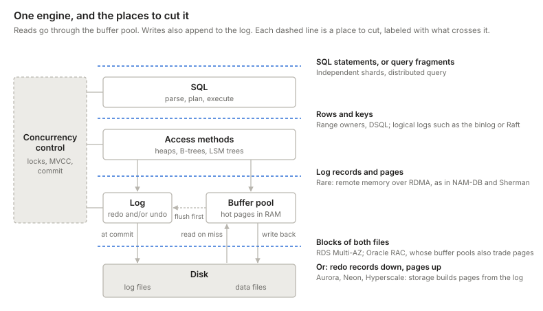
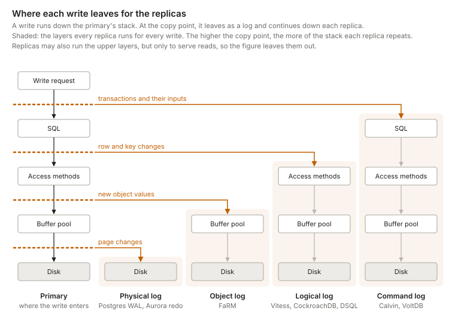
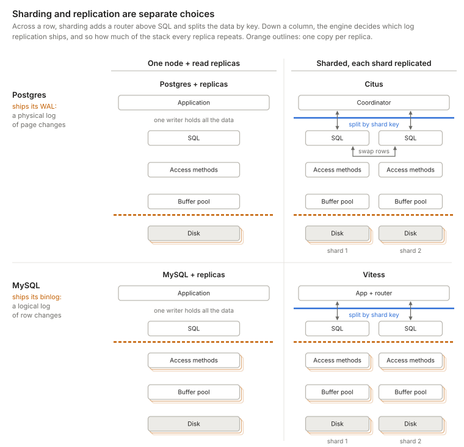
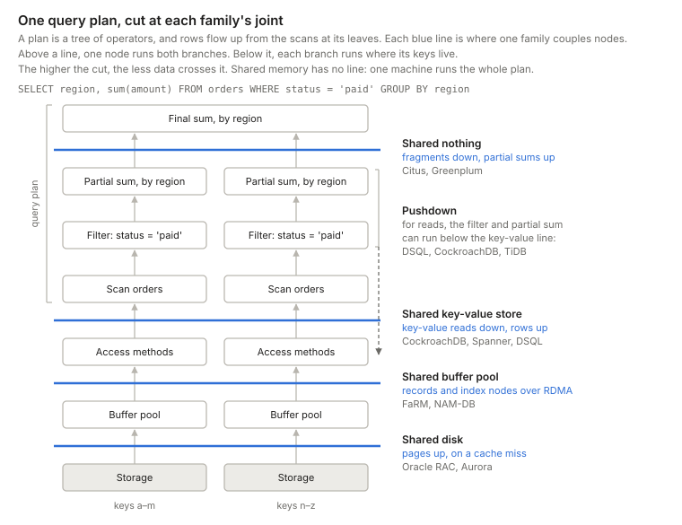
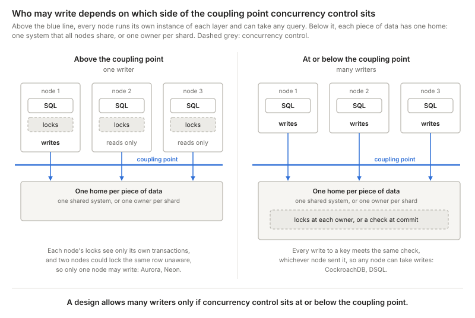
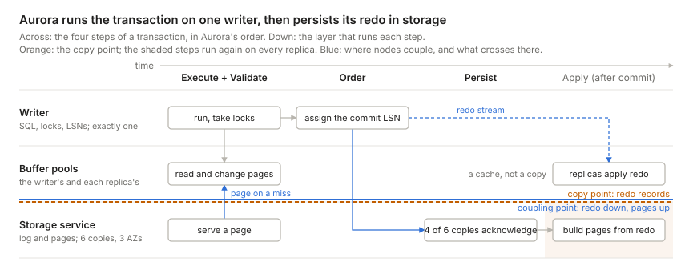
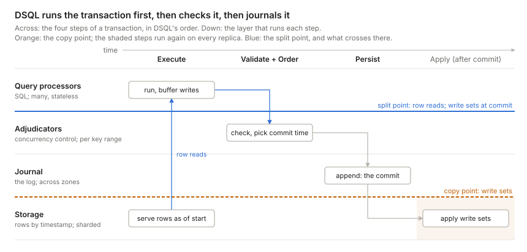
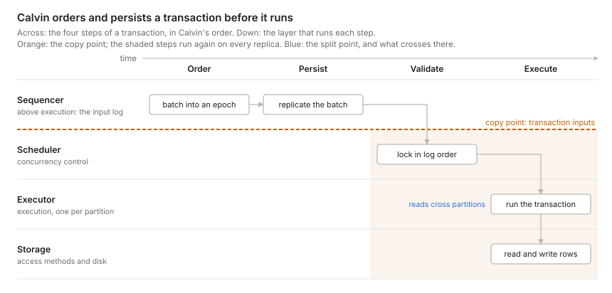

> [The second principle is] that of dividing things again by classes, where the natural joints are, and not trying to break any part, after the manner of a bad carver.
> -- Plato, *Phaedrus* 265e

- [Database engine and its interfaces](#database-engine-and-its-interfaces)
- [Replication: where data is copied](#replication-where-data-is-copied)
  - [Which log ships](#which-log-ships)
  - [Reading from a replica](#reading-from-a-replica)
- [Sharding: where nodes couple](#sharding-where-nodes-couple)
  - [Four families](#four-families)
  - [How the two cuts combine](#how-the-two-cuts-combine)
  - [Who may write](#who-may-write)
- [Three designs up close](#three-designs-up-close)
  - [Aurora: the log is the database](#aurora-the-log-is-the-database)
  - [DSQL: every layer its own fleet](#dsql-every-layer-its-own-fleet)
  - [Calvin: the log comes first](#calvin-the-log-comes-first)
- [Conclusion: the whole picture](#conclusion-the-whole-picture)

## Database engine and its interfaces

If Plato were alive today and tasked with scaling a database engine, he would look for the natural joints at which to split it.

The joints are the various interfaces between each component, from SQL statements at the top to disk blocks at the bottom:[^hellerstein]

- **SQL:** parse, plan, and execute queries. The executor asks for rows.
- **Access methods:** tables and indexes, stored as heaps, B-trees, or LSM trees. They turn a request for a row or a key into reads and writes of pages. Each change to a page also produces a log record.
- **Buffer pool:** hot pages in RAM. Reads stop here, or go to the data files on a miss. Before it writes a dirty page back, the buffer pool flushes the log up to that page's log sequence number (LSN). This rule is write-ahead logging.
- **Log:** the recovery log, kept beside the buffer pool. A commit is durable once its records are on disk. After a crash, recovery rebuilds pages from the log, so the log is the truth and the data files are a copy. [Aurora](#aurora-the-log-is-the-database) takes this literally and never writes data pages at all. Depending on the design, the log holds redo records, undo records, or both.
- **Disk:** blocks that hold the data files and the log files.
- **Concurrency control:** locks, MVCC versions, and the commit. It sits beside the stack because the executor, the access methods, and the log all take part in it.

[^hellerstein]: Hellerstein, Stonebraker, and Hamilton's [Architecture of a Database System][hellerstein-arch] (2007) draws the main components as blocks, not as a stack. Its Figure 1.1 puts the access methods, buffer manager, lock manager, and log manager side by side in one transactional storage manager, next to a process manager and shared utilities. This post orders the parts in a line for simplicity, so that each interface is one place to cut. Process management and the shared utilities don't change where a design cuts, so the figure leaves them out.

Past one machine, the classic way to scale makes two choices:

- **Replication** keeps copies of each node's data on other machines.
  - Benefits: durability, scalable reads, and lower-latency reads (via geo-replication).
- **Sharding** splits the data across several nodes.
  - Benefits: scalable writes, and a database larger than one storage device can hold.

Replication is the simpler of the two, and every database does it in much the same way, so this post starts there. The rest of the post is about sharding, where designs differ most.

## Replication: where data is copied

A replicated database ships each write from the node that decides it to the nodes that copy it, almost always as a log. This post calls the interface where the write leaves the copy point. It is plain replication, named by where it sits in the stack. Layers above it handle each write once, on the node that decides it. Layers below it handle each write on every replica: each one receives the stream and applies it. That is why copies never scale writes, and why a higher copy point means more repeated work.

A replica may also run the upper layers. A Postgres read replica has its own SQL engine and buffer pool, but they only serve its reads, and no write is decided there. Only durable state, the log and the data files, must be copied. A cache that dies with its machine costs speed, not data.

### Which log ships

The kind of log a design copies sets the height of its copy point. A physical log describes changes to pages. It copies below the buffer pool, and each replica's pages mirror the primary's. A logical log describes changes to rows or keys. It copies above the access methods, so each replica runs its own access methods and builds its own pages. A command log describes the transactions themselves, before they run. It copies above SQL, so each replica executes every transaction again. Postgres ships its write-ahead log (WAL), a physical log, so its replicas only rebuild pages. MySQL ships its binlog, a logical log, so its replicas run their own access methods.[^engine-log]

[^engine-log]: The engine sets the usual choice, not a hard limit. Postgres also offers logical replication, and Aurora MySQL ships physical redo to its storage instead of the binlog.

Designs also differ in who must acknowledge a write before it commits. A Postgres primary commits alone by default, or waits for any synchronous replicas. CockroachDB waits for a Raft majority, and Aurora for four of six storage copies.

The copy point constrains concurrency control too. Everything below the copy point runs again on each replica, so it must reach the same result everywhere. With a command log, every replica executes every transaction, so concurrency control must be deterministic: replicas agree on an order first, then execute in that order. Row-level locks and MVCC let each replica decide on its own, so they don't fit.

### Reading from a replica

Concurrency control orders conflicting transactions, and that order decides what each read sees. [Alex Miller][miller-decomposing] splits every transaction into four steps: execute, order, validate, and persist. His examples are all read-write transactions. A read-only transaction under MVCC still executes, and still needs an order: it picks a snapshot. But it changes nothing, so it can skip validate and persist.[^safe-snapshot] So any replica can serve it, once the replica knows how far the order has reached it, as an LSN or a timestamp. A replica that lags behind serves stale reads.

[^safe-snapshot]: Under serializable isolation, not every snapshot is safe. A read-only transaction can see a state that no serial order produces, which Fekete, O'Neil, and O'Neil call the read-only transaction anomaly. Postgres's `SERIALIZABLE READ ONLY DEFERRABLE` waits for a safe snapshot, and Postgres replicas don't offer serializable isolation at all.

## Sharding: where nodes couple

Replication never scales writes, and every replica holds all of its data. Sharding is the other classic choice: it splits the data across nodes, so the data and the writes can outgrow one machine. It is separate from replication, as the two most popular open-source databases show:

Across a row, sharding adds a router above SQL. Citus and Vitess route each query to the shards that hold its keys, and every shard is an ordinary Postgres or MySQL. Down a column, replication doesn't change: Citus replicates like a lone Postgres, and Vitess like a lone MySQL.

In this classic picture, sharding is a router above SQL. Newer designs split the data lower down. Aurora has one writer and no visible shards, yet its log and pages live in a storage service that is sharded and replicated underneath. Spanner and CockroachDB shard and replicate below SQL, one key range at a time. DSQL splits the engine into separately scaled fleets. Calvin replicates before it shards. To fit them all, this post generalizes sharding into the coupling point. "Sharding" suggests that each node owns a slice of the data. But a shared disk or a shared key-value store is sharded too, under the hood. What tells designs apart is the interface through which nodes reach the data: SQL queries, key-value reads and writes, pages, or log records.

Every design has a coupling point, and it is where cloning ends. Above it, every node runs its own instance of each layer, and that instance sees the whole database. Below it, each piece of data has exactly one home, and nodes reach it only through the interface at the joint. This is the only cut that can scale writes. Every request that crosses the joint is coordination, and as Pat Helland argues in [I Am SO Glad I'm Uncoordinated!][helland-uncoordinated] (2021), coordination is the one cost that cheaper hardware doesn't shrink. Each design in this post is a choice of where to pay it.

The joint may hide that the home is sharded. A shared disk offers one address space, while CockroachDB's nodes send each key to its owner.

### Four families

The classic names for coupling points have the same problem as "sharding." They are shared memory, shared disk, and shared nothing, and they describe hardware: what the processors physically share. By that measure, almost every cloud database today is shared nothing, so the labels stop telling designs apart. This post reads "shared X" as the name of a coupling point instead: X is the highest layer that all nodes share, and above it each node has its own instance. Read this way, the three names become four families. Each holds designs that cut at the same joint and differ in one other way.

**Shared memory** is one machine. Its threads couple in RAM, through one buffer pool and one lock table. Scaling it up means buying a bigger machine. **Read replicas** add machines for reads, but nothing couples writers.

**Shared nothing** cuts above SQL. The first two designs differ in how much the router understands; the third differs in when it replicates.

- **Independent shards.** Each shard is an independent database, and the application decides which one to talk to. Cross-shard queries and transactions are the application's problem. A routing proxy such as Vitess or [Figma's DBProxy][figma-dbproxy] moves routing out of the application, but the shards still never talk to each other.
- **Query fragments.** The router is a query planner. A coordinator splits a query that spans shards into fragments, sends them to the nodes that own the data, and merges the results. For `SELECT region, sum(amount) FROM orders WHERE status = 'paid' GROUP BY region`, each node sums its own rows and returns a small partial result. Joins on a key other than the shard key shuffle rows between nodes mid-query, and multi-shard writes add a commit protocol such as two-phase commit (2PC). Citus, Greenplum, and Teradata work this way.
- **Deterministic.** Partitions own the data, as with query fragments, but every replica runs every transaction from one ordered input log. Partitions swap the rows they read, so no transaction needs 2PC. [Calvin](#calvin-the-log-comes-first) covers the details.

**Shared key-value store** cuts between SQL and the access methods. Every node runs SQL over the whole database and reads and writes rows through one key-value interface. Below the joint, keys are split into ranges, and each range has an owner. The two designs differ in when the owner learns about a write.

- **Range owners.** Each range's owner, its leaseholder, receives key-value reads and writes as a transaction runs, and enforces the locks for its range. Each owner runs its own access methods. Spanner, CockroachDB, TiDB, and YugabyteDB work this way.
- **Unbundled.**[^unbundled] No owner enforces locks while a transaction runs. Concurrency control becomes a service of its own. In DSQL, query processors ask storage for rows directly and keep their writes until commit. Storage can also run the bottom of each query plan, such as filters and projections, next to the data. Then a commit check by the adjudicators, which own key ranges too, decides which writes win. [FoundationDB][foundationdb] has the same shape. [DSQL](#dsql-every-layer-its-own-fleet) covers the details.

[^unbundled]: The name comes from Lomet, Fekete, Weikum, and Zwilling's [Unbundling Transaction Services in the Cloud][lomet-unbundling] (CIDR 2009). It means something narrower than splitting compute from storage. They split the storage engine itself in two: a transactional component that runs concurrency control and recovery over logical records, and a data component that stores the records and knows nothing about transactions. The [FoundationDB paper][foundationdb] uses the word in the same sense. In Lomet's design, the transactional component still takes locks while a transaction runs. DSQL and FoundationDB check for conflicts only at commit.

No production design cuts at the next joint down, between the access methods and the buffer pool. A B-tree lookup touches several pages one after another, and across that joint each page would cost a round trip. Only research systems, such as NAM-DB and Sherman, cut there, and they need fast RDMA networks to make it pay. DSQL can look as if it cuts here, because its query processors keep no cache. But in [Brooker's words][dsql-reads], "the QP doesn't ask for pages, it asks for rows." The access methods moved to storage along with the cache, so storage walks the index, and a lookup costs one round trip.

**Shared disk** cuts below the buffer pool and the log. The two designs differ in what crosses the joint, and so in how many writers there can be.

- **Coherent caches.** The buffer pools also talk to each other. Every node runs SQL, access methods, a buffer pool, and its own log over the whole database, and all of them read and write one set of shared volumes. The hard part is keeping the buffer pools coherent and the locks global. This is data shipping: pages and lock messages cross between nodes. Oracle RAC (Cache Fusion) and Db2 pureScale are the long-lived examples. ScaleStore, a research system, keeps buffer pools coherent the same way, over RDMA and without shared disk.
- **Log-based storage.** The log is the interface. The writer sends redo records to a storage service, and storage sends pages back on a miss. Aurora, Neon, Azure SQL Hyperscale, and AlloyDB work this way, each with one writer. [Aurora](#aurora-the-log-is-the-database) shows why.

A SQL query compiles to a tree of operators, so the families above can be drawn as cuts through one query plan:

[The map at the end](#conclusion-the-whole-picture) draws all eight designs side by side, with where each copies data and where its concurrency control sits.

### How the two cuts combine

Not every read replica holds a copy. Aurora's read replicas share one copy in storage, and only the compute above the coupling point is cloned.

The coupling point and the copy point are independent. Oracle RAC couples at its buffer pools and its disk, and copies at the disk by mirroring its shared volumes. A single primary with read replicas never couples writers at all, but it still copies its log. Most designs shard first, then replicate each shard: a Raft group per range, a primary and replicas per Vitess shard. They copy at or below where they couple, because a replica can only copy what one owner has already decided. Above the coupling point, no single node decides the result: it depends on data that other nodes hold. [Calvin][calvin] does the opposite. It replicates first, by copying its input log above SQL, and each replica then shards the data among its partitions. That works only because every replica reaches the same result on its own, as [Which log ships](#which-log-ships) explains.

### Who may write

Concurrency control is the part a bad carver breaks: it has no joint of its own, and it sits beside the stack. It orders conflicting transactions. Two transactions conflict when one writes what the other reads or writes, so a read-write transaction needs its reads protected as much as its writes. Whether many nodes can run such transactions depends on which side of the coupling point concurrency control lands.

Above the coupling point, each node keeps its own locks, and those locks see only that node's transactions. Two nodes could lock the same row and never know it. So only one node may write. At or below the coupling point, every access to a key meets the same check, whichever node sent it. That check may be a lock held by the key's owner, a global lock, or a conflict check at commit. Under snapshot isolation, as in DSQL, the check covers only writes, which is why write skew is possible. So:

**A design allows many writers only if concurrency control sits at or below the coupling point.**

The dashed grey bars in [the map](#conclusion-the-whole-picture) mark where concurrency control sits in each design. [Ziegler, Bernstein, Leis and Binnig][ziegler-cidr23] (CIDR 2023) turn that question into a classification. They argue that shared nothing versus shared disk no longer predicts how a system scales. Aurora and SQL Hyperscale share storage but allow only one writer, and a MySQL primary with private-storage replicas behaves the same way. So they classify systems by who may update a data item:

- **Single-Writer:** one read-write node; reads scale with replicas, writes do not. Concurrency control runs on that node, above the coupling point.
- **Partitioned-Writer:** one writer per shard; uniform writes scale, but a hot key is always handled by the same node. Concurrency control sits with each owner, below the coupling point.
- **Shared-Writer, coherent cache:** any node writes, and compute caches are kept consistent by a coherence protocol. Hot data is replicated on demand, so skewed reads scale too. Concurrency control runs on every node, kept global by coherence and global locks.
- **Shared-Writer, no coherent cache:** any node writes, and every access goes to shared storage, which can become the bottleneck under skew. Concurrency control moves to the shared side, for example as a check at commit.

They advocate the coherent-cache design, which their ScaleStore system implements. But no archetype scales skewed writes: a hot key always ends up on one writer.

Shared-Writer is not multi-leader replication: conflicting writes are still ordered before they commit, through global locks, a coherent cache, or a commit check.

Cross where nodes couple with who may write, and the rule shows up again: any-node writes exist only where something below SQL arbitrates them, either a coherent cache or a commit-time conflict check.

DSQL and CockroachDB share a column: both cut at the same joint, below SQL, and both split keys among owners. They differ only in the row, which is when the owner hears about a write. CockroachDB sends each write to its range's owner while the transaction runs, as a write intent that blocks other writers. DSQL keeps every write in the query processor until commit, then sends the whole write set to the adjudicators, which check it for conflicts. DSQL postdates the paper, so its row is my classification: a Shared-Writer without a coherent cache, since no query processor caches data. The paper scores that archetype weakest on latency, and DSQL counters it with row-level storage and pushdown, a lever the paper itself names.

## Three designs up close

Aurora, DSQL, and Calvin each cut the engine in a different way. They differ most in where they put the log:

- **Aurora** puts it at the bottom: redo records, written after the writer runs the transaction. It keeps one writer.
- **DSQL** puts it in the middle: write sets, written once the adjudicators approve them. Any node may write.
- **Calvin** puts it at the top: transaction inputs, written before anything runs. Any node may write, and conflicts make transactions wait instead of abort.

Each design gets a chart with two axes. Across is time: [Miller's four steps](#reading-from-a-replica), in that design's order. Down is space: the layer that runs each step. The orange line is the copy point, and the shaded area holds the steps that every replica repeats.

I picked Aurora and DSQL because I know them best, and Calvin because no other design here puts the log above execution. None of them is alone. Azure SQL Hyperscale ([Socrates][socrates]), Google's AlloyDB, and Neon have Aurora's shape: one writer over shared, log-based storage. Socrates and Neon go one step further and separate the log service from the page servers. FoundationDB has DSQL's shape, as a key-value store without SQL on top. VoltDB, like Calvin, replicates transactions rather than their results.

### Aurora: the log is the database

Aurora keeps a single writer running the full SQL and transaction engine, but moves logging and page storage into a shared, quorum-replicated service. The writer sends storage only redo records, never pages.

In [Werner Vogels' description][aurora-ascendant] (2019), Aurora treated caching and logging as the layers ripe for reinvention. The storage service builds page images from the log on demand, so instances never flush dirty pages. Every write goes to six copies across three AZs and succeeds once four acknowledge. Up to 15 read replicas share the same volume.

**Why the cache sits on the joint.** The buffer pool is RAM on each instance, so physically it belongs to compute. Its rules, though, are set by the storage contract:

- **Misses:** a miss is a request to storage for a page at a specific LSN.
- **Eviction:** a dirty page can be dropped once its redo is durable, because storage can always rebuild it. There is no flush.
- **Replicas:** a read replica gets no copy of the data, because it reads the writer's storage. The writer still streams its redo to each replica. Per the [Aurora paper][aurora-paper], the replica applies each record to a page it has cached and drops the rest. That stream keeps caches fresh: it is a cache-coherence protocol, not a durability one.

**Why there is still exactly one writer.** The lock manager and the buffer pool are in-memory structures inside one process, and the writer assigns every LSN. Storage persists the log and replays it, but never decides its order. Aurora offloaded the log's durability and page construction, not its authorship. A second writer would need distributed locking and cache coherence, which brings back the shared-disk problem. [Stonebraker][stonebraker-sn] listed three such problems in 1985: copies of the lock table, buffer pools that must agree, and a log that several writers share. Aurora sits in the shared-disk family but avoids all three, because it has one writer.

**Getting more writers.** AWS has tried three ways. Only sharding adds real write capacity:

| Approach | How it works | More write capacity? |
| --- | --- | --- |
| Multi-Master (MySQL 5.6 only, discontinued) | Several writers on one volume; conflicting writes abort at the storage layer | Not reliably |
| [Global Database write forwarding][aurora-write-forwarding] | Replicas in secondary regions accept writes and forward them to the one writer | No |
| [Aurora Limitless Database][aurora-limitless] (PostgreSQL) | Tables sharded behind a router; each shard is a single-writer Aurora | Yes |

Limitless cuts above SQL, like [independent shards](#four-families): there are more writers in total, but every key range still has exactly one owner.

### DSQL: every layer its own fleet

Aurora DSQL keeps Postgres's SQL engine but replaces everything beneath it with separately scaled services. Marc Brooker's walkthrough ([Reads and Compute][dsql-reads], [Transactions and Durability][dsql-writes]) describes each piece.

- **Query processors** run a customized Postgres engine. They never talk to each other, and they cache no table data, only rarely-changing metadata such as table definitions.
- **Adjudicators** own key ranges and check each write set at commit. A transaction aborts if another one has written its keys since it started. Isolation is snapshot isolation, so write skew is possible.
- **The journal** orders and persists committed transactions. Appending is the commit.
- **Storage** is sharded, and serves rows as of a timestamp rather than pages.

**How it gets many writers.** Aurora avoids Stonebraker's three shared-disk problems by having one writer. DSQL removes each one instead. Concurrency control lives in the adjudicators, so no query processor keeps a lock table. Query processors cache no data, so there are no buffer pools to keep coherent. And the journal is the log that many writers share, built as a service that scales. The price: contention becomes aborts, and every read and commit crosses the network.

### Calvin: the log comes first

[Calvin][calvin] runs the steps in the opposite order from Aurora and DSQL. It agrees on the order of transactions first, makes that order durable, and only then runs them. It began as a research system, and FaunaDB later built a commercial database on its design.

- **Sequencers** collect transaction requests into 10 ms batches, called epochs, and replicate each batch, by Paxos or asynchronously. Once the batch is replicated, the transaction will run: this is the commit.
- **Schedulers**, one per partition (Calvin's name for a shard of each replica), take the locks each transaction needs, in log order. Replicas that read the same log take the same locks in the same order.
- **Executors** run the transaction. When it spans partitions, each partition reads its own rows and sends them to the partitions that write. Each writing partition then has every input, and computes the same result.
- **Storage** can be any store that reads and writes by key.

**How it gets many writers without aborts.** Every partition, on every replica, sees the same order. Nothing that happens after the order is fixed can change the outcome, so no partition needs to vote: there is no two-phase commit. A crashed node recovers by replaying the input log. And because locks follow the log order, contention makes transactions wait, not abort.

**What it pays.** A transaction must be deterministic, and the scheduler must know which keys it will touch before it runs. When those keys depend on data, Calvin first runs a read-only query to find them, then restarts the transaction if that data has changed. This is the one case where contention costs a retry. And one slow transaction holds its locks while every later transaction that needs them waits.

## Conclusion: the whole picture

Every design in this post comes down to three choices: where it couples, where it copies, and where concurrency control sits.

Then follow one request through it: pick a design, and step a read-write or a read-only transaction through the cuts.



## References <!-- omit in toc -->

1. [Amazon Aurora ascendant][aurora-ascendant] — Vogels, 2019; why Aurora reinvented the caching and logging layers
2. [Amazon Aurora: Design Considerations for High Throughput Cloud-Native Relational Databases][aurora-paper] — Verbitski et al., SIGMOD 2017; the log is the database, and how replica caches follow it
3. [Aurora Global Database write forwarding][aurora-write-forwarding] — AWS docs; secondary regions forward writes to the one writer
4. [Aurora PostgreSQL Limitless Database][aurora-limitless] — AWS docs; single-writer shards behind a router
5. [DSQL Vignette: Reads and Compute][dsql-reads] — Brooker, 2024; query processors and timestamped reads
6. [DSQL Vignette: Transactions and Durability][dsql-writes] — Brooker, 2024; adjudicators, the journal, and optimistic commits
7. [Is Scalable OLTP in the Cloud a Solved Problem?][ziegler-cidr23] — Ziegler, Bernstein, Leis, Binnig, CIDR 2023; the data-access archetypes
8. [FoundationDB: A Distributed Unbundled Transactional Key Value Store][foundationdb] — Zhou et al., SIGMOD 2021; proxies, resolvers, and logs
9. [How Figma's databases team lived to tell the scale][figma-dbproxy] — Figma, 2024; DBProxy, colos, and logical before physical sharding
10. [The Case for Shared Nothing][stonebraker-sn] — Stonebraker, HPTS 1985; shared memory, shared disk, and shared nothing, compared on twelve points
11. [Calvin: Fast Distributed Transactions for Partitioned Database Systems][calvin] — Thomson et al., SIGMOD 2012; deterministic ordering before execution
12. [Socrates: The New SQL Server in the Cloud][socrates] — Antonopoulos et al., SIGMOD 2019; Azure SQL Hyperscale, with the log service apart from the page servers
13. [Architecture of a Database System][hellerstein-arch] — Hellerstein, Stonebraker, Hamilton, Foundations and Trends in Databases, 2007; the components of a relational engine
14. [Decomposing Transactional Systems][miller-decomposing] — Miller, 2025; execute, order, validate, and persist, and the orders systems run them in
15. [I Am SO Glad I'm Uncoordinated!][helland-uncoordinated] — Helland, 2021; hardware keeps getting cheaper, coordination does not
16. [Unbundling Transaction Services in the Cloud][lomet-unbundling] — Lomet, Fekete, Weikum, Zwilling, CIDR 2009; a transactional component apart from a data component

[aurora-ascendant]: https://www.allthingsdistributed.com/2019/03/amazon-aurora-design-cloud-native-relational-database.html "Amazon Aurora ascendant: How we designed a cloud-native relational database"
[aurora-paper]: https://www.allthingsdistributed.com/files/p1041-verbitski.pdf "Amazon Aurora: Design Considerations for High Throughput Cloud-Native Relational Databases"
[aurora-write-forwarding]: https://docs.aws.amazon.com/AmazonRDS/latest/AuroraUserGuide/aurora-global-database-write-forwarding.html "Aurora Global Database write forwarding"
[aurora-limitless]: https://docs.aws.amazon.com/AmazonRDS/latest/AuroraUserGuide/limitless.html "Aurora PostgreSQL Limitless Database"
[dsql-reads]: https://brooker.co.za/blog/2024/12/04/inside-dsql.html "DSQL Vignette: Reads and Compute"
[dsql-writes]: https://brooker.co.za/blog/2024/12/05/inside-dsql-writes.html "DSQL Vignette: Transactions and Durability"
[ziegler-cidr23]: https://www.cidrdb.org/cidr2023/papers/p50-ziegler.pdf "Is Scalable OLTP in the Cloud a Solved Problem?"
[foundationdb]: https://www.foundationdb.org/files/fdb-paper.pdf "FoundationDB: A Distributed Unbundled Transactional Key Value Store"
[figma-dbproxy]: https://www.figma.com/blog/how-figmas-databases-team-lived-to-tell-the-scale/ "How Figma's databases team lived to tell the scale"
[stonebraker-sn]: https://dsf.berkeley.edu/papers/hpts85-nothing.pdf "The Case for Shared Nothing"
[calvin]: http://cs.yale.edu/homes/thomson/publications/calvin-sigmod12.pdf "Calvin: Fast Distributed Transactions for Partitioned Database Systems"
[socrates]: https://www.microsoft.com/en-us/research/wp-content/uploads/2019/05/socrates.pdf "Socrates: The New SQL Server in the Cloud"
[hellerstein-arch]: https://dsf.berkeley.edu/papers/fntdb07-architecture.pdf "Architecture of a Database System"
[miller-decomposing]: https://transactional.blog/blog/2025-decomposing-transactional-systems "Decomposing Transactional Systems"
[helland-uncoordinated]: https://pathelland.substack.com/p/i-am-so-glad-im-uncoordinated "I Am SO Glad I'm Uncoordinated!"
[lomet-unbundling]: https://arxiv.org/abs/0909.1768 "Unbundling Transaction Services in the Cloud"

## Footnotes <!-- omit in toc -->
