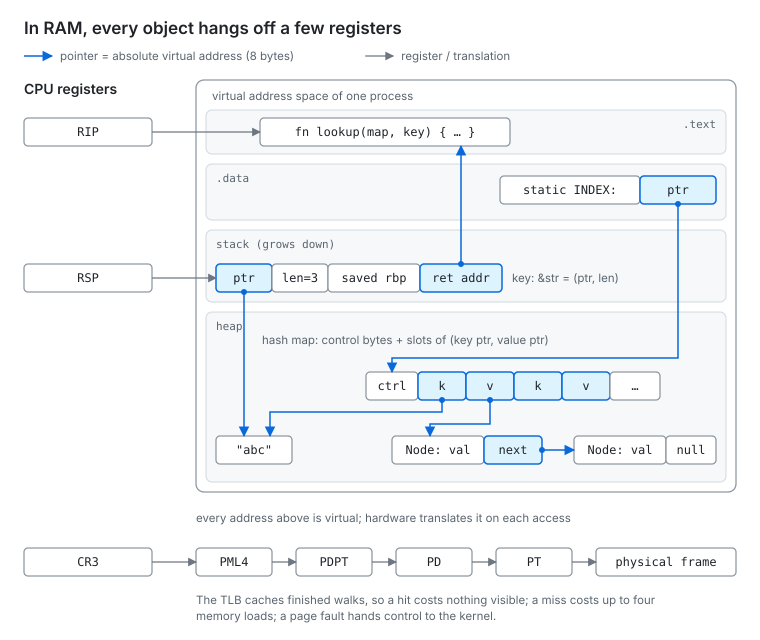
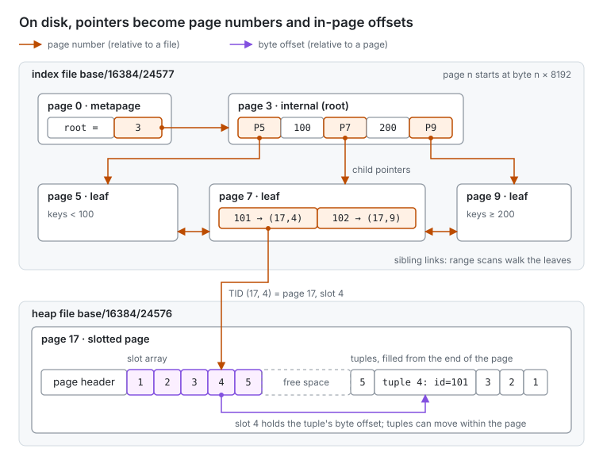
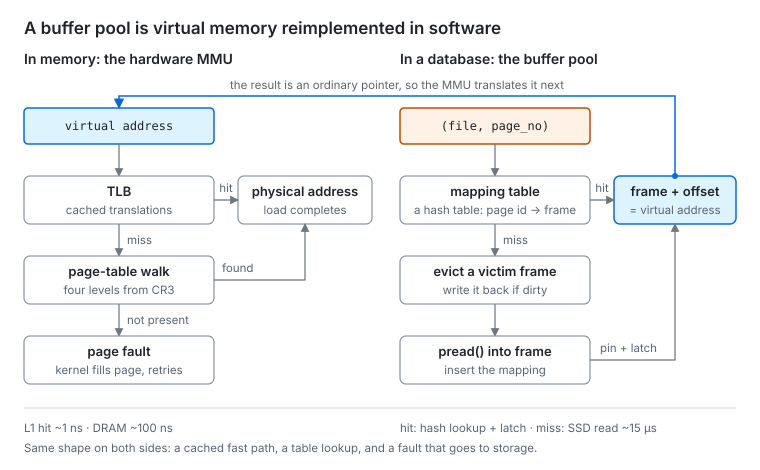
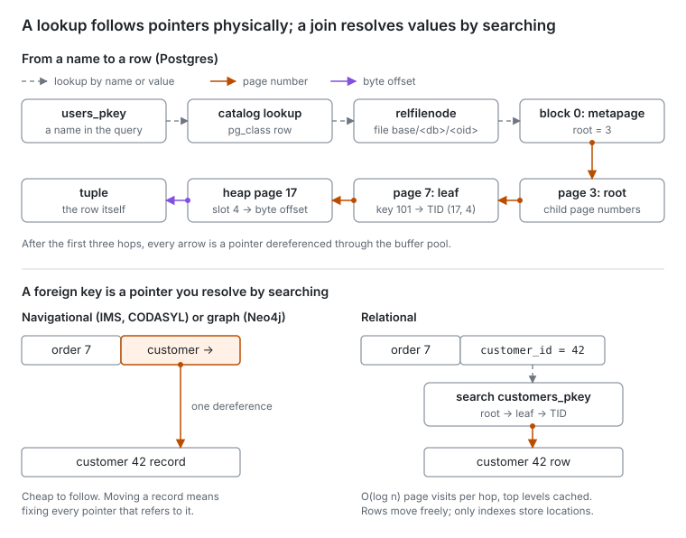

- [1. In RAM, everything hangs off a few registers](#1-in-ram-everything-hangs-off-a-few-registers)
- [2. On disk, pointers become page numbers](#2-on-disk-pointers-become-page-numbers)
- [3. Following a pointer: the MMU and the buffer pool](#3-following-a-pointer-the-mmu-and-the-buffer-pool)
- [4. Does a relational database follow pointers?](#4-does-a-relational-database-follow-pointers)
- [5. One structure, sized to what a dereference costs](#5-one-structure-sized-to-what-a-dereference-costs)
- [Closing](#closing)
- [Sources](#sources)

In RAM and on disk, a data structure is a graph of pointers. What changes between the two is what a pointer is, and what it costs to follow one.

In 2019 Evan Jones asked [why databases use ordered indexes but programs use hash tables](https://www.evanjones.ca/ordered-vs-unordered-indexes.html). His answer is that B-trees are more general purpose: slower for the single-key lookups that dominate a workload, but cheaper overall once you count range scans and the cost of keeping several indexes over a very large dataset. Oren Eini [replied](https://ravendb.net/blog/re-why-databases-use-ordered-indexes-but-programming-uses-hash-tables) from the perspective of someone who builds storage engines. On disk you count seeks, not big-O, and since a B+tree's top levels stay cached just like an extendible hash's directory, both usually cost about one disk read. Once performance is a wash, ranges, composite keys and ordered iteration decide it.

Both posts treat the RAM-versus-disk difference as a matter of constant factors. I want to look one level down. The four diagrams below follow a lookup from the CPU's registers, through the heap, onto disk, and back through the buffer pool. The question I kept circling was whether a relational database really follows pointers at all, or whether it only follows the first one, from the table's name to its root, and then searches.

## 1. In RAM, everything hangs off a few registers

A running program's memory is a pointer graph whose roots live in a handful of CPU registers.

RIP points into the code. RSP points at the top of the stack. Globals are reached with RIP-relative addressing, so they hang off RIP too. Every heap object is reachable only because some pointer on the stack, in a global, or in another heap object points at it. A tracing garbage collector uses exactly this definition of liveness: start at the roots, follow pointers, and whatever you never reach is garbage.

A pointer here is an absolute virtual address. It is 8 bytes, and the CPU dereferences it in one instruction, `mov rax, [rdi]`. The diagram shows a hash map reached from a global: the global holds a pointer to the control bytes and slot array, each slot holds pointers to a key and a value, and a value may be a linked node with its own `next` pointer.

There is one more root that is easy to forget. CR3 holds the physical address of the top-level page table. Every virtual address the program uses goes through a four-level walk starting at CR3 before it reaches a physical frame. The TLB caches the result, so you never see the walk, but it is there. Hold on to that, because the database reinvents it in section 3.

## 2. On disk, pointers become page numbers

Serialization is mostly about turning absolute pointers into relative ones.

You can't write `0x7ffd3a2c1e40` to disk. With ASLR it means nothing after a restart, and it never meant anything to another process or machine. So a storage engine replaces each absolute address with one in a stable, position-independent space: a page number within a file for references across pages, and a byte offset within the page for references inside it. The literature calls this unswizzling. Loading a structure and turning those references back into real addresses is swizzling.

The diagram shows a Postgres-style B+tree index and the table it points into. Each file is an array of 8 KiB pages, so page *n* lives at byte offset *n* × 8192. Three kinds of pointer appear:

- **Child page numbers.** An internal node holds keys interleaved with the page numbers of its children, all relative to the same file.
- **Sibling links.** Each leaf records its left and right neighbours, so a range scan walks sideways along the leaves instead of climbing back up the tree.
- **TIDs.** A leaf entry maps a key to a tuple ID, `(block, slot)`, which points into a different file: the heap. The slot number indexes the page's line-pointer array, which in turn holds the tuple's byte offset. A TID is a pointer to a pointer.

That last level of indirection is deliberate. Because indexes point at slots rather than byte offsets, the engine can compact a page and move tuples around inside it without touching a single index.

The same idea shows up at the very start of the file. Page 0 of a Postgres B-tree is a metapage that records which page is currently the root. When the root splits, only the metapage changes. It plays the role CR3 plays in memory: one fixed location that tells you where the structure starts.

## 3. Following a pointer: the MMU and the buffer pool

A database reimplements virtual memory in userspace, and its page table is a hash table.

In memory, translation from virtual to physical address is done by hardware. A TLB hit costs nothing you would notice. A miss walks the page tables from CR3. A page fault drops into the kernel, which may read the page in from swap or from an mmapped file.

A page number from section 2 needs the same treatment, but in software. The buffer pool keeps a mapping table from `(file, page_no)` to a frame in memory. On a hit, the engine pins the frame and takes a latch on it, then adds the in-page offset to the frame's base address to get a real virtual address. On a miss, it picks a victim frame, writes it back if it is dirty, issues a `pread()` into the frame, and inserts the new mapping. The two sides of the diagram have the same shape: a fast cached path, a slower table lookup, and a fault path that goes to storage.

The cost of a miss is what separates them. A DRAM access is around 100 ns. Jones puts an SSD random read at about 15 µs, roughly 150 times slower. That ratio is what drives the node sizes in section 5.

Why not let the kernel do it with mmap? Mostly because a database needs to control when dirty pages reach disk, so that the write-ahead log is always ahead of the data, and it wants its own eviction and I/O scheduling. LMDB is the well-known exception. It maps the whole file, so a page number times the page size is an offset into the mapping, and the hardware MMU does the translation for free.

## 4. Does a relational database follow pointers?

Physically, yes, at every level. Logically, no, and that is the whole point of the relational model.

Start with the physical side. A query names an index. The name is looked up in the catalog (`pg_class` in Postgres, itself found through an index on `pg_class`, with the system catalogs bootstrapped from a small map file). That yields a relfilenode, which names a file under `base/<db_oid>/`. Block 0 of that file is the metapage, which names the root. From there, the lookup descends internal pages to a leaf, takes a TID to a heap page, follows the line pointer, and lands on the tuple. Every arrow after the name is a pointer dereference, each one going through the buffer pool from section 3.

The logical side is where the intuition that "we don't follow pointers" comes from. Before Codd, databases like IMS and CODASYL were navigational: records stored direct pointers to related records, and programs walked them. The relational model replaced those pointers with values. A foreign key such as `customer_id = 42` says nothing about where customer 42 lives. To follow it, a join searches the customers index again, from the root.

So a foreign key is a pointer you resolve by searching. That costs O(log n) page visits per hop instead of one dereference, though the top levels are almost always cached. What it buys is location independence. Rows can move through vacuum, page splits, `CLUSTER` or resharding, and nothing that refers to them by value breaks. Only indexes store physical locations, and only indexes need fixing when rows move.

Graph databases make the opposite trade. Neo4j advertises index-free adjacency: an edge is a direct record pointer, so traversals are cheap, and reorganizing storage is expensive.

## 5. One structure, sized to what a dereference costs

A B-tree in RAM and a B-tree on disk are the same data structure. The node size tracks the ratio between the cost of following a pointer and the cost of scanning inside a node.

| Structure | Pointer | Cost of a dereference | Node sized to |
| --- | --- | --- | --- |
| Red-black tree (`std::map`, Java `TreeMap`) | virtual address | \~1–100 ns | one element |
| In-memory B-tree (`absl::btree_map`) | virtual address | \~100 ns on a cache miss | a few cache lines |
| On-disk B+tree | page number | \~µs (SSD) to \~ms (spinning disk) | a 4–16 KiB page |

When dereferences are cheap, one key per node is fine. When a dereference is a cache miss, you pack a few cache lines' worth of keys into each node. When it is a disk read, you pack a whole page, which gives fanouts in the hundreds and keeps even very large trees three or four levels deep.

Pointer swizzling is where the two worlds meet. Engines such as LeanStore and Umbra store a tagged word in each child slot. While the child is in memory, the word is a real virtual address and following it costs the same as following any other pointer. When the child is evicted, the word goes back to being a page ID and following it faults through the buffer manager. That removes the mapping-table lookup from the hot path, which is most of a traditional buffer pool's overhead when the working set fits in memory.

Hash tables fit this picture too. A hash table does not follow a pointer to find a bucket. It computes the bucket's address from the key, which is why lookups are O(1). The same property is why it cannot answer range queries, and, as Eini points out, why a persistent hash table has to keep one hash function forever, leaving it permanently open to collision attacks.

## Closing

The split between programs that use hash tables and databases that use B-trees is real, but it is not a split between pointer-following and searching. Both follow pointers all the way down. A database just has to dereference through a software page table and pay a disk read on a miss, so it builds fat nodes and keeps the ordering that makes those nodes useful for more than one kind of query. The one place it truly stops following pointers is the logical layer, where references are values, and that is a choice made for flexibility, not speed.

## Sources

- Evan Jones, [Why databases use ordered indexes but programming uses hash tables](https://www.evanjones.ca/ordered-vs-unordered-indexes.html), 2019
- Oren Eini, [re: Why databases use ordered indexes but programming uses hash tables](https://ravendb.net/blog/re-why-databases-use-ordered-indexes-but-programming-uses-hash-tables), 2019
- Goetz Graefe, *Modern B-Tree Techniques*, recommended by Jones as the survey to read first
