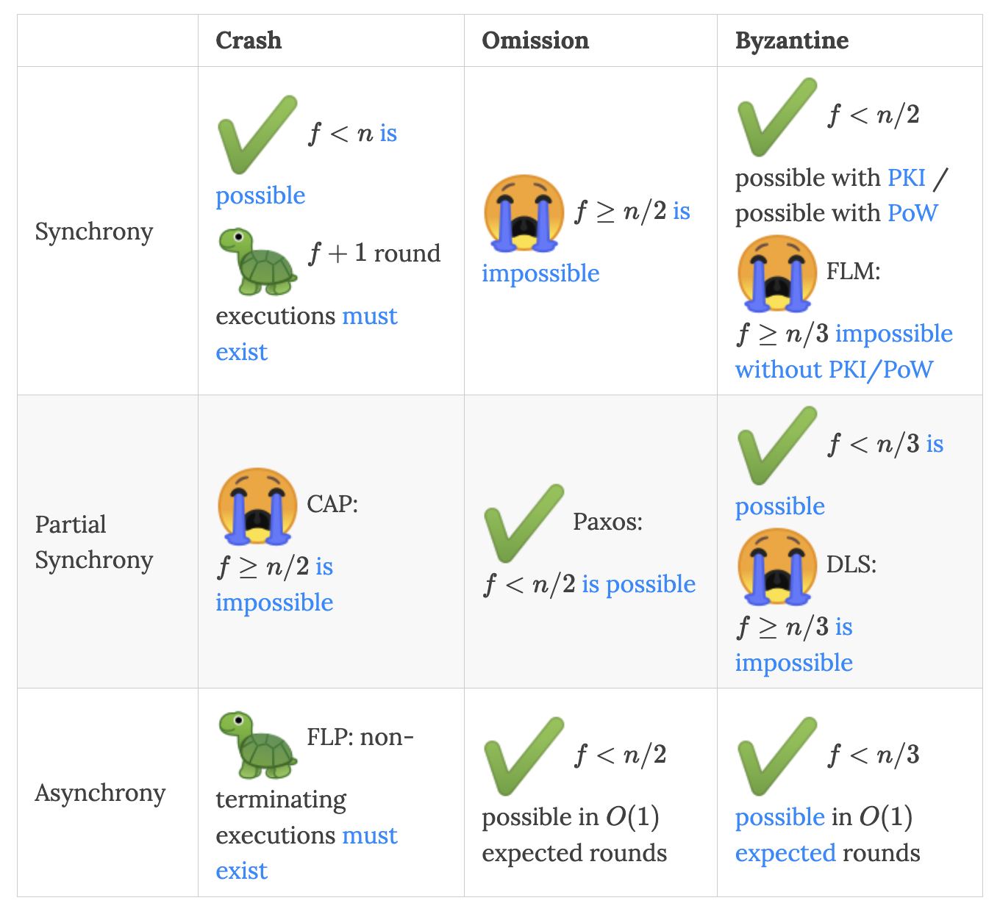

Crash-tolerant consensus needs a majority of correct nodes. Byzantine consensus needs more than two thirds. Fast Byzantine protocols that finish in one round need more than four fifths. Textbooks give each threshold its own proof. This post argues they share one cause.

A Byzantine node can do anything, but only one of its powers matters for agreement: it can *equivocate*, telling different nodes different things. Every Byzantine protocol is built to stop that. There are two places to stop it. A vote round stops equivocation *across space*: a node can't tell two peers two different things without being caught. A disk stops it *across time*: a node can't say one thing today and forget it tomorrow. Crash-tolerant protocols need only the disk. Byzantine protocols need both, and the thresholds above say how much each costs.

This is a sequel to [BFT Broadcast](/blockchain/bft-broadcast.html), which covered the broadcast side of the picture. [Replication in four cells](/programming/replication-in-four-cells.html) covers the crash-tolerant side, and the one-round bounds this post explains.

- [The one power that matters](#the-one-power-that-matters)
- [Space: a vote before the commit](#space-a-vote-before-the-commit)
- [Paying in replicas instead of rounds](#paying-in-replicas-instead-of-rounds)
- [Signatures prove equivocation; timing decides if the proof arrives](#signatures-prove-equivocation-timing-decides-if-the-proof-arrives)
- [Time: a disk that forgets](#time-a-disk-that-forgets)
- [One counter for both](#one-counter-for-both)
- [The Byzantine column, revisited](#the-byzantine-column-revisited)

From Decentralized Thoughts' [consensus cheat sheet][cheat-sheet].

## The one power that matters

The cheat sheet sorts faults into three kinds. A *crash* node stops and stays stopped. An *omission* node drops some of its messages. A *Byzantine* node does anything at all.

Most of what a Byzantine node can do is harmless to agreement. If it proposes a bad value, validity rules decide whether that value may win. If it sends the same lie to everyone, every correct node sees the same lie and can treat it the same way. The damage comes from sending *different* messages to different correct nodes. Then two correct nodes hold different views of the same moment, and may decide differently.

The cleanest way to see this is to take equivocation away and check what is left. Clement, Junqueira, Kate, and Rodrigues ("On the (Limited) Power of Non-Equivocation," PODC 2012) did exactly that. Stopping equivocation alone doesn't help. But stopping it *and* signing every message turns a Byzantine node into something a crash-tolerant protocol can handle, with the same number of nodes. [One counter for both](#one-counter-for-both) shows the hardware that does this.

Quorum math shows where the extra nodes go. Say each step of a protocol waits for q of n nodes, and up to f are faulty.

- **Liveness:** a node can't wait for the faulty ones, so q ≤ n − f.
- **Safety:** any two quorums overlap in at least 2q − n nodes. The overlap is what carries a decision from one quorum to the next.

With crash faults, any node in the overlap tells the truth, so an overlap of one node is enough: 2q − n ≥ 1. With q = n − f, that gives n ≥ 2f + 1. With Byzantine faults, the overlap might hold only faulty nodes, and each of them can vote one way in the first quorum and the other way in the second. So the overlap must contain at least one correct node: 2q − n ≥ f + 1. With q = n − f, that gives n ≥ 3f + 1. Song, van Renesse, Schneider, and Dolev ([The Building Blocks of Consensus][building-blocks], 2008) make this the one consistency rule that every consensus quorum system must meet: any two quorums share a correct node. A quorum is then more than n/2 nodes with crash faults, and more than (n + f)/2 with Byzantine ones.

So the gap between one half and one third is the price of equivocation in the overlap. A node in the overlap must be one that says the same thing to both quorums.

## Space: a vote before the commit

Every consensus protocol, crash or Byzantine, has two jobs before it commits a value:

1. **Notarize:** make sure the value is the only one proposed in this round.
2. **Commit:** make sure the value survives a change of leader. Whoever leads next must find it and propose it again.

A crash-tolerant protocol gets the first job for free. Its leader proposes one value per round, because a crashed node stops and never lies. So the leader's proposal is its own notarization. Song et al. call this a *leader quorum system*: the leader alone forms the quorum that keeps a round's value unique. It works for one reason, in their words: "the leader has to be honest." Commit then takes one round of votes from a majority. Any later leader hears from a majority too, and the two majorities share a node that saw the value.

A Byzantine leader can send X to some nodes and Y to others. So before anyone commits, the nodes vote on what they received. A *certificate* of 2f + 1 votes out of n = 3f + 1 proves the value is unique in this round. Two certificates overlap in at least f + 1 nodes, so they share a correct node, and a correct node votes only once. This is the extra round, and it is all about space: it checks that the leader said the same thing to everyone.

A certificate still isn't a commit. One correct node may hold it while the others don't. A new leader hears from 2f + 1 nodes, and of the 2f + 1 that voted for X, it may hear from as few as f + 1, of which f may lie. So nodes that see the certificate *lock* on X, and a value commits once 2f + 1 nodes have locked it. Now any new leader hears from at least one correct, locked node. That node shows the certificate, and because the votes are signed, the new leader can check it. [PBFT][pbft] calls these steps pre-prepare, prepare, and commit. Tendermint calls the two votes prevote and precommit.

| Fault model | Notarize | Why | Commit | Why |
| --- | --- | --- | --- | --- |
| Crash, f < n/2 | the leader's proposal | a crashed node never sends two values | votes from a majority | any two majorities share a node, and every node tells the truth |
| Byzantine, f < n/3 | a certificate of 2f + 1 votes | two certificates share a correct node, which voted once | 2f + 1 locks, in a second round | a certificate one node holds may not reach the next leader |

## Paying in replicas instead of rounds

The extra round is one way to pay for equivocation. Extra replicas are another. Give the protocol enough nodes, and a single round of votes can both notarize and commit.

Take f below 20% of nodes, so n = 5f + 1. A node finalizes X in one round once 4f + 1 nodes vote for it, which is n − f, or 80%. Now say the leader changes. The new leader can wait for only 4f + 1 reports. How many of them say X?

- At least 4f + 1 nodes voted for X.
- The new leader misses up to f of them, because it waits for only 4f + 1 of the 5f + 1 nodes.
- Up to f of the ones it hears are faulty, and may now deny their vote.

So at least 2f + 1 reports say X. Can another value Y look just as strong? At least 3f + 1 correct nodes voted for X, and each voted once. That leaves at most f correct nodes for Y, plus f faulty ones: 2f in all. X has at least 2f + 1, so X wins, and the new leader can always find it. The 2f + 1 threshold is about 40% of the nodes. A block with more than 40% of the votes is safe to build on, because fewer than 80% remain for anything else.

| Fault model | Votes | Notarize | Commit |
| --- | --- | --- | --- |
| Crash, f < n/2 | one round | the leader's proposal | more than 50% |
| Byzantine, f < n/3 | two rounds | more than 67% (a certificate) | more than 67% locked, in a second round |
| Byzantine, f < n/5 | one round | more than 40% | more than 80%, in the same round |

This is the quorum axis of [Replication in four cells](/programming/replication-in-four-cells.html#quorum-axis-a-bigger-quorum-for-fewer-rounds). Martin and Alvisi's [FaB Paxos][fab] proved that one round costs n ≥ 5f + 1 when all f faulty nodes may also be silent.[^5f-1] Solana's [Alpenglow][alpenglow] runs both paths at once: one round at 80% of stake, or two rounds at 60%. Because a blockchain can't add stake, it pays by lowering f instead.

Crash-tolerant protocols pay the same kind of price when they drop the leader. In [Fast Paxos][fast-paxos], clients send values straight to the replicas, so two clients can propose different values in the same round. Concurrent clients act like one equivocating leader. That is why a fast quorum needs about three quarters of the replicas, not a majority.

[^5f-1]: The counting above isn't tight. [Kuznetsov, Tonkikh, and Zhang][kuznetsov] (PODC 2021) showed that n = 5f − 1 suffices, by being more careful about what the new leader may propose.

## Signatures prove equivocation; timing decides if the proof arrives

Votes catch a leader that equivocates, but only if a node can show what the leader told it. Signatures turn a node's word into proof. Without them, "the leader told me X" is a claim anyone could make. With them, a node that sees the leader's signature on X and on Y holds proof that the leader equivocated, and can show it to anyone.

The impossibility results in the Byzantine column of the cheat sheet are about exactly this.

**Synchrony without signatures: f < n/3.** Lamport, Shostak, and Pease ([1982][byz-generals]) showed that with unsigned messages, Byzantine agreement needs n ≥ 3f + 1, even in a synchronous network. Fischer, Lynch, and Merritt ("Easy Impossibility Proofs for Distributed Consensus Problems," 1986) gave the short proof, now called FLM. A faulty node can act out a different world for each neighbor, and no correct node can prove which world is real. That is equivocation that can't be caught.

**Synchrony with signatures: f < n for broadcast.** Dolev and Strong ([1983][dolev-strong]) broke the FLM argument with signatures. Their broadcast runs for f + 1 rounds. In each round, a node passes on every value it has seen, with the chain of signatures that vouch for it. If a node ends up with two values signed by the sender, it has proof that the sender equivocated, and outputs a default value. The f + 1 rounds guarantee that at least one round has a correct node passing values on, so every correct node sees the proof in time. This works for any f < n.

**Synchrony with signatures: f < n/2 for agreement.** Signatures don't rescue agreement past one half. [BFT Broadcast](/blockchain/bft-broadcast.html) showed that broadcast and agreement differ only in validity. Agreement's validity says: if every correct node starts with v, decide v. With f ≥ n/2, the faulty half can act exactly like a correct half that started with w. Signatures prove who said what, but not who is correct. So the two problems are equivalent below one half, and only broadcast survives above it:

| | f < n/2 | n/2 ≤ f < n |
| --- | --- | --- |
| Broadcast | possible | possible (Dolev–Strong) |
| Agreement | equivalent to broadcast | impossible |

State machine replication lands on one side or the other, depending on who reads the log. If the clients are the nodes themselves, each correct node trusts its own copy, and repeated Dolev–Strong broadcasts give a log for any f < n. If the clients sit outside the group, a client learns the log only from replies, so it must trust a majority of them, and f < n/2 again. [Decentralized Thoughts][dt-smr] covers this split.

**Partial synchrony, even with signatures: f < n/3.** Dwork, Lynch, and Stockmeyer ([1988][dls]) proved that partial synchrony brings the one-third bound back, and signatures don't help. The reason is timing. Proving equivocation means seeing both messages. Dolev–Strong waits f + 1 rounds so that the proof is sure to arrive. Before the network settles, no wait is long enough. A node can wait for only n − f replies, because f nodes may be silent. And among the replies it gets, f may come from faulty nodes, while the f it didn't hear from were correct but slow. The second signed message, the one that would expose the equivocation, can arrive after the node has decided. So the quorum overlap must again contain a correct node, and n ≥ 3f + 1.

Signatures make equivocation provable. Timing decides whether the proof shows up before it matters.

## Time: a disk that forgets

Crash-tolerant protocols assume a node never lies. They also assume something quieter: a node that recovers from a crash still remembers what it said before. A Paxos acceptor writes its promise and its accepted value to disk before it replies, and reads them back when it restarts. Most crash-tolerant protocols [don't model storage faults][storage-talk]. When the disk loses that state, a correct node equivocates: it tells one leader one thing, and a later leader another.

Here is the failure with three acceptors, A, B, and C.

1. Leader 1 runs ballot 1. A and B accept X. A majority accepted it, so X is chosen.
2. B's disk loses the entry. B restarts with no record of accepting anything.
3. Leader 2 runs ballot 2, and hears from B and C. Neither reports an accepted value, so leader 2 is free to propose Y.
4. B and C accept Y. A majority accepted it, so Y is chosen too.

No node lied, and the protocol tolerated one fault, just as designed. But B told leader 1 "I accepted X" and told leader 2 "I accepted nothing." That is equivocation across time. A corrupted entry is worse than a lost one: B might report that it accepted some third value.

| | Threat | What stops it |
| --- | --- | --- |
| Vote round | a faulty node tells two peers different things: equivocation across space | n − f nodes check, together, that the value is unique |
| Durable write | a correct node forgets what it said: equivocation across time | the disk remembers across restarts |

Crash-tolerant protocols need only the second row, because crashed nodes don't lie. Byzantine protocols need both. A disk fault in a Byzantine protocol is just one more faulty node, and it counts against f. A disk fault in a crash-tolerant protocol falls outside the model entirely, so the protocol has no budget for it at all.

The fixes turn amnesia back into a crash:

- **Detect it.** Checksums turn a corrupt entry into a missing one, so a node never reports a value it didn't accept.
- **Don't vote until you remember.** A node that lost state must not count toward a quorum until it has recovered that state from the others. [Protocol-Aware Recovery][par] (Alagappan et al., FAST 2018) shows how to do this without losing availability, and shows the data loss that follows in real systems when they don't.
- **Rejoin as someone new.** The common fix for Raft: a server that lost its disk gets a new identity, and joins through a membership change, so its old promises no longer count.

Blockchains hit the same failure under another name. A validator that restarts without its record of what it last signed may sign two blocks at the same height. The protocol can't tell this from an attack, so the validator is slashed as if it were Byzantine. Tendermint keeps that record in a small state file, and Ethereum clients keep a slashing-protection database, which [EIP-3076][eip-3076] lets operators carry from one client to another. Both exist to stop equivocation across time.

## One counter for both

If equivocation is the problem, the most direct fix is to make it impossible. A *trusted counter* is a small piece of trusted hardware. It holds a counter that only ever goes up, and it signs each message together with the next counter value. A node can't attach the same counter value to two different messages, so it can't tell two peers different things. And it can't roll the counter back, so it can't take back what it said.

That one mechanism covers both rows of the table above. With it, Byzantine faults collapse to the crash case, as Clement et al. predicted: [A2M][a2m] (Chun et al., SOSP 2007), [TrInc][trinc] (Levin et al., NSDI 2009), and MinBFT (Veronese et al., IEEE TC 2013) all tolerate f Byzantine faults with 2f + 1 replicas. MinBFT also drops PBFT's extra round. It doesn't need a vote to check uniqueness, because the counter already guarantees it.

The problem moves; it doesn't disappear. The counter itself must survive a crash without rolling back, which is the disk problem again, now inside the hardware. Rollback attacks on trusted hardware are the same equivocation across time, aimed at the one component the protocol trusts.

## The Byzantine column, revisited

The cheat sheet's Byzantine column holds three bounds. Each comes from equivocation, and each exit either catches equivocation or prevents it:

| Bound | Setting | Why | Exit |
| --- | --- | --- | --- |
| f < n/3 (FLM) | synchrony, no signatures | a faulty node acts out a different world for each neighbor, and no one can prove it | signatures, which make equivocation provable (Dolev–Strong); or proof of work, which makes acting out many worlds expensive ([Nakamoto][bitcoin]) |
| f < n/2 | synchrony, with signatures, for agreement | signatures prove who said what, not who is correct | none for agreement; broadcast, and a log whose readers are the nodes themselves, reach f < n |
| f < n/3 (DLS) | partial synchrony, even with signatures | the proof of equivocation may arrive too late | change the fault model: trusted counters prevent equivocation, so f < n/2 (A2M, TrInc, MinBFT) |

In the crash-tolerant column, the one assumption that keeps a node honest is that its disk remembers. In the Byzantine column, the protocol must also check, in every round, that no node told two stories at once. Rounds, replicas, signatures, and trusted hardware are four ways to pay for the same check.

## Open questions <!-- omit in toc -->

- Verify the statement of Clement et al. (PODC 2012): non-equivocation plus transferable authentication turns any crash-tolerant protocol into a Byzantine-tolerant one with the same n. Check any conditions.
- Verify the Decentralized Thoughts claim on SMR: external clients need f < n/2 even in synchrony with signatures; internal clients reach f < n.
- Check the "Raft: rejoin as a new server" claim against Ongaro's thesis, and find a source to cite.
- Check what the storage-fault talk linked in "Time" says at that timestamp, and name its speaker.
- Check whether Alpenglow's fallback uses a 40% threshold (its "safe to notar" rule), to tie it to the counting in "Paying in replicas".
- Add links for FLM, Clement et al., and MinBFT, and check the A2M and TrInc links.
- Category: `blockchain`, next to BFT Broadcast, or `programming`, next to the Agreement series?

## References <!-- omit in toc -->

1. [Consensus cheat sheet][cheat-sheet] — Decentralized Thoughts, 2021; which fault models and network timings allow consensus
2. [The Byzantine Generals Problem][byz-generals] — Lamport, Shostak, Pease, TOPLAS 1982; n ≥ 3f + 1 with unsigned messages
3. Easy Impossibility Proofs for Distributed Consensus Problems — Fischer, Lynch, Merritt, Distributed Computing 1986; FLM
4. [Authenticated Algorithms for Byzantine Agreement][dolev-strong] — Dolev, Strong, SIAM J. Computing 1983; broadcast for any f < n with signatures
5. [Consensus in the Presence of Partial Synchrony][dls] — Dwork, Lynch, Stockmeyer, JACM 1988; DLS
6. [Consensus for State Machine Replication][dt-smr] — Decentralized Thoughts, 2019; internal and external clients
7. [Practical Byzantine Fault Tolerance][pbft] — Castro, Liskov, OSDI 1999
8. [Fast Byzantine Consensus][fab] — Martin, Alvisi, IEEE TDSC 2006; one round needs n ≥ 5f + 1
9. [Revisiting Optimal Resilience of Fast Byzantine Consensus][kuznetsov] — Kuznetsov, Tonkikh, Zhang, PODC 2021; 5f − 1 suffices
10. [Alpenglow: a new consensus for Solana][alpenglow] — Anza; one round at 80% of stake, or two at 60%
11. [Fast Paxos][fast-paxos] — Lamport, 2006
12. On the (Limited) Power of Non-Equivocation — Clement, Junqueira, Kate, Rodrigues, PODC 2012
13. [Attested Append-Only Memory][a2m] — Chun, Maniatis, Shenker, Kubiatowicz, SOSP 2007; A2M
14. [TrInc: Small Trusted Hardware for Large Distributed Systems][trinc] — Levin, Douceur, Lorch, Moscibroda, NSDI 2009
15. Efficient Byzantine Fault-Tolerance — Veronese, Correia, Bessani, Lung, Verissimo, IEEE TC 2013; MinBFT
16. [Protocol-Aware Recovery for Consensus-Based Storage][par] — Alagappan et al., FAST 2018
17. [EIP-3076: Slashing Protection Interchange Format][eip-3076] — Ethereum
18. [Bitcoin: A Peer-to-Peer Electronic Cash System][bitcoin] — Nakamoto, 2008
19. [The Building Blocks of Consensus][building-blocks] — Song, van Renesse, Schneider, Dolev, ICDCN 2008; quorum consistency, and the leader as a one-node quorum

[cheat-sheet]: https://decentralizedthoughts.github.io/2021-10-29-consensus-cheat-sheet/ "Consensus cheat sheet"
[dt-smr]: https://decentralizedthoughts.github.io/2019-10-15-consensus-for-state-machine-replication/ "Consensus for State Machine Replication"
[byz-generals]: https://lamport.azurewebsites.net/pubs/byz.pdf "The Byzantine Generals Problem"
[dolev-strong]: https://doi.org/10.1137/0212045 "Authenticated Algorithms for Byzantine Agreement"
[dls]: https://groups.csail.mit.edu/tds/papers/Lynch/jacm88.pdf "Consensus in the Presence of Partial Synchrony"
[pbft]: https://pmg.csail.mit.edu/papers/osdi99.pdf "Practical Byzantine Fault Tolerance"
[fab]: https://doi.org/10.1109/TDSC.2006.35 "Fast Byzantine Consensus"
[kuznetsov]: https://arxiv.org/abs/2102.12825 "Revisiting Optimal Resilience of Fast Byzantine Consensus"
[alpenglow]: https://anza.xyz/blog/alpenglow-a-new-consensus-for-solana "Alpenglow: a new consensus for Solana"
[fast-paxos]: https://www.microsoft.com/en-us/research/publication/fast-paxos/ "Fast Paxos"
[a2m]: https://www.sigops.org/s/conferences/sosp/2007/papers/sosp07-final47.pdf "Attested Append-Only Memory: Making Adversaries Stick to their Word"
[trinc]: https://www.usenix.org/legacy/event/nsdi09/tech/full_papers/levin/levin.pdf "TrInc: Small Trusted Hardware for Large Distributed Systems"
[par]: https://www.usenix.org/conference/fast18/presentation/alagappan "Protocol-Aware Recovery for Consensus-Based Storage"
[storage-talk]: https://youtu.be/tRgvaqpQPwE?t=784 "Talk on storage faults in consensus"
[eip-3076]: https://eips.ethereum.org/EIPS/eip-3076 "EIP-3076: Slashing Protection Interchange Format"
[bitcoin]: https://bitcoin.org/bitcoin.pdf "Bitcoin: A Peer-to-Peer Electronic Cash System"
[building-blocks]: https://www.cs.cornell.edu/home/rvr/papers/icdcn08.pdf "The Building Blocks of Consensus"

## Footnotes <!-- omit in toc -->
