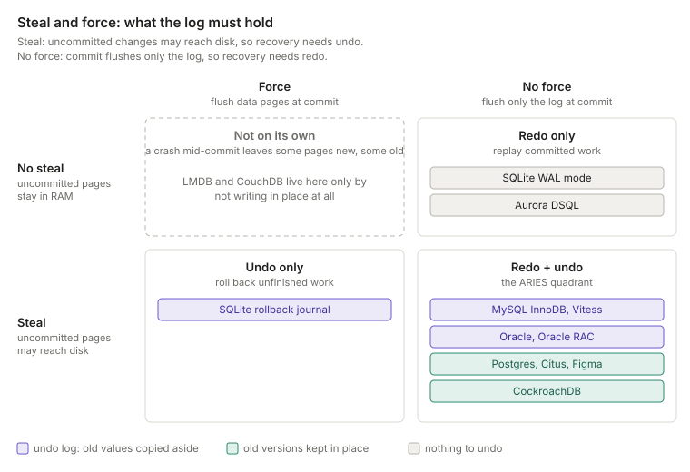
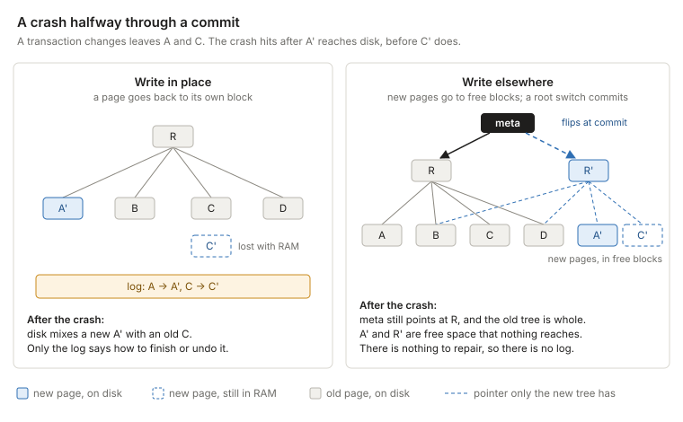
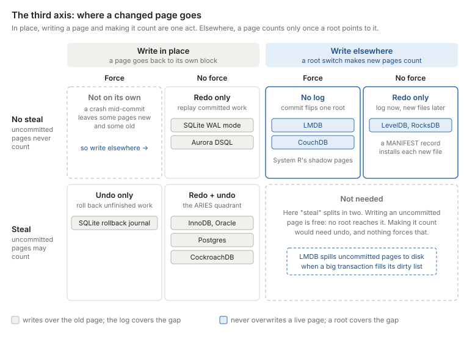

- [Steal and force](#steal-and-force)
- [Write in place or write elsewhere](#write-in-place-or-write-elsewhere)
  - [Even one page can tear](#even-one-page-can-tear)
  - [Shadow paging](#shadow-paging)
  - [Steal splits in two](#steal-splits-in-two)
  - [The cost of writing elsewhere](#the-cost-of-writing-elsewhere)
- [Who decides steal: mmap](#who-decides-steal-mmap)
- [Undo log or old versions in place](#undo-log-or-old-versions-in-place)
- [Three answers for every write](#three-answers-for-every-write)

A database's buffer pool is a write-back cache. A change lands in a page in RAM, and reaches the data files later. A cache like that must answer a question that read caches never face: what survives a crash? [Database caches](/programming/db-caches.html) covers the read side. This post covers the write side.

One question runs through every design here: who decides when a changed page reaches disk, and what must the log hold so that recovery can repair whatever the crash left? Three choices answer it. Two are famous: steal and force. The third gets less attention: does a changed page go back to its own block, or somewhere new? That choice is what separates LMDB and CouchDB from Postgres and InnoDB.

## Steal and force

Logs differ in what they hold. A log can hold new values, old values, or both. It can hold only committed work, or everything. The choice follows from two rules for the buffer pool. [Härder and Reuter][harder-reuter] (1983) named them:

- **Steal:** may the buffer pool write a page to disk while it holds changes from an uncommitted transaction? This happens when it evicts a dirty page to make room.
- **Force:** must a commit write all of the transaction's pages to disk before it returns?

Each answer creates a recovery job. With steal, the disk can hold changes from transactions that abort or die in a crash, so recovery needs **undo** to remove them. With no-force, a committed change may exist only in RAM when the machine crashes, so recovery needs **redo** to replay it.

The log must also reach disk in the right order. With steal, a page's undo records reach disk before the page does. With no-force, a transaction's redo records reach disk before its commit returns. Together, these two rules are write-ahead logging.

**Steal and no-force: redo and undo.** The buffer pool gets the most freedom: it can evict any page at any time, and a commit flushes only the log. Almost every engine picks this, and [ARIES][aries] (Mohan et al., 1992) is the textbook recovery algorithm for it. Recovery must redo committed work, and must either undo uncommitted changes or make readers skip them. Aurora is the extreme case. Its writer never writes data pages, so a commit is just its redo reaching storage. Storage applies redo from uncommitted transactions too, so in effect Aurora steals.

**No steal and no-force: redo only.** Uncommitted changes never reach the data files, so there is nothing to undo. DSQL holds a transaction's writes in the query processor until commit, so an abort just discards them. SQLite's WAL mode works the same way: only a checkpoint copies committed pages into the database file.

**Steal and force: undo only.** SQLite's rollback journal copies a page's old contents aside before it overwrites the page, and a commit syncs the database file. Every committed page is already on disk, so there is nothing to redo.

**No steal and force: not on its own.** This looks like the quadrant that needs no log. A commit must then put all of a transaction's pages on disk at once. But a crash halfway through that write leaves some pages new and some old, and nothing on disk says which. Undo would fix it, and undo is what this quadrant was meant to avoid. The systems that do live here, LMDB and CouchDB, get there by not writing in place at all.

## Write in place or write elsewhere

Every quadrant so far assumes that a changed page goes back to its own block. That assumption hides a problem, and dropping it opens a third axis.

### Even one page can tear

A commit that writes many pages is not atomic. Neither is a single page. A Postgres page is 8 KB, but a disk may promise to write only 4 KB, or 512 bytes, as a unit. A crash during the write can leave a page half old and half new. This is a torn page. Redo can't repair it, because a redo record describes a change to a page and assumes the page it starts from is whole.

Engines that write in place pay to avoid this:

- **Postgres** writes the whole page into the WAL the first time the page changes after a checkpoint ([`full_page_writes`][pg-wal-config]). Recovery starts from that copy, not from the torn one on disk.
- **InnoDB** writes each page to a [doublewrite buffer][innodb-doublewrite] first, syncs it, and only then writes the page to its home. If the home copy tears, the doublewrite copy is whole.
- **SQLite's rollback journal** holds whole original pages, so restoring them also repairs a torn page.

Each trick writes the page somewhere else first, so that a safe copy exists while the home copy is at risk. Shadow paging takes that idea all the way.

### Shadow paging

Härder and Reuter split writing a page from making it count. Writing puts bytes in a block. *Propagation* makes the block part of the database that a restart will find, which they call the materialized database. When a page goes back to its own block, the two are one act: the write destroys the old value. When a page goes to a new block, they come apart. The new block counts only once something points to it.

That gives their third axis, the propagation strategy:

- **Not atomic:** pages are written in place. "Since no set of pages can be written indivisibly (even a single write may be interrupted somewhere in between), propagation is vulnerable to system crashes."
- **Atomic:** "Any set of modified pages can be propagated as a unit, such that either all or none of the updates become part of the materialized database."

The classic way to get atomic propagation is shadow paging, from System R ([Lorie][lorie], 1977). A page table maps page numbers to blocks. A transaction writes its changed pages to free blocks, then writes a new page table that points to them. The commit is one small write: a record on disk that now points to the new table instead of the old one. In Härder and Reuter's words, "the problem of indivisibly propagating a set of pages has been reduced to safely updating one record."

[LMDB][mdb-paper] drops the page table and lets its B+tree be the map. To change a leaf, it copies the leaf, then every page on the path to the root, because each parent must point to the new copy of its child. Subtrees the change didn't touch are shared by the old tree and the new one. Two meta pages sit at the start of the file, and each points to a root. A commit writes and syncs the new pages, then overwrites the older meta page to point to the new root. On restart, LMDB reads both meta pages and picks the one with the higher transaction ID. [CouchDB][couchdb-overview] does the same with an append-only B-tree. It appends new nodes to the end of the file and syncs them. Then it writes a new header, twice, into the first 4 KB of the file, and syncs again.

Now replay the crash. Until the meta page flips, it points to the old root, and the old tree is whole. The new pages are free space that nothing reaches. Once it flips, every new page is already on disk. Neither state needs undo or redo, so LMDB has no log at all. Shadow paging also sidesteps torn pages, because it never writes over a page that a live tree reaches. The one write that must not tear is the root's, and both designs keep two copies of it.

Shadow paging still has a write-ahead rule. The new pages must reach disk before the meta page that points to them. LMDB's commit flushes the pages, syncs the file, and only then writes the meta page. A log follows the same rule, with a commit record in place of the meta page.

### Steal splits in two

Härder and Reuter note that with atomic propagation, steal can mean two things. May an uncommitted page be *written* to disk, or may it be *propagated*? In place, these are the same act. Elsewhere, they are not.

LMDB writes uncommitted pages to disk when it must. A transaction keeps a list of the pages it has dirtied, and the list has a fixed size. When a big transaction fills it, LMDB spills some of the pages to the file before the commit, to free up room. That is steal in the writing sense, and it costs nothing, because no root reaches those pages yet. Undo is needed only when uncommitted pages are *propagated*, and LMDB never propagates before a commit. So on this axis, steal comes free, and the undo it usually brings disappears.

Writing elsewhere doesn't require force either. An LSM tree, like LevelDB or RocksDB, never overwrites a data file. A write goes to a log and to a table in memory, and the commit flushes only the log. Later, a flush writes the table out as a new file that never changes, and one record in the [MANIFEST][rocksdb-manifest] adds the file to the database. That is atomic propagation without force: redo only.[^rocksdb-steal]

### The cost of writing elsewhere

Shadow paging trades the log for other costs:

- **One writer.** Each commit installs a whole new root. Two writers would each build a root from the same old one, and someone would have to merge them. LMDB allows one write transaction at a time. Readers never block, since each keeps reading from the root it started with.
- **Path copying.** Changing one row rewrites every page from its leaf to the root. A log would record a few bytes.
- **Space.** An old page lingers while any reader might still reach it. LMDB keeps a free list and reuses a page once every reader has moved past it, so one long read transaction makes the file grow. CouchDB never reuses space in place. Compaction copies the live data to a new file, and needs about twice the disk.
- **Scattered pages.** New pages land wherever space is free. Pages that sit side by side in key order drift apart on disk, and a range scan pays for it.

These costs hurt most with many concurrent writers, which is the workload most server databases target. That is why most of them write in place and keep a log. LMDB targets the other end: many readers, few writers, and data that mostly fits in memory.

## Who decides steal: mmap

So far, the engine decides when a page reaches disk. With `mmap`, it doesn't. The engine maps the data file into its address space, and the kernel's page cache becomes the buffer pool. [Crotty, Leis, and Pavlo][crotty-mmap] (CIDR 2022) state the problem plainly: "the OS can flush a dirty page to secondary storage at any time, irrespective of whether the writing transaction has committed. The DBMS cannot prevent these flushes and receives no warning when they occur." Pinning the page with `mlock` doesn't help. POSIX lets the kernel write a pinned dirty page too.

In steal and force terms, a writable map forces steal on the engine. Worse, it breaks the write-ahead rule: a page can reach disk before the log records that describe it. An engine that writes in place must keep uncommitted changes out of the shared map. The paper sorts the ways to do this into three groups:

| Approach | Where uncommitted changes live | Examples |
| --- | --- | --- |
| Copy-on-write by the kernel | In a second, private mapping (`MAP_PRIVATE`). The kernel copies a page the first time it's written, and never writes the copy to the file. A log makes commits durable, and a background thread applies them to the shared mapping. | MongoDB's MMAPv1 |
| Copy-on-write by the engine | In copies of pages in the engine's own memory. A commit writes the log, then copies the pages back into the map. | SQLite, MonetDB, RavenDB |
| Shadow paging | In pages that no root points to | LMDB |

Only the last one lets the kernel flush whatever it likes. A stray flush lands on a page that no meta page reaches, which is harmless. This is why `mmap` and shadow paging fit together so well.

LMDB still keeps its map read-only by default, and writes new pages with plain `write()` calls. The reason is a different kind of crash: a bug in the application. In [Chu's words][mdb-paper], "Keeping the mapping read-only prevents stray writes from buggy application code from corrupting the database." LMDB's `MDB_WRITEMAP` option writes through the map instead, and its docs warn that this "loses protection from application bugs like wild pointer writes." SQLite's [mmap mode][sqlite-mmap] is read-only for the same reason, and it copies a page into its own memory before it changes it.

The paper's verdict is still "don't". Crash safety is only the first of its four problems. The rest are about speed and error handling.[^mmap-other] LMDB sits near the one case the paper allows: a read-heavy workload whose working set fits in memory.

## Undo log or old versions in place

Steal needs an undo log only if a write overwrites the old value. The ARIES quadrant splits on this, and the split follows where each system's MVCC keeps old row versions. [Wu et al.][wu-mvcc] (VLDB 2017) call the two designs delta storage and append-only storage.

|  | Undo log | Old versions in place |
| --- | --- | --- |
| Examples | InnoDB, Oracle, Aurora MySQL | Postgres, Aurora PostgreSQL, CockroachDB |
| An update | Overwrites the row, and copies the old value into the undo log | Writes a new version, and leaves the old one where it is |
| A reader with an older snapshot | Follows the chain from the row back into the undo log | Skips versions whose transaction never committed |
| An abort | Rolls back from the undo log | Leaves dead versions behind |
| Who pays | Long-running readers, who rebuild old versions | Every table, in bloat and garbage collection |

The undo log lives in ordinary pages that pass through the buffer pool, and redo protects them like any other page. So in these engines, the log beside the buffer pool holds only redo.

This is the third axis again, one level up. InnoDB writes rows in place and keeps the old value aside, like a page engine with an undo log. Postgres writes each new row version elsewhere, and a transaction's commit status decides which version counts, the way a root pointer decides which page counts. Its pages are written in place; its rows are not.

DSQL is MVCC too, but it never needs old versions to roll back, because uncommitted writes never leave the query processor.

## Three answers for every write

Every design answers the same three questions. Where does a changed page go? May uncommitted changes reach the database on disk? Must a commit wait for the data pages? The answers decide what the log must hold.

| System | Where a changed page goes | Steal | Force | What the log holds |
| --- | --- | --- | --- | --- |
| InnoDB, Oracle | Its own block | Yes | No | Redo. Undo lives in ordinary pages. |
| Postgres | Its own block; a changed row gets a new version | Yes | No | Redo |
| SQLite, rollback journal | Its own block | Yes | Yes | Old pages, for undo |
| SQLite, WAL mode | The WAL first, its own block at checkpoint | No | No | New pages, for redo |
| LevelDB, RocksDB | New files, added by the MANIFEST | No | No | Redo |
| LMDB, CouchDB | Free blocks or the end of the file, reached by a new root | No | Yes | No log |

Write in place, and the log covers the gap between what the disk holds and the last commit. Write elsewhere, and a root pointer covers it, paid for in writers and space. Either way, the engine must decide when pages reach disk, or arrange not to care. That is why `mmap` breaks engines that write in place and suits LMDB.

## References <!-- omit in toc -->

1. [Principles of Transaction-Oriented Database Recovery][harder-reuter] — Härder and Reuter, ACM Computing Surveys 1983; steal, force, and atomic propagation
2. [Physical Integrity in a Large Segmented Database][lorie] — Lorie, ACM TODS 1977; shadow pages in System R
3. [ARIES: A Transaction Recovery Method Supporting Fine-Granularity Locking and Partial Rollbacks Using Write-Ahead Logging][aries] — Mohan et al., TODS 1992; redo and undo recovery for steal and no-force
4. [MDB: A Memory-Mapped Database and Backend for OpenLDAP][mdb-paper] — Chu, 2011; LMDB's copy-on-write B+tree, two meta pages, and free list
5. [CouchDB technical overview][couchdb-overview] — CouchDB docs; append-only B-trees and the double header
6. [Write-ahead log settings][pg-wal-config] — Postgres docs; `full_page_writes`
7. [Doublewrite buffer][innodb-doublewrite] — MySQL docs; InnoDB's guard against torn pages
8. [MANIFEST][rocksdb-manifest] — RocksDB wiki; atomic changes to the set of files
9. [Are You Sure You Want to Use MMAP in Your Database Management System?][crotty-mmap] — Crotty, Leis, and Pavlo, CIDR 2022; why the kernel makes a poor buffer pool
10. [Memory-mapped I/O][sqlite-mmap] — SQLite docs; a read-only map, and copies before changes
11. [An Empirical Evaluation of In-Memory Multi-Version Concurrency Control][wu-mvcc] — Wu et al., VLDB 2017; append-only versus delta version storage

[harder-reuter]: https://dl.acm.org/doi/10.1145/289.291 "Principles of Transaction-Oriented Database Recovery"
[lorie]: https://dl.acm.org/doi/10.1145/320521.320540 "Physical Integrity in a Large Segmented Database"
[aries]: https://dl.acm.org/doi/10.1145/128765.128770 "ARIES: A Transaction Recovery Method Supporting Fine-Granularity Locking and Partial Rollbacks Using Write-Ahead Logging"
[mdb-paper]: https://openldap.org/pub/hyc/mdm-paper.pdf "MDB: A Memory-Mapped Database and Backend for OpenLDAP"
[couchdb-overview]: https://docs.couchdb.org/en/stable/intro/overview.html "CouchDB technical overview"
[pg-wal-config]: https://www.postgresql.org/docs/current/runtime-config-wal.html "PostgreSQL: Write Ahead Log settings"
[innodb-doublewrite]: https://dev.mysql.com/doc/refman/8.0/en/innodb-doublewrite-buffer.html "MySQL: Doublewrite Buffer"
[rocksdb-manifest]: https://github.com/facebook/rocksdb/wiki/MANIFEST "RocksDB: MANIFEST"
[crotty-mmap]: https://vldb.org/cidrdb/papers/2022/p13-crotty.pdf "Are You Sure You Want to Use MMAP in Your Database Management System?"
[sqlite-mmap]: https://www.sqlite.org/mmap.html "SQLite: Memory-Mapped I/O"
[wu-mvcc]: https://www.vldb.org/pvldb/vol10/p781-Wu.pdf "An Empirical Evaluation of In-Memory Multi-Version Concurrency Control"

## Footnotes <!-- omit in toc -->

[^rocksdb-steal]: This is RocksDB's default transaction policy, WriteCommitted, which holds a transaction's writes in a batch until commit. Its WritePrepared and WriteUnprepared policies let uncommitted writes into the memtable and files earlier, which is a form of steal.

[^mmap-other]: I/O stalls: any access can fault on an evicted page and block, and `mmap` offers no asynchronous reads. Error handling: an I/O error arrives as a `SIGBUS` wherever the code touches mapped memory, and page checksums must be checked on every access, since the kernel may have reloaded the page. Speed: on fast NVMe drives, page-table contention, single-threaded eviction, and TLB shootdowns cap throughput.
