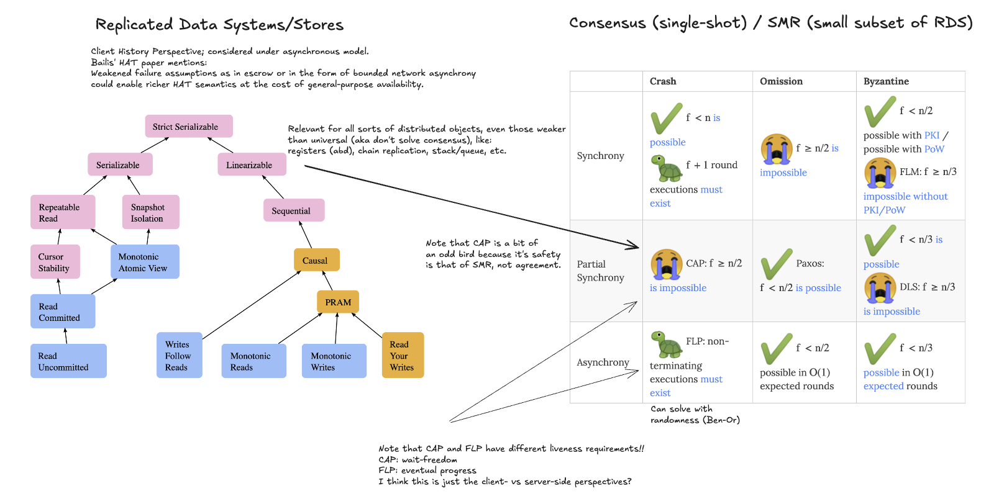

Every replicated system makes two kinds of promise. One is to its clients: what a read may return, and which transactions may interleave. The other is about its own machines: how many may crash, how slow the network may get, and whether the system still makes progress. Most writing covers one side. Database papers name isolation and consistency levels. Distributed systems papers prove when consensus is possible. This series connects the two, and asks one question throughout: which promises force the machines to agree, and what does agreeing cost?

[Carving a database at its joints](/programming/carving-a-database-at-its-joints.html) treats each replica group as one node that decides what commits. This series opens that node up.

## Safety and liveness

[Lamport][lamport-proving] (1977) split the properties of a concurrent system in two. A *safety* property says nothing bad ever happens: a read never returns a value that was overwritten. A *liveness* property says something good eventually happens: every request gets an answer. [Alpern and Schneider][alpern-schneider] (1985) proved that every property is a safety property combined with a liveness property. Consensus itself has this shape. Two of its properties are safety: *agreement*, no two processes decide differently, and *validity*, the decision is a value someone proposed. The third is liveness: *termination*, every correct process eventually decides. So the series is about when machines must agree, and safety and liveness are how it measures what agreeing costs. It takes them in that order:

- **Part 1 is liveness alone.** Does an operation finish, whatever the scheduler, the network, or a crash does? Progress conditions rank the answers, from wait-free down to obstruction-free.
- **Part 2 is safety.** Isolation and consistency say which results an operation may return. Safety alone is free: a system that never answers never answers wrongly. So the price of each guarantee is the liveness it gives up, measured on Part 1's ladder.
- **Part 3 is both at once.** A replication protocol must never break safety, whatever fails, and quorum intersection is what guarantees it. It must also keep answering, and it buys that with spare replicas, a leader, timeouts, or randomness.

## The map

The left half is what a replicated store promises its clients. The right half is when its replicas can agree at all, for each failure model and network timing. The note at the bottom is where the series starts. CAP and FLP ask for different kinds of progress. CAP asks every live node to answer, whatever the network does. FLP asks only that the system finish eventually. Those are two rungs on one ladder, and Part 1 builds that ladder.

Part 2 draws the arrows between the halves. Some promises on the left need no agreement at all. Some need only a quorum. The rest need consensus, which puts them on the right. Part 3 then works mostly in the crash, partially synchronous cell, where most real systems live, with a detour into Byzantine protocols. It asks how a replica group keeps agreeing while machines fail.

## The articles

1. **[Progress conditions](/programming/progress-conditions.html)** — *liveness*. How much an operation depends on the scheduler. Wait-free, lock-free, and obstruction-free, from Herlihy and Shavit's table. A crash is a thread the scheduler never runs again, so the same ladder measures fault tolerance. ZooKeeper is wait-free for its clients, but not underneath. Paxos is only obstruction-free, and a leader or randomness buys the rest.
2. **[Isolation, consistency, and consensus](/programming/isolation-consistency-and-consensus.html)** — *safety*. Isolation and consistency are separate axes, and every named level picks a rung on each. What each rung costs: nothing, a quorum, or consensus, and how much liveness each one keeps. Why preventing a lost update forces consensus, from Herlihy's consensus numbers. And how, once you have consensus, you could have invented state machine replication.
3. **[Replication in four cells](/programming/replication-in-four-cells.html)** — *both*. Alex Miller's replication spectrum redrawn as a two-by-two grid: one leader or none, writes to a quorum or to all. Where consensus runs in each cell, the quorum rules that keep every cell safe, and the hybrids that stay live by taking a fast path in one cell and falling back to another.

The series builds on [What makes a system distributed that a multiprocessor is not?](/programming/multiprocessors-are-distributed-systems.html): Part 1 starts in shared memory and moves to message passing. [BFT Broadcast](/blockchain/bft-broadcast.html) covers the broadcast side of state machine replication, which Part 2 ends on.

[lamport-proving]: https://lamport.azurewebsites.net/pubs/proving.pdf "Proving the Correctness of Multiprocess Programs"
[alpern-schneider]: https://doi.org/10.1016/0020-0190%2885%2990056-0 "Defining Liveness"
