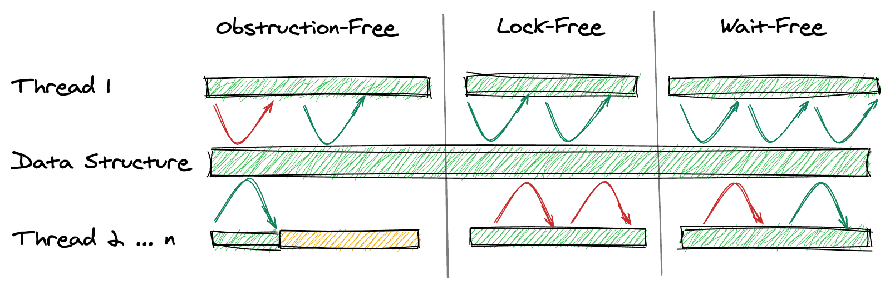
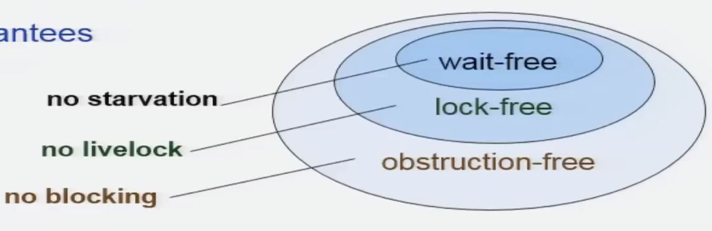

> This is Part 1 of a three-part [series on agreement](/programming/agreement-series-intro.html).
>
> 1. **Progress conditions** — *liveness*: how much an operation depends on the scheduler, why a crash is a thread that never runs again, and why Paxos is only obstruction-free.
> 2. **[Isolation, consistency, and consensus](/programming/isolation-consistency-and-consensus.html)** — *safety*: two separate axes, how much liveness each rung gives up, why isolation needs consensus, and how state machine replication follows.
> 3. **[Replication in four cells](/programming/replication-in-four-cells.html)** — *both*: Miller's spectrum as a two-by-two grid, quorum rules that keep each cell safe, and leaders, timeouts, and hybrids that keep it live.

Working title.

**Thesis:** this post is about liveness alone: whether an operation finishes, not what it returns. Part 2 covers safety. A progress condition says how much an operation depends on the scheduler. A crash is a thread the scheduler never runs again, so the same ladder measures fault tolerance. Consensus sits low on it: Paxos is only obstruction-free, and a leader or randomness buys the rest.

**Scope:** this post owns the liveness terms: wait-free, lock-free, obstruction-free, starvation-free, deadlock-free, termination. Links out:

- Consensus numbers and the cost tiers live in Part 2. This post points there for what each object can build wait-free.
- The leader axis (QuePaxa, Raft elections) lives in Part 3. Section 5 hands off to it.
- Wait-free linearizable reads (Gryff, Ellis Michael) live in the reads post.

## 1. The scheduler as adversary

Context: multicore shared memory, so the usual requirements are strong. Safety is usually linearizability. Liveness is the interesting part.

> Non-blocking means: other threads being suspended or delayed won't prevent eventual progress.

So non-blocking is about not depending on the scheduler:

- **Lock-based:** "I need the scheduler to eventually run thread A so it can release the lock."
- **Obstruction-free:** "I finish in a bounded number of steps, but only if the scheduler runs me alone for a while."
- **Lock-free:** "Whatever the scheduler does, someone succeeds, so the system as a whole progresses. I might not."
- **Wait-free:** "Whatever the scheduler does, I succeed in a bounded number of steps."

## 2. The table

Herlihy and Shavit, "On the Nature of Progress" (OPODIS 2011):

|  | Doesn't depend on the scheduler | Depends on it, non-blocking | Depends on it, blocking |
| --- | --- | --- | --- |
| **Everyone progresses** | wait-free | obstruction-free | starvation-free |
| **Someone progresses** | lock-free | clash-free | deadlock-free |

Examples:

| Condition | Example |
| --- | --- |
| Wait-free | hardware fetch-and-add; CAS-based consensus; readers in RCU |
| Lock-free | a CAS retry loop (a failed CAS means another succeeded); lock-free stacks, queues, hash tables |
| Obstruction-free | single-decree Paxos; software transactional memory |
| Starvation-free | a fair (ticket) lock |
| Deadlock-free | a test-and-set spinlock |

- "Lock-free" doesn't mean "uses no locks." It means no thread's delay can stop the whole system. "Livelock-free" would be a better name.

- Database aside: OCC with backward validation is close to lock-free, because a transaction aborts only when another committed. Snapshot isolation's first-committer-wins behaves the same way. (This ignores the commit machinery itself.) It is lock-free, not wait-free: a long transaction can lose validation forever to a stream of short ones.
- Weaker liveness notions, for contrast: termination (consensus protocols), guaranteed eventual entry to a critical section, fair access under contention.

### From deadlock-free to starvation-free

- The two blocking cells differ in one thing: whether a waiter's priority improves while it waits. A test-and-set spinlock is deadlock-free. Someone always gets the lock, but an unlucky thread can lose every race. A ticket lock is starvation-free. A thread's ticket never changes, so every thread ahead of it eventually leaves, and its turn comes. Both still need the scheduler to run each holder until it releases, which is why they sit in the blocking column.
- Two-phase locking adds a new problem. A transaction holds many locks at once, so two transactions can each wait for the other. Plain 2PL isn't even deadlock-free. Databases fix this in two ways: prevent cycles, or detect and break them.
- **Prevention: wait-die and wound-wait** (Rosenkrantz, Stearns, and Lewis, 1978). Each transaction gets a timestamp when it starts. Older means higher priority. On a conflict, the timestamps decide who waits and who aborts. Waiting goes only one way by age, and ages are strictly ordered, so no waits-for cycle can form.

  | T1 is older, T2 is younger | Wait-die | Wound-wait |
  | --- | --- | --- |
  | T1 wants a lock T2 holds | T1 **waits** | T1 **wounds** T2: T2 aborts and releases the lock |
  | T2 wants a lock T1 holds | T2 **dies**: it aborts itself | T2 **waits** |

  The names describe what the requester does: it waits or dies, or it wounds or waits.[^wound]

- These are two choices, so there are four schemes. Choose the wait direction, then choose who aborts in the other case:

  | | Requester aborts (dies) | Holder aborts (is wounded) |
  | --- | --- | --- |
  | **Old waits for young** | wait-die: a young requester dies | an old holder is wounded |
  | **Young waits for old** | an old requester dies | wound-wait: a young holder is wounded |

- All four are deadlock-free, because waiting goes one way. Only the two classic ones are starvation-free. Their rule is: **always abort the younger transaction.** A restarted transaction keeps its original timestamp, so it only gets older compared with new arrivals. Eventually it is the oldest transaction in the system, and nothing can abort it. The reversed schemes abort the older one. If it keeps its timestamp, it stays old and keeps losing. If it takes a new one, it starts over. Either way, nothing guarantees it finishes.
- So starvation-freedom collapses the two choices into one. Pick the wait direction, and "abort the younger" fixes the rest.
- The timestamp is a ticket. The ticket lock and wound-wait share one principle: priority must improve with time spent waiting. Age is the natural choice, because it only grows. Give priority to the young instead, and a steady stream of newcomers can beat an old transaction forever.
- The two schemes waste work differently. Wait-die aborts young requesters early and often, but they have done little work. Wound-wait aborts less often, but it can kill a transaction that has done a lot.
- **Detection.** PostgreSQL, MySQL/InnoDB, SQL Server, and Oracle let transactions wait freely. They build a waits-for graph, and when they find a cycle, they abort one transaction in it. Breaking every cycle makes them deadlock-free. They are starvation-free only if the victim choice is fair: a transaction picked as the victim every time starves. The textbook fix counts past rollbacks in the victim's cost, which is age again in another form.
- **The trade-off.** Prevention aborts transactions even when no deadlock would form, but it needs no global view. Detection aborts far fewer, because real deadlocks are rare, but it needs the waits-for graph. That is easy on one machine and hard across many. So Spanner uses wound-wait, and CockroachDB combines priorities (transactions "push" each other) with distributed deadlock detection.

[^wound]: "Wound" is deliberate. A wounded transaction should abort, but if it has already finished its work and is committing, it survives. A wound isn't always fatal.

## 3. A crash is a thread that never runs again

- Wait-free means tolerating up to n − 1 crashes: no other thread's fate can stop you.
- In message passing, the same idea is called resilience: the number of crashes a protocol tolerates. Wait-freedom does make sense there, given a failure bound. ABD's reads and writes are wait-free as long as a majority is alive.
- Where termination fits: Paxos and Raft terminate only under partial synchrony. In a fully asynchronous network, Paxos is merely obstruction-free (FLP).
- CAP's availability is wait-freedom for every live node under any partition. FLP's termination allows only minority crashes. Both are liveness: neither sets a deadline. A deadline turns either into safety, and that is what operators mean by availability (Part 3). The theory post uses this distinction; define it here. See [Brooker, "Availability and availability"](https://brooker.co.za/blog/2018/02/25/availability-liveness.html).
- **Timing models are scheduler powers.** In message passing, the scheduler delivers messages. Synchronous: every message arrives within a known bound Δ. Asynchronous: the scheduler may delay any message for any finite time. Partially synchronous ([Dwork, Lynch, and Stockmeyer, 1988](https://groups.csail.mit.edu/tds/papers/Lynch/jacm88.pdf)): the bound holds only after an unknown global stabilization time (GST). So asynchrony is section 1's adversarial scheduler, and partial synchrony is a scheduler that turns fair at a moment no one can see. Parts 2 and 3 use all three terms; define them here.
- **Links.** All three models assume reliable links: a message between correct nodes arrives, exactly once. Cachin, Guerraoui, and Rodrigues build this from *fair-loss* links, which may drop, duplicate, or reorder. Retransmitting forever gives *stubborn* links, and dropping duplicates gives *perfect* links. TCP does both, while the connection lasts. A MAC on each message, as in TLS, makes them *authenticated* perfect links. [From IPC to RPC](/programming/ipc-to-rpc.html) covers why exactly-once processing still needs deduplication at the ends.
- Perfect links still can't coordinate an action. Two generals shows it for lossy links. Halpern and Moses (1990) show it for reliable links with no delay bound: common knowledge needs timing.

## 4. Wait-free for whom?

[ZooKeeper](https://www.usenix.org/legacy/event/atc10/tech/full_papers/Hunt.pdf) calls itself "wait-free coordination for Internet-scale systems." That isn't wrong. It is wait-free *for clients*: a slow or failed client can't block others, because the API has no locks. The servers underneath run Zab, which needs a majority and some timing.

> ZooKeeper has two basic ordering guarantees:
> - Linearizable writes: all requests that update the state of ZooKeeper are serializable and respect precedence;
> - FIFO client order: all requests from a given client are executed in the order that they were sent by the client.

- Reads are served by the local server, so they may be stale. Writes are linearizable and need consensus, so they terminate but aren't wait-free.
- The API is asynchronous: a client can have many requests in flight and gets callbacks, so even its own slow writes don't block it.
- Hardware CAS follows the same pattern. It is wait-free for threads because the memory system underneath is synchronous. That is why CAS "feels magical": consensus is easy in a synchronous system, and the hardware solves it below the thread.

## 5. Consensus is obstruction-free; a leader buys the rest

- Herlihy, Luchangco, and Moir ([2003](https://cs.brown.edu/people/mph/HerlihyLM03/main.pdf)):

  > As an aside, we note that there is no "obstruction-free hierarchy" comparable to the "wait-free consensus hierarchy": One can solve obstruction-free consensus using only read/write registers by derandomizing randomized wait-free consensus algorithms such as the one in [4].

- Paxos is exactly obstruction-free consensus: a proposer running alone decides, and dueling proposers livelock. Miller's "Paxos livelocks under contention" is this.
- FLP forbids a deterministic protocol that always terminates in an asynchronous network with one crash. There are four ways out, and each gives something up:
  - **A leader.** Chandra, Hadzilacos, and Toueg (1996): Ω, an eventual leader, is the weakest failure detector that solves consensus. Raft's timed elections implement Ω. Partial synchrony is how real systems build it: after GST, a timeout that keeps growing stops suspecting correct nodes. Guerraoui and Schiper ([Consensus: the Big Misunderstanding](https://doi.org/10.1109/FTDCS.1997.644722), 1997) read the failure detector the same way: not a device to build, but a specification for your timeouts, whose "forever" only has to last "until the problem (e.g., consensus) is solved." Obstruction-free code plus a contention manager is the shared-memory version of the same idea.
  - **Randomness.** Ben-Or (1983); QuePaxa terminates with probability 1 and uses the leader only as a hint.
  - **A weaker object.** ABD builds a register, not consensus, so it is wait-free while a majority is alive. Part 2 covers why a register needs no agreement.
  - **Weaker termination.** Bracha's reliable broadcast must terminate only if the sender is correct, or once any correct node delivers. [BFT Broadcast](/blockchain/bft-broadcast.html) covers this ladder.
- The first two keep consensus and add power. The last two keep the model and solve less.
- The first two exits are closer than they look. Song, van Renesse, Schneider, and Dolev ([The Building Blocks of Consensus](https://www.cs.cornell.edu/home/rvr/papers/icdcn08.pdf), ICDCN 2008) build Paxos, Chandra–Toueg, and Ben-Or from one skeleton. The protocols differ mainly in who picks each round's proposal: a leader, or every node, at random.
- Hand off to the 2×2 post's leader axis.

## 6. Readers that never wait

- Copy the data, then publish it with one CAS on a root pointer. Readers are wait-free, because they read an immutable version. Writers are lock-free.
- RCU in the Linux kernel, persistent data structures, and MVCC snapshots all use this pattern. So does LMDB's root swap in the caches post.
- Persistent data structures aren't a subset of lock-free structures. They are the technique that makes lock-free updates easy.
- Link the reads post: snapshot reads go brrrr for the same reason.
- RCU and LMDB are the same pattern. LMDB adds persistence:

  | | RCU | LMDB |
  | --- | --- | --- |
  | Readers | read the current pointer, no locks | read the root from the meta page, no locks |
  | Writer | copies the node, edits the copy, swaps the pointer | copies every page on the path from leaf to root, writes a new root |
  | Publish point | one atomic pointer store | one of two meta pages, then fsync |
  | Writers | usually serialized by a lock | one at a time, under a global mutex |
  | Freeing old versions | after a grace period, once no reader that started before can still see them | once no reader's transaction is old enough to need the page, tracked in a reader table |
  | Failure mode | a long read-side section delays freeing, so memory grows | a long read transaction pins old pages, so the file grows |

- Only the readers are wait-free. With one CAS on the root, writers would be lock-free. RCU and LMDB serialize writers with a lock instead, so their writers are blocking.
- The waiting moves from readers to reclamation. An old version can be freed only once every reader that might see it has finished. One stalled reader therefore blocks freeing, and memory or the file grows without bound. Kernel RCU infers quiescent states, for example "every CPU has context-switched since then," so it needs no bookkeeping per reader. LMDB's reader table is closer to epoch-based reclamation: each reader records the version it started from. This is the same question as the open question on epoch-based reclamation below.
- The copy size differs. RCU copies the node it changes, often just one. A copy-on-write B+tree must copy the whole path to the root, because each parent stores its children's addresses. So an LMDB write costs pages in proportion to the tree's depth.
- Durability comes almost free in LMDB: the root flip is the commit, so it needs no log. Link the recovery post's shadow paging section.
- The same pattern shows up in copy-on-write file systems (btrfs, ZFS), Clojure's persistent maps, and Rust's `arc-swap` and `im` crates.

## Open questions

- Verify the Herlihy–Shavit table, especially clash-free.
- Verify Chandra–Hadzilacos–Toueg's statement of Ω, and whether the Hadzilacos paper below is it.
- Verify the Halpern–Moses claim in section 3: common knowledge is unattainable with guaranteed delivery but no delay bound.
- Wait-free in practice: helping-based queues are rare because they are complex. Is wait-freedom mostly academic?
- Verify the database claims in section 2: Spanner uses wound-wait, CockroachDB combines push priorities with distributed deadlock detection, and Rosenkrantz–Stearns–Lewis let a committing wounded transaction survive. Check how PostgreSQL and InnoDB pick a deadlock victim, and whether any of them guards against starvation.
- Memory reclamation: the old notes listed epoch-based reclamation as lock-free. Check it: a stalled thread can block every epoch from advancing, so it may only be blocking, unlike hazard pointers.

## References

- Herlihy and Shavit, ["On the Nature of Progress"](https://lrita.github.io/images/posts/datastructure/on-the-nature-of-progress.pdf), OPODIS 2011
- Herlihy, Luchangco, Moir, ["Obstruction-Free Synchronization: Double-Ended Queues as an Example"](https://cs.brown.edu/people/mph/HerlihyLM03/main.pdf), ICDCS 2003
- Chandra, Hadzilacos, Toueg, "The Weakest Failure Detector for Solving Consensus," JACM 1996
- Guerraoui, Schiper, [Consensus: the Big Misunderstanding](https://doi.org/10.1109/FTDCS.1997.644722), FTDCS 1997
- Song, van Renesse, Schneider, Dolev, [The Building Blocks of Consensus](https://www.cs.cornell.edu/home/rvr/papers/icdcn08.pdf), ICDCN 2008
- Rosenkrantz, Stearns, Lewis, "System Level Concurrency Control for Distributed Database Systems," ACM TODS 1978
- Corbett et al., "Spanner: Google's Globally-Distributed Database," OSDI 2012
- Hunt et al., [ZooKeeper](https://www.usenix.org/legacy/event/atc10/tech/full_papers/Hunt.pdf), USENIX ATC 2010
- [Brooker, "Availability and availability"](https://brooker.co.za/blog/2018/02/25/availability-liveness.html), 2018
- Unsorted from the old drafts:
  - https://www.youtube.com/watch?v=MgatrtcGH2U
  - https://nofluffjuststuff.com/blog/billy_newport/2009/07/lock_free_data_structures_good_and_bad
  - https://arxiv.org/abs/2001.04235
  - https://infoscience.epfl.ch/server/api/core/bitstreams/93334d47-067c-467b-a36f-0cb17346428c/content
  - https://csis.pace.edu/~marchese/CS865/Papers/hadzilacos_ps.pdf
