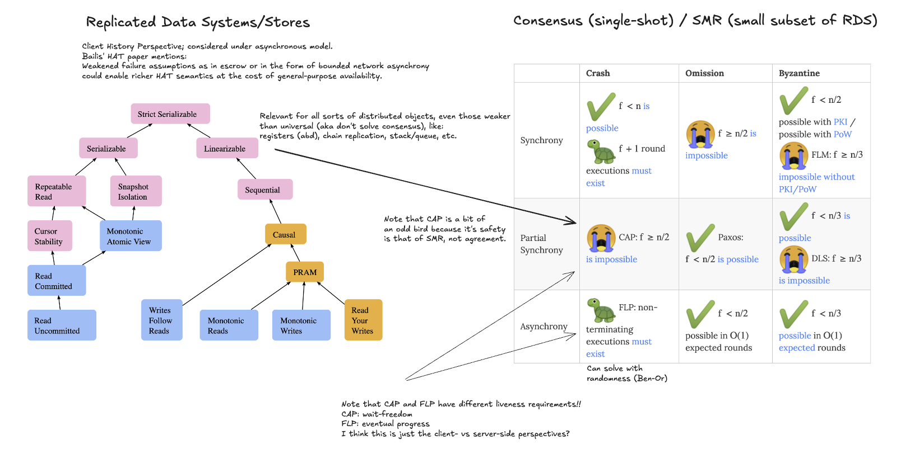
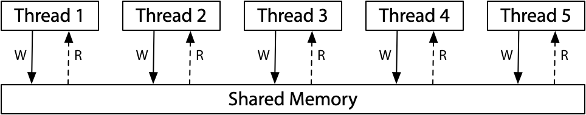
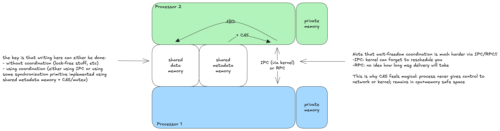
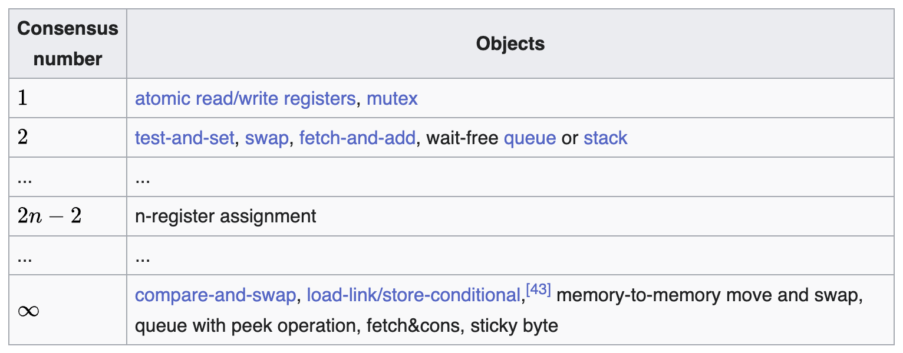

> This is Part 2 of a three-part [series on agreement](/programming/agreement-series-intro.html).
>
> 1. **[Progress conditions](/programming/progress-conditions.html)** — *liveness*: how much an operation depends on the scheduler, why a crash is a thread that never runs again, and why Paxos is only obstruction-free.
> 2. **Isolation, consistency, and consensus** — *safety*: two separate axes, how much liveness each rung gives up, why isolation needs consensus, and how state machine replication follows.
> 3. **[Replication in four cells](/programming/replication-in-four-cells.html)** — *both*: Miller's spectrum as a two-by-two grid, quorum rules that keep each cell safe, and leaders, timeouts, and hybrids that keep it live.

Working title. Part 4 keeps "You could have invented SMR" as its heading.

**Thesis:** consistency needs overlap. Isolation needs agreement.

Agreement is overlap plus a promise. The overlap (every leader-change quorum meets every write quorum) lets a new leader learn every past decision. The promise (ignore older leaders) stops two leaders from deciding at once. A register needs only the overlap, because two concurrent writes don't have to exclude each other.

This post is about safety: which results an operation may return. Part 1 covered liveness. Isolation and consistency are separate axes, and every system answers both. Safety alone is free, so each rung's price is the liveness it gives up. A read that overlaps every write quorum sees the latest write, so even a linearizable register needs only a quorum. A read-modify-write needs consensus, on one object (compare-and-swap) or on many (any isolation level that prevents lost update). Real-time order costs a quorum round or a clock bound. Atomic read-modify-write is what forces agreement. Once you have consensus, you can build any object, and the construction is state machine replication (SMR).

**Scope:** this post owns all the theory: the two axes, their definitions and anomalies, how named levels pair up, and what coordination each rung needs. What each rung costs a read in latency (Attiya and Welch's bounds) stays in the reads post. Other posts link here instead of re-deriving it:

| Post | What it keeps |
| --- | --- |
| Progress (Part 1) | the liveness terms (wait-free, lock-free, obstruction-free, termination); this post links there instead of defining them |
| Replication (Part 3) | how protocols survive failures; its operation axis cites part 3 of this post |
| Reads (standalone, ships first) | practice: a one-paragraph recap with the ladder table and short glosses of the rarer level names, Attiya and Welch's construction and bounds, a two-sentence doctors example, then what each axis costs a read in real systems; never links here, this post links to it |
| Carving (standalone) | where a design checks conflicts; ships first, so it links to nothing here |
| Caches (standalone) | freshness for copies; links here for consistency levels |

The image already draws the post: parts 1 and 2 are its left half, parts 3 and 4 its right half.

## Part 1: Two ladders

- [Abadi][abadi-iso-cons] (2019): isolation levels "only specify what happens for concurrent transactions." Consistency says what an operation must see of the operations that finished before it began.
- Two non-concurrent transactions are trivially isolated, so isolation alone can't make a later transaction see an earlier one. Abadi's "time travel" example: serializable, yet a later read sees an older value. Jepsen's empty-state database is the extreme case (quoted below).
- Consistency covers single operations, so it can't make a read and its write atomic. Abadi's lost-update example: two linearizable increments, and one is lost.

### The consistency ladder

Draft prose moved from the reads post. Consistency is a ladder, and each rung adds one rule. Distributed systems named the rungs for one operation on one object. Databases name them for transactions too, but a database name usually bundles a rung with an isolation level.

**Any prefix.** [Jepsen][jepsen-serializable] spells out how little serializability promises:

> However, it does not impose any real-time, or even per-process constraints. […] For instance, a serializable database can always return the empty state for any reads, by appearing to execute those reads at time 0.

For one object, [Terry][terry-baseball] calls this rule *consistent prefix*: a read sees the writes in order, from the first one up to some point. The result may be stale, but it is never scrambled.

**Your own order.** [Jepsen][jepsen-sequential] on sequential consistency:

> A process in a sequentially consistent system may be far ahead of, or behind, other processes. For instance, they may read arbitrarily stale state. However, once a process A has observed some operation from process B, it can never observe a state prior to B.

What you lose is real-time order across processes. Say A writes x = 1 and returns, then phones B. B reads its own cache and still sees x = 0. Sequential consistency allows that. Linearizability doesn't.

**Real time.**

From [Russ Cox, Hardware Memory Models][swtch-hwmm].

Hardware papers use this picture to introduce sequential consistency. But one shared memory with atomic operations gives more than sequential consistency asks for. Each operation takes effect in real-time order, so the picture is linearizable. Sequential consistency is the spec, and this picture is one implementation that happens to be stronger. Inside one machine, the difference shows only if threads also talk through a side channel. Caches and store buffers are what let hardware give less.

[Bailis][bailis-lin-ser] quotes Herlihy and Wing:

> Linearizability can be viewed as a special case of strict serializability where transactions are restricted to consist of a single operation applied to a single object.

What each rung costs a read in latency (Attiya and Welch's sequencer, and their d, u/4, and u/2 bounds) stays in the reads post. Link it from here.

### The anomalies each axis rules out

| Axis | Anomalies |
| --- | --- |
| Isolation | dirty read, lost update, read skew, write skew |
| Consistency | stale read, non-monotonic read, causal reverse, time travel |

Write skew, moved from the reads post: the classic example is two doctors on call, where at least one must stay on call. Transactions T1 and T2 each read both rows, see two doctors on call, and each takes their own doctor off. T1 read the row T2 writes, and T2 read the row T1 writes. If no one notices those reads, both commit, and nobody is on call. Snapshot isolation ([Berenson et al. 1995][berenson-critique]) allows it: each transaction reads a snapshot as of its start, and a commit aborts only if a concurrent transaction wrote one of the same keys. The doctors write different rows, so both commit.

### Named levels are pairs

Abadi's table of serializable variants differ only in consistency. In his words: "The only difference between these so called isolation levels are their consistency guarantees."

| Name | Isolation | Consistency |
| --- | --- | --- |
| one-copy serializable | serializable | any prefix |
| strong session serializable | serializable | each session's own order |
| strong write serializable | serializable | linearizable for read-write transactions, sequential for read-only ones |
| strong partition serializable | serializable | linearizable within a partition (CockroachDB) |
| strict serializable | serializable | linearizable |

Snapshot isolation has the same weak, strong, and strong session variants.

- The Jepsen chart is the usual picture: isolation on the left, consistency on the right. Cockroach Labs point out that it names only one combination, strict serializable, though every system has both levels.
- The names fight the grid. [etcd][etcd-guarantees] calls its local, possibly stale reads "serializable," which fits one key at any prefix. Abadi's lost-update example shows the other direction. Two linearizable increments can still lose one, because consistency covers single operations, and only isolation makes a read and its write atomic.
- History: [Cockroach Labs][crdb-iso-cons] add a point about history. A database on one node is linearizable without trying, so for decades serializable quietly meant strict serializable. What is new is serializable without strict.

### Defined from the client's side

- [Vogels][vogels-ec] (2007) splits consistency in two. *Client-side* consistency is what an observer sees: strong, weak, or eventual, plus session guarantees such as read-your-writes, monotonic reads, and monotonic writes. *Server-side* consistency is how updates flow: N replicas, a write quorum W, a read quorum R, and strong consistency when W + R > N.
- [Crooks, Pu, Alvisi, and Clement][crooks-seeing] (PODC 2017) do the same for isolation. Adya defines each level by a history of low-level reads and writes, which clients never see. Crooks et al. define it by *read states*: the states of the store that a transaction could have read from. Each level becomes a test on those states, and they prove each test equivalent to Adya's definition.
- The client's view makes write skew obvious. Serializability makes each transaction read from the state just before it commits. Snapshot isolation lets both doctors read the same complete but stale state, so neither sees the other's write.
- It also strips out implementation details. Several variants of snapshot isolation turn out to be the same level: parallel snapshot isolation equals Adya's PL-2+, and generalized snapshot isolation equals ANSI snapshot isolation. ANSI defines serializable as banning four phenomena, but that equivalence holds only for single-version, lock-based databases. That gap is why Oracle's SERIALIZABLE bans all four and still allows write skew.
- This post takes the client's side throughout. Part 1 defines every level by what a client can observe. Part 2 asks which server-side mechanism each level costs. This split is between definition and mechanism. It is not the split between CAP and FLP, which is about the failure model (Part 2).

## Part 2: What each rung costs

- Safety alone is free: a system that never answers never answers wrongly. So the price of a rung is the liveness it gives up, on Part 1's ladder. Each tier keeps less.

| Tier | Needs | Liveness it keeps | Levels |
| --- | --- | --- | --- |
| No coordination | nothing | every live node answers, under any partition (total availability) | read uncommitted, read committed, monotonic atomic view; with sticky sessions: causal, PRAM, read-your-writes |
| Quorum, no consensus | a majority | wait-free while a majority is alive, even in a fully asynchronous network | sequential and linearizable registers (ABD) |
| Consensus | a majority plus partial synchrony or randomness | terminates under partial synchrony, or with probability 1 using randomness; in a fully asynchronous network, obstruction-free at best (FLP) | cursor stability, repeatable read, snapshot isolation, serializable, strict serializable; any read-modify-write object |

- The chart's colors are Jepsen's availability classes: blue is totally available, orange is sticky available, pink is unavailable. The tiers split pink in two. Linearizable and sequential registers need only a quorum. Every pink isolation level prevents lost update, so it needs consensus.
- Why tier 2 needs no consensus: message passing with a majority alive has the power of registers. ABD builds a register from messages, and registers can carry messages. See the [shared register constructions](https://en.wikipedia.org/wiki/Shared_register). So tier 2 is exactly what registers can do.
- CAP vs FLP is about the failure model, not client vs server. CAP allows a partition of any size, so every live node must answer. FLP allows minority crashes. ABD sits between: impossible under CAP, fine under FLP. The progress post defines both liveness terms. See [Brooker, "Availability and availability"](https://brooker.co.za/blog/2018/02/25/availability-liveness.html).
- Tier 1 is where CALM and invariant confluence live: see [When the application needs less](#when-the-application-needs-less). It is also the carving post's no-decider.
- Sources: Bailis et al., Highly Available Transactions (VLDB 2014); Jepsen's consistency models map.

## Part 3: Why isolation needs consensus

### Shared objects

> A concurrent object, or shared object, is a data structure which helps concurrent processes communicate to reach an agreement.

- Same question in shared memory and message passing: which objects let processes agree?
- Shared memory is a spectrum: one coherent machine; NUMA, where locks work but cost more across nodes; non-coherent domains, where locks stop working and you need messages; and distributed memory, with no shared address space at all.
- Why CAS feels magical: the process never hands control to the kernel or the network. Message passing has to emulate that, which is where ABD and consensus come in.

### Consensus numbers

- Herlihy (1991): registers 1, test-and-set and fetch-and-add 2, CAS ∞. See [consensus number](https://en.wikipedia.org/wiki/Consensus_(computer_science)#Consensus_number).
- Consensus numbers count *wait-free* solutions (defined in the progress post). That is why a mutex is 1: if the holder crashes, everyone else waits forever.
- FLP is the message-passing face of Loui and Abu-Amara (1987): registers can't solve consensus even with one crash. Message passing with a majority alive is as strong as registers (part 2), so the two results are one theorem in two models.
- Is there a consensus number for message passing? Effectively 1, with a majority alive. To go higher, add a failure detector (Ω, an eventual leader) or timing assumptions. The progress post covers Ω.
- "Consensus," said loosely, means consensus number ∞.

### Linearizable ≠ consensus

- Linearizability is a correctness condition. The object type decides whether you need consensus.
- A linearizable register needs no consensus. A linearizable CAS does.
- [Bailis][bailis-lin-ser] sorts the two conditions by object count and operation count: linearizability is one operation on one object, serializability is many operations on many objects. But those counts depend on the level you look at. A write to a 100 MiB file is one operation on one file, or thousands of writes to thousands of pages. Bailis says as much: linearizability is strict serializability where each transaction is one operation on one object. The split that decides consensus is a different one: does an operation's answer depend on the order of concurrent operations?

  | | One object | Many objects |
  | --- | --- | --- |
  | Blind writes and reads | linearizable register: a quorum, no consensus (ABD) | read atomic: no coordination at all ([RAMP][ramp]) |
  | Read-modify-write | compare-and-swap: consensus | snapshot isolation, serializable: consensus |

- Atomic writes to many objects need no consensus: RAMP makes a write to many partitions visible all at once, without coordination. What forces consensus is reading, then writing based on what you read. So serializability is CAS generalized to many objects. A transaction is a read-modify-write on the whole database, and a CAS is a transaction of one object.
- Gryff runs both paths in one object (link the replication post's operation axis).
- Chain replication: the head orders every update, so it is SMR and can do CAS. The consensus sits in the master. See [Murat, "Is this consensus?"](https://muratbuffalo.blogspot.com/2019/06/is-this-consensus.html).

### Isolation forces it

- Preventing a lost update makes increment atomic: fetch-and-add, consensus number 2. Conditional writes are CAS, consensus number ∞.
- Rule: a fault-tolerant system whose read-modify-write transactions must eventually commit has solved consensus. Aborting forever is the only escape.
- "Strict serializable without consensus?" Each candidate hides consensus somewhere:
  - primary-backup: in failover and membership
  - leases: in clocks plus an election
  - quorum replication: only gives registers
  - timestamp ordering: one owner per item; replicating the owner needs consensus
- Strictness (real-time order) is a separate cost: clocks with commit wait, a timestamp oracle, or a leader. Link the reads post. [Abadi 2018](https://dbmsmusings.blogspot.com/2018/09/newsql-database-systems-are-failing-to.html) covers clock-based systems that fail to be strict.

### When the application needs less

- An isolation level stands in for what the application needs. Serializability coordinates on every conflict, whether or not any rule of the application depends on it.
- CALM ([Hellerstein and Alvaro][calm], CACM 2020): a program has a consistent implementation without coordination exactly when it is monotonic, meaning new input never takes back an earlier output. Adding to a set is monotonic. "This name is free" is not: a later write can make it false.
- Invariant confluence ([Bailis et al.][iconfluence], VLDB 2015) asks the same question of a database's transactions. They need coordination only if running them on separate copies, then merging, could break one of the application's invariants. "Each ID is unique" needs coordination. "Each order points to an existing customer" doesn't, as long as customers are only added, never deleted. Bailis et al. found that most of TPC-C's invariants need none.
- Escrow sits between the two. "A balance stays at or above zero" isn't confluent in general: two concurrent debits can overdraw it. But it is while the balance is far from zero. Split the slack among the replicas, and each one debits its share alone. The [replication post's operation axis](/programming/replication-in-four-cells.html#operation-axis-pay-for-order-only-when-needed) covers escrow and its relatives.
- So the slogan has a footnote of its own: isolation needs agreement, but the application may need less than isolation. Coordination follows the invariants, not the isolation level.

### CAS is universal, but doesn't compose

- Herlihy's universal construction: one CAS cell can host any object, including a whole transactional database. But then every transaction goes through that one object.
- Cassandra 2.0's lightweight transactions give CAS per partition. [FoundationDB: "Those are not transactions"](https://web.archive.org/web/20130914220625/http://blog.foundationdb.com/post/60455516312/those-are-not-transactions-cassandra-2-0).
- A transaction across partitions needs atomic commit across many consensus groups. That is the carving post's owner-decider commit protocol.
- Linearizability is local: it composes across objects (Herlihy and Wing). Atomicity across objects doesn't.

## Part 4: You could have invented SMR

- The universal construction is a log of consensus slots: SMR.
- Three problems that people mix up. [BFT Broadcast](/blockchain/bft-broadcast.html) covers the first two, and why they are equivalent when fewer than half the nodes fail:

  | Problem | Safety | Liveness | Who takes part |
  | --- | --- | --- | --- |
  | Broadcast | every correct node delivers the same message; if the sender is correct, it is the sender's message | every correct node delivers | a fixed set of n nodes, one sender |
  | Consensus | every correct node decides the same value, and someone proposed it | every correct node decides | a fixed set of n nodes, all propose |
  | SMR | every correct replica runs the same operations in the same order | every client's operation eventually runs | replicas, plus clients that come and go |

- Consensus decides one value among the nodes. SMR decides a log, slot after slot, and answers clients outside the group. [Decentralized Thoughts](https://decentralizedthoughts.github.io/2019-10-15-consensus-for-state-machine-replication/) states SMR's properties from the client's side and consensus's from the server's side.
- Atomic broadcast is equivalent to consensus (Chandra and Toueg, 1996).
- Consensus is the building block for the other agreement problems too. Guerraoui and Schiper's [Generic Consensus Service][generic-consensus] (FTCS 1996; IEEE TSE 2001) builds atomic commitment, group membership, view synchrony, and total order as clients of one consensus service.
- [Murat on scalable SMR](https://muratbuffalo.blogspot.com/2020/10/scalable-state-machine-replication.html).

## Epilogue: Beyond linearizability

Moved from the reads post. Possibly a footnote instead, to keep the post focused.

Linearizability treats each operation as taking effect at one instant, alone. Some objects can't be specified that way. Castañeda, Rajsbaum, and Raynal ([CACM 2022][cacm-hierarchy], [JACM 2018][jacm-interval]) relax that rule in two steps:

- **Set-linearizability:** a set of concurrent operations may take effect at the same instant, so each one sees the others. An exchanger is the classic example: two concurrent swaps trade values, which no one-at-a-time order can describe.
- **Interval-linearizability:** one operation may take effect over an interval, overlapping several others and seeing states along the way. This can specify any distributed task, such as lattice agreement.

Each level strictly contains the one before: linearizability ⊂ set-linearizability ⊂ interval-linearizability. Consistency models weaken *which state* an operation sees. This hierarchy weakens *atomicity* instead: concurrent operations may see each other. That relaxation lets some objects run [wait-free on plain read/write registers][relaxed-queues], where their linearizable versions can't. The [NETYS 2022 talk][netys-talk] introduces the hierarchy through snapshot objects.

## Open questions

- Read [arXiv 2407.01720](https://arxiv.org/pdf/2407.01720).
- Verify that the chain replication paper replicates its master with Paxos.
- Verify the escape clause in part 3: which progress condition makes "serializable read-modify-write solves consensus" precise.
- Check Abadi's exact definitions of strong write and strong partition serializable before quoting the table.
- Check that cursor stability prevents lost update in Berenson et al.'s sense, as part 2 claims.

[cacm-hierarchy]: https://cacm.acm.org/research/a-linearizability-based-hierarchy-for-concurrent-specifications/ "A Linearizability-based Hierarchy for Concurrent Specifications"
[jacm-interval]: https://dl.acm.org/doi/10.1145/3266457 "Unifying Concurrent Objects and Distributed Tasks: Interval-Linearizability"
[relaxed-queues]: https://arxiv.org/abs/2005.05427 "Relaxed Queues and Stacks from Read/Write Operations"
[netys-talk]: https://www.youtube.com/watch?v=MbHOu5EHgsE "A Snapshot-Based Introduction to the Linearizability Hierarchy"
[bailis-lin-ser]: http://www.bailis.org/blog/linearizability-versus-serializability/ "Linearizability versus Serializability"
[ramp]: https://dl.acm.org/doi/10.1145/2588555.2588562 "Scalable Atomic Visibility with RAMP Transactions"
[calm]: https://arxiv.org/abs/1901.01930 "Keeping CALM: When Distributed Consistency Is Easy"
[iconfluence]: https://www.vldb.org/pvldb/vol8/p185-bailis.pdf "Coordination Avoidance in Database Systems"
[jepsen-serializable]: https://jepsen.io/consistency/models/serializable "Jepsen: Serializability"
[jepsen-sequential]: https://jepsen.io/consistency/models/sequential "Jepsen: Sequential Consistency"
[terry-baseball]: https://dl.acm.org/doi/10.1145/2500500 "Replicated Data Consistency Explained Through Baseball"
[swtch-hwmm]: https://research.swtch.com/hwmm "Hardware Memory Models"
[berenson-critique]: https://dl.acm.org/doi/10.1145/223784.223785 "A Critique of ANSI SQL Isolation Levels"
[abadi-iso-cons]: https://dbmsmusings.blogspot.com/2019/08/an-explanation-of-difference-between.html "An explanation of the difference between Isolation levels vs. Consistency levels"
[crdb-iso-cons]: https://www.cockroachlabs.com/blog/db-consistency-isolation-terminology/ "How to talk about consistency and isolation in distributed DBs"
[etcd-guarantees]: https://etcd.io/docs/v3.5/learning/api_guarantees/ "etcd API guarantees"
[vogels-ec]: https://www.allthingsdistributed.com/2007/12/eventually_consistent.html "Eventually Consistent"
[crooks-seeing]: https://www.cs.cornell.edu/lorenzo/papers/Crooks17Seeing.pdf "Seeing is Believing: A Client-Centric Specification of Database Isolation"
[generic-consensus]: https://gsd.di.uminho.pt/teaching/DC/2009/papers/GS98.pdf "The Generic Consensus Service"
